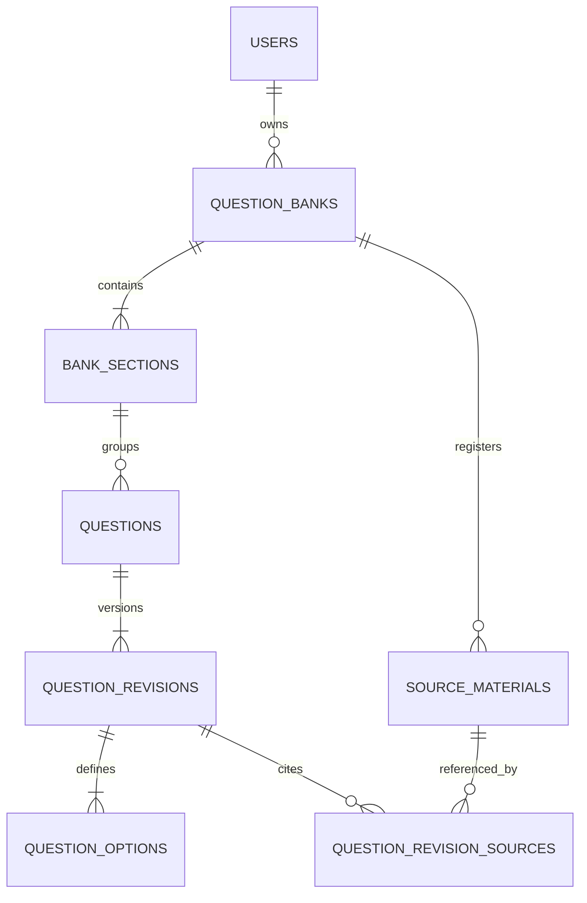
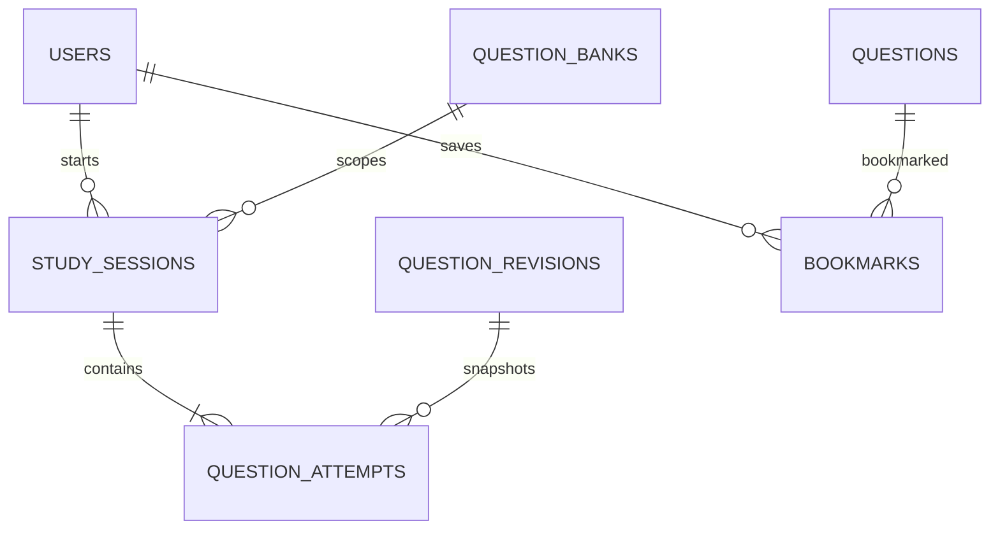
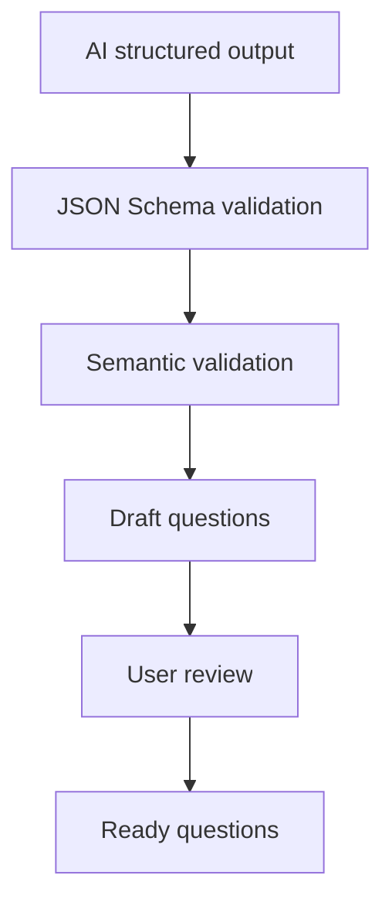

# 범용 Question Schema와 데이터 구조 v1

작성일: 2026-09-02
상태: 사용자 승인 완료 (2026-09-03 인수인계 확인)
대상: 개인 수험생용 비공개 문제은행·학습 플랫폼 MVP

## 1. 결정 요약

MVP의 범용성은 “모든 시험 유형 지원”이 아니라 다음 범위로 제한한다.

- 텍스트 기반 단일정답 객관식
- 선택지 2~8개
- 문제은행마다 자유로운 섹션 수와 순서
- 수동 작성, JSON import, Mammo seed, AI PDF 변환이 같은 문항 계약을 사용
- 사용자 문제은행은 비공개, Mammo만 시스템 데모
- 문항 수정 후에도 과거 시험 결과는 당시 내용을 그대로 보존
- 북마크는 현재 문항을, 학습 이력은 당시 문항 revision을 참조
- 틀린 문제는 “가장 최근 제출 결과가 오답 또는 미응답인 문항”으로 정의

복수정답, O/X 전용 유형, 단답형, 서술형, 이미지·수식 블록, 공개 공유는 v1에서 제외한다. 필요할 때 discriminator를 추가해 schema version을 올린다.

## 2. 왜 기존 Mammo 스키마를 그대로 확장하지 않는가

현재 Mammo 스키마는 다음 장점이 있다.

- JSON Schema Draft 2020-12 사용
- 문항·선택지·정답·해설·출처를 명시적으로 분리
- 선택지별 rationale과 출처 페이지 보존
- 빌드 단계에서 파일 수, 문항 수, ID 중복 등을 검증

하지만 범용 플랫폼의 영속 모델로 그대로 사용하기에는 다음 항목이 도메인에 고정되어 있다.

- 챕터 번호 1~11
- 선택지 4개와 ID `1`~`4`
- `breast-specialist-question-bank`라는 schema name
- 모든 문항의 `reviewStatus`가 `ai-draft`
- 입력 데이터가 `sourceVerified: true` 등의 검증 완료 상태를 직접 주장
- 문항 내용과 생성 batch·검증 결과·출처 정보가 한 문서에 혼합

새 구조에서는 문항 콘텐츠, 검토 상태, import 실행 결과, 서버 검증 결과를 분리한다.

## 3. 세 가지 데이터 계약

### 3.1 Question Package

수동 JSON 업로드, Mammo 이전, 구조화된 AI 출력에 쓰는 교환 형식이다.

- 파일: `generic-question-package.schema.json`
- 기준: JSON Schema Draft 2020-12
- 문항 내용과 출처 locator만 포함
- 소유권, 검토 상태, 서버 ID, 생성 시각은 포함하지 않음
- 서버는 import할 때 항상 새 ID와 workflow 상태를 결정

JSON Schema는 구조와 타입을 검증한다. ID 간 참조처럼 문서의 서로 다른 위치를 비교해야 하는 규칙은 별도 semantic validator가 담당한다. JSON Schema는 각 instance location에 대해 독립적으로 평가되는 구조이므로, 이 구분이 명확해야 한다. [JSON Schema validation specification](https://json-schema.org/draft/2020-12/draft-bhutton-json-schema-validation-00)

### 3.2 PostgreSQL Domain Model

사용자 소유권, 문항 revision, 시험 세션, 북마크, 학습 이력의 source of truth다.

- 자주 조회하고 무결성이 중요한 관계는 정규화
- 모드별 선택 설정처럼 형태가 달라지는 snapshot만 `jsonb` 사용
- DB가 보장할 수 있는 규칙은 PK, FK, UNIQUE, CHECK로 강제
- 여러 행을 비교해야 하는 규칙은 한 transaction 안의 domain service와 테스트로 강제

PostgreSQL의 `CHECK`는 다른 행을 조회하는 용도로 설계되지 않았으므로 “한 revision에 선택지가 정확히 2~8개인가” 같은 교차 행 규칙은 service validation 또는 constraint trigger가 필요하다. 기본 MVP에서는 service validation과 integration test를 사용한다. [PostgreSQL CREATE TABLE](https://www.postgresql.org/docs/current/sql-createtable.html)

### 3.3 API Read Models

같은 DB 문항이라도 화면 목적에 따라 다른 응답을 사용한다.

| 응답 | 포함 | 제외 |
|---|---|---|
| `AuthorQuestionDTO` | 정답, 해설, rationale, 출처, 검토 상태 | 다른 사용자의 소유 데이터 |
| `TestQuestionDTO` | attempt ID, prompt, 선택지, 표시 순서 | 정답, 해설, rationale, 출처 검증 정보 |
| `ReviewQuestionDTO` | 선택 답, 정답, 결과, 해설, rationale, 출처 | 작성·import 내부 정보 |

풀이 시작 API가 정답까지 내려주지 않도록 분리한다. 학습 앱이 고부담 시험 시스템은 아니더라도, 네트워크 응답만 열어 정답을 확인할 수 있는 구조는 모의시험의 신뢰성을 떨어뜨린다.

## 4. Question Package v1

### 예시

```json
{
  "schemaName": "generic-question-package",
  "schemaVersion": "1.0.0",
  "bank": {
    "externalId": "mammo-demo",
    "title": "Mammo Cert Prep",
    "description": "Mammography 전문방사선사 시험 대비 문제은행",
    "languageTag": "ko-KR"
  },
  "sources": [
    {
      "externalId": "source-01",
      "kind": "system_seed",
      "title": "학습 자료 1",
      "edition": "2026",
      "sha256": "0123456789abcdef0123456789abcdef0123456789abcdef0123456789abcdef",
      "pageCount": 120
    }
  ],
  "sections": [
    {
      "externalId": "section-01",
      "title": "Mammography의 개요",
      "position": 1
    }
  ],
  "questions": [
    {
      "externalId": "q-001",
      "sectionExternalId": "section-01",
      "type": "single_choice",
      "topic": "유방촬영의 발전사",
      "difficulty": "easy",
      "prompt": "1913년 Albert Salomon이 체계적으로 시행한 방법은?",
      "options": [
        {
          "key": "1",
          "text": "절제한 조직을 X선으로 촬영했다.",
          "rationale": "해당 연구 방법에 관한 설명이다."
        },
        {
          "key": "2",
          "text": "디지털 검출기로 영상을 획득했다.",
          "rationale": "디지털 유방촬영은 훨씬 뒤에 도입됐다."
        }
      ],
      "correctOptionKey": "1",
      "explanation": {
        "summary": "Salomon은 절제 조직을 대상으로 X선 촬영을 시행했다.",
        "keyConcept": "유방촬영의 초기 역사"
      },
      "tags": ["역사"],
      "references": [
        {
          "sourceExternalId": "source-01",
          "printedPages": ["12"],
          "pdfPages": [14],
          "basisSummary": "Salomon의 연구 방법을 설명한 부분"
        }
      ]
    }
  ]
}
```

### 구조 검증 규칙

- 모든 object는 `additionalProperties: false`
- `schemaName`은 `generic-question-package`
- `schemaVersion`은 `1.0.0`
- package에 section과 question이 각각 하나 이상 존재
- question type은 `single_choice`
- option은 2~8개
- difficulty는 `unspecified | easy | medium | hard`
- text field는 plain text로 취급
- 출처와 태그는 빈 배열 허용
- rationale은 선택 사항, 전체 해설 summary는 필수

### Semantic validation 규칙

JSON Schema 통과 후 서버에서 다음을 추가 검사한다.

1. bank·section·source·question의 `externalId`가 각 범위에서 중복되지 않는다.
2. section의 `position`이 중복되지 않는다.
3. `sectionExternalId`가 실제 section을 가리킨다.
4. option key가 중복되지 않고 `1`부터 연속된다.
5. `correctOptionKey`가 실제 option 중 하나다.
6. reference의 `sourceExternalId`가 실제 source를 가리킨다.
7. `pdfPages`가 source의 `pageCount`를 넘지 않는다.
8. 한 question 안의 reference locator가 중복되지 않는다.
9. import package checksum과 idempotency key가 기존 성공 import와 충돌하지 않는다.
10. AI 생성 package는 구조 검증에 성공해도 반드시 `draft`로 저장하며 사용자가 승인하기 전 학습 대상이 될 수 없다.

`uniqueItems`는 배열 원소 전체의 동일성만 검사한다. object 내부의 특정 `externalId`만 비교하거나 정답 key가 option에 존재하는지 확인하는 규칙을 대신하지 못한다. [JSON Schema array reference](https://json-schema.org/understanding-json-schema/reference/array)

## 5. PostgreSQL Core Model

### 콘텐츠 관계



### `question_banks`

문제은행이 최상위 학습 단위다. MVP에서는 별도 `exams` 테이블을 두지 않는다.

| column | 의미 |
|---|---|
| `id uuid PK` | 서버 ID |
| `owner_user_id uuid NULL FK users` | 사용자 bank의 소유자 |
| `kind` | `user_private | system_demo` |
| `system_key text NULL` | Mammo 같은 시스템 bank 식별자 |
| `title`, `description` | 표시 정보 |
| `language_tag` | 예: `ko-KR` |
| `status` | `draft | ready | archived` |
| `created_at`, `updated_at` | 감사 정보 |

핵심 제약:

```sql
CHECK (
  (kind = 'user_private' AND owner_user_id IS NOT NULL AND system_key IS NULL)
  OR
  (kind = 'system_demo' AND owner_user_id IS NULL AND system_key IS NOT NULL)
)
```

`system_key`에는 partial unique index를 둔다. 모든 user query는 서버에서 `owner_user_id = current_user_id`를 확인하고, system demo만 별도 read path로 허용한다.

별도 `exams` 테이블은 다음 요구가 생길 때 추가한다.

- 하나의 시험 아래 여러 bank를 묶어 통합 학습
- 시험별 공통 일정·합격 기준·과목 체계
- 여러 사용자가 같은 시험 catalog를 공유

현재는 이 요구가 없으므로 추가하지 않는다.

### `bank_sections`

기존 chapter를 범용화한 flat ordered section이다.

| column | 의미 |
|---|---|
| `id uuid PK` | section ID |
| `bank_id uuid FK question_banks ON DELETE CASCADE` | 소속 bank |
| `title`, `description` | 표시 정보 |
| `position integer` | 릴레이·목록 순서 |

제약:

- `CHECK (position >= 1)`
- `UNIQUE (bank_id, position)`
- `UNIQUE (bank_id, id)`를 두어 question의 composite FK에 사용
- v1은 중첩 section을 지원하지 않음

### `questions`

수정되어도 유지되는 문항 identity다.

| column | 의미 |
|---|---|
| `id uuid PK` | stable question ID |
| `bank_id uuid` | 소속 bank |
| `section_id uuid` | 소속 section |
| `position integer` | section 내 기본 순서 |
| `status` | `draft | ready | archived` |
| `created_at`, `updated_at` | 감사 정보 |

제약:

- composite FK `(bank_id, section_id) → bank_sections(bank_id, id)`
- `UNIQUE (section_id, position)`
- `ready`만 새 학습 세션의 후보가 됨
- 개별 문항 삭제는 `archived`로 처리해 과거 이력을 보존

### `question_revisions`

문항의 불변 콘텐츠 version이다.

| column | 의미 |
|---|---|
| `id uuid PK` | revision ID |
| `question_id uuid FK questions ON DELETE CASCADE` | stable question |
| `revision_no integer` | 1부터 증가 |
| `type` | v1은 `single_choice` |
| `topic` | 선택 주제 |
| `difficulty` | `unspecified | easy | medium | hard` |
| `prompt_text` | 문제 본문 |
| `explanation_text` | 전체 해설 |
| `key_concept` | 선택 핵심 개념 |
| `tags text[]` | 최대 10개의 정규화된 태그 |
| `correct_option_position smallint` | 정답 위치 |
| `origin` | `manual | json_import | ai_import | system_seed` |
| `import_id uuid NULL` | 생성 import 추적 |
| `created_by_user_id uuid NULL` | 작성자 |
| `created_at` | 생성 시각 |

제약:

- `UNIQUE (question_id, revision_no)`
- `CHECK (revision_no >= 1)`
- `CHECK (correct_option_position BETWEEN 1 AND 8)`
- tag는 trim·case normalization 후 중복 제거
- revision은 UPDATE하지 않고 수정 시 새 행을 INSERT
- 현재 revision은 가장 큰 `revision_no`

ready 문항 수정은 question row를 `FOR UPDATE`로 잠그고 `max(revision_no) + 1`을 한 transaction에서 저장한다. 과거 attempt는 이전 revision을 계속 참조한다. PostgreSQL은 동시 접근에서 데이터 무결성을 유지하기 위한 MVCC와 transaction isolation을 제공하며, 필요한 경우 serialization failure를 재시도해야 한다. [PostgreSQL concurrency control](https://www.postgresql.org/docs/current/mvcc.html)

### `question_options`

| column | 의미 |
|---|---|
| `revision_id uuid FK question_revisions ON DELETE CASCADE` | 소속 revision |
| `position smallint` | 1~8 |
| `text` | 선택지 |
| `rationale NULL` | 선택지별 해설 |

PK 또는 unique key는 `(revision_id, position)`이다. `question_revisions(id, correct_option_position)`에서 이 key로 deferrable composite FK를 걸면 정답이 반드시 같은 revision의 실제 option을 가리키도록 DB가 보장할 수 있다.

선택지 개수 2~8개와 position 연속성은 revision 생성 transaction의 semantic validator에서 확인한다.

### `source_materials`

| column | 의미 |
|---|---|
| `id uuid PK` | source ID |
| `bank_id uuid FK question_banks ON DELETE CASCADE` | 소속 bank |
| `source_key` | package 내부 external ID 또는 생성 key |
| `kind` | `uploaded_document | manual_reference | system_seed` |
| `title`, `edition` | 출처 표시 정보 |
| `original_file_name` | 업로드 당시 파일명 |
| `storage_key` | private object storage key, URL 아님 |
| `sha256`, `page_count` | 중복·페이지 검증 정보 |
| `created_at` | 생성 시각 |

- `UNIQUE (bank_id, source_key)`
- `storage_key`는 클라이언트에 직접 노출하지 않음
- 업로드 파일 접근 시 bank 소유권을 다시 확인한 뒤 짧은 만료의 접근 수단을 발급

### `question_revision_sources`

| column | 의미 |
|---|---|
| `revision_id` | 문항 revision |
| `source_material_id` | 출처 |
| `printed_pages text[]` | 인쇄 페이지 표기 |
| `pdf_pages integer[]` | PDF 기준 1-based 페이지 |
| `basis_summary` | 문제 근거 요약 |

페이지 배열은 조회 필터가 아니라 표시·검증용 locator이므로 별도 page row로 과도하게 정규화하지 않는다.

## 6. 학습·이력 모델



### `study_sessions`

| column | 의미 |
|---|---|
| `id uuid PK` | session ID |
| `user_id uuid FK users` | 학습자 |
| `bank_id uuid FK question_banks` | 학습 bank |
| `mode` | 아래 mode enum |
| `status` | `in_progress | submitted | abandoned | expired` |
| `requested_question_count` | 사용자 요청 수 |
| `actual_question_count` | 실제 수 |
| `time_limit_seconds NULL` | 모의시험 제한 시간 |
| `selection_config jsonb` | section·shuffle 등 시작 설정 snapshot |
| `idempotency_key` | 중복 세션 생성 방지 |
| `started_at`, `expires_at`, `submitted_at` | 시간 |
| `auto_submitted` | 시간 만료 자동 제출 여부 |
| 결과 count·score | 제출 시 저장되는 summary |

mode:

- `mini_test`
- `mock_exam`
- `relay`
- `wrong_review`
- `bookmark_review`

`selection_config` 예:

```json
{
  "sectionIds": ["..."],
  "sectionOrder": "sequential",
  "questionOrder": "random",
  "optionOrder": "random"
}
```

모드별 기본 순서는 다음과 같다.

- `mini_test`, `mock_exam`: 선택한 범위에서 문항 random
- `relay`: `section.position → question.position` 순서
- `wrong_review`, `bookmark_review`: 대상 문항 random
- option 순서는 모든 모드에서 세션 시작 시 한 번 randomize하고 attempt에 고정

핵심 제약:

- `UNIQUE (user_id, idempotency_key)`
- count는 양의 정수이고 `actual <= requested`
- `mock_exam`은 `time_limit_seconds`와 `expires_at` 필수
- `submitted`이면 `correct + incorrect + unanswered = actual`
- `score_percent = round(correct / actual * 100)`은 서버에서 계산해 저장하고 integration test로 검증

### `question_attempts`

별도 session item과 attempt를 나누지 않고, 세션에 배정된 문항 한 개를 하나의 attempt row로 표현한다.

| column | 의미 |
|---|---|
| `id uuid PK` | attempt ID |
| `study_session_id uuid FK study_sessions ON DELETE CASCADE` | 세션 |
| `question_revision_id uuid FK question_revisions` | 당시 문항 revision |
| `position integer` | 세션 내 순서 |
| `option_order smallint[]` | 사용자에게 보여준 선택지 순서 |
| `selected_option_position smallint NULL` | 최종 선택 |
| `result_status NULL` | 제출 후 `correct | incorrect | unanswered` |
| `answered_at NULL` | 최종 선택 시각 |

제약:

- `UNIQUE (study_session_id, position)`
- `UNIQUE (study_session_id, question_revision_id)`
- `(question_revision_id, selected_option_position)`이 실제 option을 가리키는 composite FK
- 세션 시작 시 문항과 표시 순서를 확정해 재접속해도 구성이 바뀌지 않음
- 사용자가 답을 변경해도 MVP에서는 최종 선택만 저장
- 제출 전에는 `result_status`가 NULL, 제출 transaction에서 전부 확정

### 제출 transaction

1. session row를 `FOR UPDATE`로 잠근다.
2. 이미 `submitted`면 기존 결과를 반환한다.
3. 만료 여부와 사용자 소유권을 확인한다.
4. 모든 attempt를 revision의 정답과 비교한다.
5. attempt result와 session summary를 함께 저장한다.
6. 하나라도 실패하면 전체 rollback한다.

이 방식은 새로고침이나 네트워크 재시도로 동일 제출 요청이 반복되어도 결과가 중복 기록되지 않게 한다.

### `bookmarks`

| column | 의미 |
|---|---|
| `user_id uuid` | 사용자 |
| `question_id uuid` | stable question |
| `created_at` | 저장 시각 |

- PK 또는 UNIQUE `(user_id, question_id)`
- revision이 아니라 stable question을 참조
- 새 북마크 학습은 최신 ready revision을 사용
- archived question은 새 학습 후보에서 제외하되 과거 이력은 유지

### 오답과 대시보드 계산

`question_attempts`와 제출된 session이 원본이다. MVP에서는 별도 집계 테이블을 두지 않는다.

- 현재 오답: stable question별 가장 최근 제출 attempt가 `incorrect` 또는 `unanswered`
- 정답 재학습 완료: 그 뒤 최신 attempt가 `correct`로 바뀐 경우
- 총 풀이 수: 제출된 attempt 수
- 재학습 정답률: 최초 오답 이후 attempt 중 correct 비율
- 최근 모의시험 점수와 변화: 최근 두 `mock_exam` session summary 비교
- 북마크 수: bookmark row 수

현재 Mammo의 `currentWrongQuestionIds`와 `learningSummary` 의미를 그대로 유지할 수 있다. 데이터가 커져 실제 쿼리가 병목이 된 뒤에만 `user_question_progress` projection이나 materialized summary를 추가한다.

## 7. Import와 AI 연결 경계

AI 범위는 다음 논의에서 확정하되, core model은 아래 연결점만 확보한다.

### `question_imports` 제안

| column | 의미 |
|---|---|
| `id uuid PK` | import ID |
| `bank_id`, `requested_by_user_id` | 소유 범위 |
| `kind` | `json | pdf_ai | system_seed` |
| `status` | `queued | processing | needs_review | completed | failed | cancelled` |
| `schema_version` | 결과 package version |
| `input_sha256` | 중복 입력 추적 |
| `idempotency_key` | 중복 요청 방지 |
| count fields | 생성·유효·거절·승인 문항 수 |
| `error_code`, `error_summary` | 안전한 오류 정보 |
| timestamps | 처리 시간 |

AI 원문 응답과 validation error를 무기한 핵심 테이블에 쌓지 않는다. 보존 기간과 개인정보·저작권 정책은 다음 단계에서 확정한다.

AI 결과는 다음 순서로만 ready가 된다.



Schema-valid는 내용의 사실성을 보장하지 않는다. 따라서 AI가 생성한 `validation: true` 같은 값을 신뢰하지 않고, 서버 검증과 사용자 승인을 분리한다.

## 8. 기존 Mammo 이전 매핑

| 기존 | 신규 |
|---|---|
| `chapter.number`, `chapter.title` | `sections[].position`, `sections[].title` |
| `question.id` | `questions[].externalId` 후 server UUID 생성 |
| `chapterNumber` | `sectionExternalId` |
| `part` | section title과 중복이면 제거, 다르면 topic/tag로 검토 |
| `topic` | `topic` |
| `question` | `prompt` |
| `choices[].id` | `options[].key` |
| `choices[].text` | `options[].text` |
| `choices[].rationale` | `options[].rationale` |
| `answer` | `correctOptionKey` |
| `explanation.correctReason` | `explanation.summary` |
| `explanation.keyConcept` | `explanation.keyConcept` |
| 반복되는 reference metadata | `sources[]`에 1회 등록 |
| question reference pages | `questions[].references[]` |
| `reviewStatus: ai-draft` | migration 검증 후 DB status `ready` |
| `validation.*` | import report와 서버 검증 결과, 콘텐츠에서는 제거 |
| bank `fingerprint` | seed/import checksum과 release metadata |

이전 검증:

1. 11 sections, 806 questions 유지
2. 모든 기존 question ID가 새 question에 1:1 매핑
3. 정답과 선택지 rationale 손실 없음
4. source와 printed/pdf page locator 손실 없음
5. 기존 Build Gate의 파일·count·중복 검증 유지
6. 새 package schema와 semantic validator 모두 통과
7. 이전 전후 대표 mini-test·mock-exam 결과 동일

## 9. 삭제와 보존 정책

- 개별 question: archive, 과거 revision·attempt 유지
- 개별 revision: 사용자에게 직접 삭제 기능을 제공하지 않음
- bank 전체 삭제: 명시적 확인 후 bank 콘텐츠, 학습 이력, bookmark, import metadata를 transaction으로 cascade 삭제
- 사용자 계정 삭제: 인증 정책 단계에서 유예 기간과 완전 삭제 범위 확정
- 시스템 Mammo bank: 일반 사용자 API에서 수정·삭제 불가

soft delete를 모든 테이블에 일괄 적용하지 않는다. purge 작업 없이 `deleted_at`만 남기면 개인정보가 사실상 계속 보존되기 때문이다.

## 10. 인덱스 우선순위

MVP 시작 인덱스:

- `question_banks(owner_user_id, updated_at desc)`
- `bank_sections(bank_id, position)` unique
- `questions(section_id, position)` unique
- `questions(bank_id, status)`
- `question_revisions(question_id, revision_no desc)` unique
- `study_sessions(user_id, started_at desc)`
- `study_sessions(user_id, bank_id, status)`
- `question_attempts(study_session_id, position)` unique
- `bookmarks(user_id, created_at desc)`

태그 검색, 전문 검색, JSONB GIN index는 실제 query와 사용량이 생긴 뒤 추가한다.

## 11. 테스트해야 할 핵심 무결성

### Schema·import

- 중복 question/section/source ID 거절
- 존재하지 않는 section/source 참조 거절
- option key 중복·불연속 거절
- 존재하지 않는 correct option 거절
- source page 범위 초과 거절
- 같은 checksum·idempotency key 재요청의 중복 생성 방지

### Authorization

- 다른 사용자의 bank·source·question·session·bookmark 접근 거절
- system demo 읽기만 허용
- 소유권을 바꾼 ID 조합으로 nested resource 접근 거절

### Revision

- 수정 시 revision 증가
- 동시 수정 충돌 또는 직렬화
- 과거 session 결과가 최신 question 수정 후에도 동일

### Study

- 세션 문항 중복 없음
- 선택지 표시 순서 재접속 후 유지
- 제출 transaction 원자성
- 중복 제출이 같은 결과 반환
- 시간 만료 자동 제출과 unanswered 처리
- 최신 correct attempt가 current wrong에서 제거
- bookmark는 최신 ready revision으로 출제

## 12. 이번 단계에서 승인받을 결정

1. MVP 문항은 텍스트 기반 단일정답 객관식 2~8지선다로 제한한다.
2. question bank를 최상위 단위로 두고 별도 `exams` 테이블은 만들지 않는다.
3. section은 flat ordered structure로 두고 중첩 챕터는 제외한다.
4. 선택지 rationale은 선택, 전체 explanation은 필수다.
5. question은 stable identity와 immutable revision을 분리한다.
6. 과거 attempt는 revision, bookmark는 stable question을 참조한다.
7. 현재 오답은 가장 최근 제출 결과 기준으로 계산한다.
8. DB 원본에서 대시보드를 계산하고 별도 집계 테이블은 나중에 추가한다.
9. AI import는 구조·의미 검증 후에도 사용자 승인 전까지 draft다.
10. Mammo의 806문항은 검증 완료된 system seed로 이전한다.

## 참고 자료

- [기존 Mammo Question Schema](https://github.com/sysysysyb/mammo-cert-prep/blob/main/schema/breast-specialist-question-bank.chapter.schema.json)
- [기존 Mammo question domain](https://github.com/sysysysyb/mammo-cert-prep/blob/main/src/domain/questions.ts)
- [기존 Mammo learning history](https://github.com/sysysysyb/mammo-cert-prep/blob/main/src/domain/learning-history.ts)
- [JSON Schema Draft 2020-12](https://json-schema.org/draft/2020-12)
- [JSON Schema validation specification](https://json-schema.org/draft/2020-12/draft-bhutton-json-schema-validation-00)
- [PostgreSQL constraints](https://www.postgresql.org/docs/current/ddl-constraints.html)
- [PostgreSQL concurrency control](https://www.postgresql.org/docs/current/mvcc.html)
