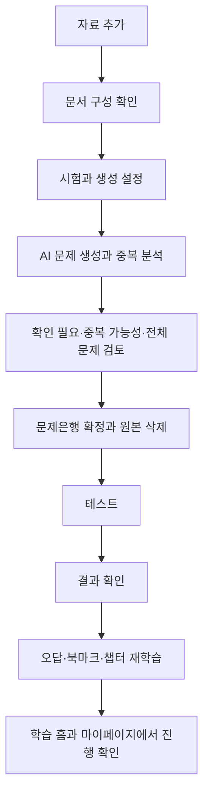

# AMUQ MVP Requirements - Plan

## Goal Capsule

- **Objective:** 개인 학습자가 자신의 PDF 자료를 신뢰할 수 있는 비공개 문제은행으로 바꾸고, 한 서비스에서 시험 대비 학습과 재학습 현황을 이어서 관리할 수 있게 한다.
- **Means:** AI 제안과 사용자 검토를 결합한 단계형 문제 생성 흐름을 완전한 테스트·재학습·통계 경험에 연결한다.
- **Product authority:** `docs/STRATEGY.md`가 제품 방향과 경계를 정하며, 이 Product Contract가 AMUQ MVP의 사용자 행동과 범위를 구체화한다.
- **Open blockers:** None.

---

## Product Contract

### Summary

AMUQ는 하나 이상의 PDF를 비공개 문제은행에 차례로 추가하고, AI가 제안한 구성과 문제를 사용자가 검토·확정한 뒤 테스트, 재학습, 학습 통계까지 이용하는 서비스다.
MVP는 문제 생성만 제공하지 않고 사용자가 자신의 자료로 학습 성과를 확인하는 전체 순환을 완성한다.

### Problem Frame

개인 학습자는 여러 자료에서 문제를 만들고 정답·오답·북마크·시험 기록을 직접 정리하는 데 많은 시간을 쓴다.
기록이 여러 도구에 흩어지면 현재 오답 상태, 최근 시험 점수, 취약 영역과 재학습 성과를 즉시 파악하기 어렵다.
자료가 많아질수록 빠뜨린 범위와 중복된 문제를 사람이 일일이 찾아내기도 어려워진다.

### Actors

- A1. **등록 학습자:** 자신의 비공개 문제은행을 만들고 편집하며 학습 기록을 축적한다.
- A2. **데모 방문자:** 계정 없이 AMUQ 데모의 독립 사본을 제한된 시간 동안 편집하고 학습한다.
- A3. **운영자:** 임시 자료 삭제 상태와 실패를 확인하고 필요한 정리 작업을 재처리한다.

### Key Decisions

- **완전한 학습 순환을 MVP로 제공한다.** (session-settled: user-directed — 문제 생성 전용 출시 대신 선택: 생성된 문제를 실제로 풀고 재학습할 수 있어야 제품 가치가 생긴다.) Governs R10, R27-R37.
- **사용자 문제은행의 입력은 PDF로 한정한다.** (session-settled: user-directed — 수동 입력과 JSON 가져오기 대신 선택: AMUQ의 첫 가치는 개인 자료의 자동 문제 변환에 있다.) Governs R10, R11.
- **문서 구성을 확정한 뒤 문제를 생성한다.** (session-settled: user-directed — 문제를 먼저 생성하고 나중에 분류하는 방식 대신 선택: 미분류 문제와 조용한 페이지 누락을 방지한다.) Governs R12-R16.
- **AI 생성물은 선택적·일괄 검토와 집중 검토를 함께 제공한다.** (session-settled: user-directed — 모든 초안을 하나씩 열게 하는 방식 대신 선택: 많은 문제를 검토할 때의 피로를 줄이면서 오류와 중복 후보는 놓치지 않는다.) Governs R19-R22.
- **하나의 문제은행에 PDF를 차례로 추가할 수 있다.** (session-settled: user-approved — PDF마다 문제은행을 따로 만드는 방식 대신 선택: 같은 시험의 자료와 학습 통계가 여러 문제은행으로 갈라지지 않는다.) Governs R11, R17, R25.
- **모든 핵심 학습 모드를 MVP에 포함한다.** (session-settled: user-directed — 일부 테스트 모드만 제공하는 범위 대신 선택: 미니 테스트, 모의고사와 세 종류의 릴레이가 하나의 학습 순환을 이룬다.) Governs R27-R34.
- **현재 학습 행동을 돕는 통계를 과거 문항 복기보다 우선한다.** (session-settled: user-approved — 과거 테스트를 문항별로 다시 보는 기능 대신 선택: 최근 성과와 재학습 상태를 간결하게 보여주는 것이 MVP 목표에 더 가깝다.) Governs R31, R35-R37.
- **문제은행 보관·복원 기능은 만들지 않는다.** (session-settled: user-directed — 보관 상태를 추가하는 방식 대신 선택: 검증되지 않은 정리 기능보다 유지와 영구 삭제만 제공하는 편이 단순하다.) Governs R8-R9.
- **AMUQ 데모는 읽기 전용 기준본의 임시 사본을 사용한다.** (session-settled: user-directed — 모든 방문자가 같은 데모 문제은행을 수정하는 방식 대신 선택: 방문자끼리 영향을 주지 않으면서 편집 기능까지 체험하게 한다.) Governs R4.

### Requirements

**Accounts, privacy, and demo**

- R1. 등록 학습자는 이메일·비밀번호 또는 Google로 가입·로그인할 수 있으며, 이메일 가입에는 인증과 비밀번호 재설정 흐름이 포함되어야 한다.
- R2. 계정 삭제는 최근 본인 확인 후 시작하고 14일 동안 취소할 수 있으며, 최종 삭제 시 계정의 문제은행과 관련 데이터를 모두 제거해야 한다.
- R3. 등록 학습자의 문제은행과 학습 기록은 비공개이며 다른 사용자가 열람하거나 변경할 수 없어야 한다.
- R4. AMUQ 데모는 `체험하기`를 누를 때마다 방문자 전용 사본과 세션을 만들고, 생성 12시간 후 수정 내용과 학습 데이터를 함께 삭제해야 한다. PDF 업로드, AI 문제 생성과 계정으로의 기록 이전은 데모에서 제공하지 않는다.

**Navigation and bank management**

- R5. 전역 홈은 사용자의 문제은행 목록과 `문제 생성` 진입점을 보여주며, 각 문제은행에는 이름, 강조색, 현재 문제 수와 최근 학습일을 표시해야 한다.
- R6. 전역 홈과 문제은행 학습 홈의 헤더 좌측에는 `AMUQ` 로고를 표시해야 한다. 문제은행의 하위 화면에서는 같은 위치를 `← 문제은행 이름`으로 교체하며, 이를 누르면 해당 문제은행의 학습 홈으로 이동해야 한다.
- R7. 전역 화면은 Mammo의 초록색을 고정 강조색으로 사용해야 한다. 각 문제은행에는 초록색을 제외한 접근 가능한 5가지 테마 중 하나를 서비스가 지정하며, 사용자가 직접 선택하거나 수정하지 않게 한다. 지정된 색은 카드와 현재 문제은행의 주요 강조 요소에만 적용되어야 한다.
- R8. 사용자는 문제은행 이름을 다시 입력해 영구 삭제를 확인해야 하며, 삭제 시 문제, 챕터, 생성 작업, 학습 기록, 오답 상태와 북마크를 함께 제거해야 한다.
- R9. 문제은행은 유지 또는 영구 삭제만 지원하며 보관·복원 상태를 제공하지 않아야 한다.

**PDF analysis and generation**

- R10. 사용자 문제은행의 새 문제는 PDF 업로드를 통해서만 생성하며, MVP는 한국어·영어 텍스트 PDF와 인쇄된 스캔·이미지형 PDF를 최선 노력 방식으로 지원해야 한다.
- R11. 하나의 문제은행은 PDF를 한 번에 하나씩 반복해서 추가할 수 있으며, 각 추가 작업은 독립적으로 분석·검토·확정되어야 한다.
- R12. 생성 흐름은 자료 추가, 문서 구성 확인, 생성 설정, AI 생성·중복 분석, 문제 검토, 최종 확정의 순서로 진행되어야 한다.
- R13. 문서 구성 단계에서 AI 자동 분류를 기본으로 제공하되 사용자가 직접 분류를 선택할 수 있어야 한다. AI는 평면형 챕터 이름, PDF 뷰어 기준 페이지 범위와 `생성 제외` 범위를 먼저 제안해야 한다.
- R14. 사용자는 챕터와 페이지 범위를 추가·수정·삭제·병합·정렬할 수 있으며, 모든 PDF 페이지는 정확히 하나의 챕터 또는 `생성 제외`에 속해야 한다.
- R15. 인식하기 어려운 페이지는 `확인 필요`로 표시하고 자동 제외하지 않아야 한다. 미해결 페이지, 비어 있는 범위 또는 겹친 범위가 남아 있으면 문제 생성을 시작할 수 없어야 한다.
- R16. 사용자가 문서 구성을 확정한 뒤에만 문제를 생성하며, 생성된 문제는 확정된 챕터를 물려받아 미분류 상태가 생기지 않아야 한다.
- R17. 추가 PDF에서는 AI가 새 페이지를 기존 챕터에 연결하거나 새 챕터 생성을 제안해야 하며, 기존 문제와 챕터는 사용자 확인 없이 변경하지 않아야 한다.
- R18. 생성 전에 실제 시험의 출제 문항 수, 제한시간과 기본 선택지 수를 설정해야 한다. 모르는 값에는 각각 50문제, 60분, 4지선다를 적용하고 선택지 수는 2~8개 범위에서 수정할 수 있어야 한다.
- R19. AI는 챕터별 내용량과 시험 설정을 바탕으로 생성 문제 수를 제안하고, 사용자는 전체 및 챕터별 문제 수를 조정할 수 있어야 한다.
- R20. 자료 분석과 문제 생성은 화면을 떠나도 계속되어야 하며, 관리 화면에는 `자료 분석 중`, `문제 생성 중`, `검토 필요`, `일부 실패`와 확인 가능한 챕터 완료 수를 지속적으로 표시해야 한다. 사용자가 서비스를 열어둔 상태에서 처리가 끝나면 일회성 토스트로도 알려야 한다.
- R21. 일부 챕터의 생성만 실패하면 성공한 초안은 유지하고 실패한 챕터만 다시 생성할 수 있어야 한다.
- R22. 시스템은 새 초안을 같은 생성 묶음과 기존 문제은행에서 비교해 `중복 가능성` 후보와 비교 대상을 제시해야 한다. 이 신호는 검토를 돕지만 자동 삭제하거나 확정을 차단하지 않아야 한다.
- R23. 문제 검토는 `확인 필요`, `중복 가능성`, `전체 문제` 보기를 제공해야 한다. 사용자는 필요한 문제만 열어 수정하고 여러 초안을 일괄 확정하거나 삭제할 수 있어야 한다.
- R24. 구조 또는 내용 오류가 있는 초안은 개별 확인을 요구하고, 모든 AI 결과는 사용자 확인 전까지 학습에 사용할 수 없어야 한다.
- R25. 검토 중에는 질문·정답·선지·해설과 원본 페이지를 함께 확인할 수 있어야 한다. 확정 후에는 원본 미리보기 없이 `p.51 (the_file_n….pdf)`처럼 PDF 순번과 파일명을 표시하되, 확장자를 제외한 이름은 10자 뒤에서 생략하고 전체 이름을 마우스 오버와 키보드 포커스로 확인할 수 있어야 한다.
- R26. 각 PDF 작업을 확정하면 원본과 임시 산출물을 삭제해야 한다. 중단 작업은 안내된 임시 보관 기한이 지나면 삭제하고, 운영자는 삭제 상태와 실패를 확인·재처리할 수 있어야 한다.

**Question lifecycle**

- R27. 확정된 문제는 문제 목록과 풀이 결과의 보조 메뉴에서 수정할 수 있어야 하며, 이후 학습에는 수정된 문제가 적용되어야 한다.
- R28. 문제 수정은 과거 점수와 정오답 결과를 다시 계산하지 않아야 하며, 과거 기록은 응시 당시 문제 버전과 연결되어야 한다. 이전 버전을 사용자가 열람하는 기능은 MVP에서 제공하지 않는다.
- R29. 확정된 문제를 삭제하면 현재 목록, 문제 수와 이후 출제에서 제외해야 한다. 복원 기능은 제공하지 않되 과거 통계를 유지하는 데 필요한 기록은 문제은행이 삭제될 때까지 보존해야 한다.

**Study modes and scoring**

- R30. 미니 테스트는 사용자가 챕터 범위와 5, 10, 15, 20, 30개 중 문제 수를 선택하면 해당 범위에서 문제를 중복 없이 무작위로 출제해야 한다. 출제 가능한 문제보다 큰 선택지는 비활성화하고 시간 제한을 두지 않아야 한다.
- R31. 모의고사는 문제은행의 실제 시험 문항 수와 제한시간을 사용해 전체 문제은행에서 중복 없이 무작위 출제해야 한다.
- R32. 모의고사에 필요한 문제보다 보유 문제가 적으면 모든 문제를 출제하고 차이를 안내해야 한다. 제한시간은 실제 시험의 문제당 시간을 유지하도록 출제 비율에 맞춰 줄여야 한다.
- R33. 미니 테스트와 모의고사는 문제 목록을 데스크톱에서 페이지당 10문항, 모바일에서 페이지당 5문항으로 나누어 보여주고, 선택 답안과 진행 위치를 자동 저장해 마지막 지점부터 재개할 수 있어야 한다. 모의고사 시간은 이탈 중에도 흐르며 만료되면 자동 제출되어야 한다.
- R34. 미니 테스트와 모의고사는 전체 제출 후 점수, 정답과 해설을 보여줘야 한다. 미응답 문제가 있으면 제출 전에 이를 알리고 해당 문제로 이동하거나 미응답을 포함해 제출할 수 있어야 한다.
- R35. 챕터·오답·북마크 릴레이는 시작 시점의 대상 문제를 섞어 중복 없이 한 번씩 제시해야 한다. 답을 선택하고 `확인`하면 즉시 정답과 해설을 보여주며 진행 위치는 저장하지 않아야 한다.
- R36. 릴레이에서 한 문제 이상 풀면 해당 세션의 풀이 수와 정답 수를 기록해야 한다. 중단 후 다시 시작하면 현재 대상 문제를 기준으로 새 릴레이를 만들어야 한다.
- R37. 틀리거나 미응답한 문제는 현재 오답이 되고, 이후 어느 학습 모드에서든 한 번 맞히면 현재 오답에서 해제되어야 한다. 과거 결과는 유지하며 북마크는 정오답과 별개로 사용자가 직접 설정·해제해야 한다.

**Learning home and progress**

- R38. 문제은행 학습 홈은 큰 최근 모의고사 점수, 모든 학습 모드 진입점과 최근 학습 3건을 보여줘야 한다. 오답 수와 북마크 수는 홈의 `내 학습 요약`에서 표시하지 않아야 한다.
- R39. 최근 학습은 최신순으로 유형, 정답 수/전체 문제 수와 응시일을 표시해야 한다. 릴레이의 전체 문제 수는 해당 세션에서 실제로 푼 문제 수이며, 기록은 문항별 과거 결과 화면으로 연결하지 않아야 한다.
- R40. 문제은행별 마이페이지는 전체 출제 수, 정답률, 미응답 수, 현재 오답 수, 북마크 수, 오답 재도전 정답률, 모의고사 점수 추이와 취약 챕터를 제공해야 한다.
- R41. 마이페이지 통계는 1개월, 6개월, 1년, 3년, 전체 기간으로 조회할 수 있어야 하며 기본 기간은 1년이어야 한다.
- R42. 모든 점수와 통계는 현재 문제은행 범위에서 계산하고 서로 다른 시험의 기록을 합치지 않아야 한다. 문제 수정이나 삭제가 이미 확정된 과거 점수를 바꾸지 않아야 한다.

**Cross-cutting experience**

- R43. 주요 흐름은 모바일과 데스크톱에서 사용할 수 있어야 하며 키보드 조작, 명확한 포커스, 읽을 수 있는 대비와 보조기술용 이름을 제공해야 한다.
- R44. 로그인, 문제은행, 생성 작업, 검토, 테스트, 릴레이와 통계 화면에는 적용 가능한 로딩·빈 상태·오류·비활성·재시도 상태가 있어야 한다.
- R45. 사용자에게 원본과 중단 작업의 보관 기준, 현재 처리 상태와 삭제 결과를 명확히 안내해야 한다.

### Key Flows

- F1. **Private bank creation**
  - **Trigger:** A1이 전역 홈에서 문제 생성을 선택한다.
  - **Actors:** A1
  - **Steps:** 문제은행 기본 정보를 정하고 첫 PDF를 추가한 뒤 F2를 완료한다.
  - **Outcome:** 확정된 문제를 가진 비공개 문제은행이 학습 홈에 열린다.
  - **Covered by:** R3, R5-R7, R10-R26
- F2. **PDF analysis and confirmation**
  - **Trigger:** A1이 새 문제은행 또는 기존 문제은행에 PDF를 추가한다.
  - **Actors:** A1, A3
  - **Steps:** OCR 상태와 챕터를 확인하고 시험·문제 수를 설정한 뒤 생성 결과와 중복 후보를 검토한다.
  - **Outcome:** 사용자 확인을 거친 문제만 학습 대상이 되고 작업 원본은 삭제된다.
  - **Covered by:** R11-R26
- F3. **Mini test and mock exam**
  - **Trigger:** A1 또는 A2가 학습 홈에서 미니 테스트나 모의고사를 선택한다.
  - **Actors:** A1, A2
  - **Steps:** 출제 조건에 따라 세션을 시작하고 답안을 저장하며 제출 후 결과를 확인한다.
  - **Outcome:** 점수와 문제별 정오답이 기록되고 현재 오답 상태와 통계가 갱신된다.
  - **Covered by:** R30-R34, R37-R42
- F4. **Relay learning**
  - **Trigger:** A1 또는 A2가 챕터·오답·북마크 릴레이를 선택한다.
  - **Actors:** A1, A2
  - **Steps:** 시작 시 구성된 문제를 한 번씩 풀고 각 문제의 정답과 해설을 즉시 확인한다.
  - **Outcome:** 진행 위치 없이 세션 요약과 정오답 기록만 남는다.
  - **Covered by:** R35-R39
- F5. **Question correction or removal**
  - **Trigger:** A1이 확정된 문제의 오류나 불필요함을 발견한다.
  - **Actors:** A1
  - **Steps:** 보조 메뉴에서 문제를 수정하거나 삭제한다.
  - **Outcome:** 이후 학습에는 최신 상태만 사용되며 과거 결과와 통계는 유지된다.
  - **Covered by:** R27-R29, R42
- F6. **AMUQ demo**
  - **Trigger:** A2가 `체험하기`를 선택한다.
  - **Actors:** A2
  - **Steps:** 독립 사본에서 문제은행 편집과 학습 기능을 사용한다.
  - **Outcome:** 다른 방문자와 기준본에 영향을 주지 않고 체험하며 12시간 후 모든 임시 데이터가 삭제된다.
  - **Covered by:** R4

### Acceptance Examples

- AE1. **Covers R14-R16.**
  - **Given:** PDF 페이지 일부가 어느 챕터에도 속하지 않거나 두 챕터에 겹쳐 있다.
  - **When:** 사용자가 문제 생성을 시도한다.
  - **Then:** 생성은 시작되지 않고 수정해야 할 페이지 범위를 보여준다.
- AE2. **Covers R15.**
  - **Given:** 스캔 PDF의 120페이지 중 3페이지를 충분히 인식하지 못했다.
  - **When:** 문서 구성 결과가 열린다.
  - **Then:** 세 페이지를 `확인 필요`로 보여주고 사용자가 더 선명한 PDF로 교체하거나 `생성 제외`를 선택하기 전까지 생성을 막는다.
- AE3. **Covers R20-R21.**
  - **Given:** 다섯 챕터 중 세 챕터는 생성에 성공하고 두 챕터는 실패했다.
  - **When:** 사용자가 작업 상태를 다시 연다.
  - **Then:** 성공한 초안을 유지하고 실패한 두 챕터만 재시도할 수 있다.
- AE4. **Covers R22-R23.**
  - **Given:** 새 초안이 기존 문제와 의미상 유사한 후보로 탐지되었다.
  - **When:** 사용자가 `중복 가능성` 보기를 연다.
  - **Then:** 새 문제와 비교 대상을 필요할 때만 함께 보여주고 유지·수정·삭제를 선택하게 하며, 미검토 상태여도 최종 확정을 허용한다.
- AE5. **Covers R25-R26.**
  - **Given:** 사용자가 `long_private_filename.pdf`의 PDF 뷰어 기준 51페이지에서 생성된 문제를 검토한다.
  - **When:** 문제은행을 확정한다.
  - **Then:** 검토 중에는 원본 페이지를 볼 수 있지만 확정 후에는 원본 없이 `p.51 (long_priva….pdf)`와 전체 파일명 확인 수단만 남는다.
- AE6. **Covers R32.**
  - **Given:** 실제 시험 설정은 100문제·120분이고 현재 문제은행에는 72문제만 있다.
  - **When:** 모의고사를 시작한다.
  - **Then:** 72문제를 모두 중복 없이 출제한다는 안내를 보여주고 제한시간을 86분 24초로 조정한다.
- AE7. **Covers R33.**
  - **Given:** 사용자가 진행 중인 모의고사를 닫았다가 제한시간 안에 돌아온다.
  - **When:** 같은 세션을 다시 연다.
  - **Then:** 저장된 답과 위치를 복원하고 화면을 떠난 동안 흐른 시간을 제외한 남은 시간을 보여준다.
- AE8. **Covers R35-R36.**
  - **Given:** 사용자가 오답 릴레이에서 12문제 중 8문제를 맞힌 뒤 화면을 나간다.
  - **When:** 학습 홈으로 돌아온다.
  - **Then:** 최근 학습에 `오답 릴레이 · 8/12 · 응시일`을 남기고 다음 릴레이는 새 문제 순서로 시작한다.
- AE9. **Covers R27-R29, R42.**
  - **Given:** 과거 풀이 기록이 있는 문제를 수정하거나 삭제한다.
  - **When:** 이후 학습과 마이페이지를 연다.
  - **Then:** 수정된 문제만 출제하거나 삭제된 문제를 제외하면서 과거 점수는 변경하지 않는다.
- AE10. **Covers R4.**
  - **Given:** 데모 방문자가 기준 문제를 수정하고 테스트를 완료했다.
  - **When:** 체험 세션 생성 후 12시간이 지났거나 새 체험 세션을 시작한다.
  - **Then:** 이전 수정과 기록은 보이지 않고 변경되지 않은 AMUQ 데모 기준본에서 새 사본을 만든다.

### Success Criteria

- **문제은행 학습 전환율:** 자료로 문제를 생성하고 검토한 사용자 중 24시간 이내 첫 테스트를 완료한 비율을 측정한다.
- **14일 반복 학습률:** 첫 테스트 후 14일 이내 서로 다른 3일에 걸쳐 총 5회 이상 테스트를 완료한 사용자 비율을 측정한다.
- **재학습 순환 완료율:** 오답이나 북마크가 생긴 사용자 중 14일 이내 오답·북마크 릴레이를 합계 2회 이상 완료한 비율을 측정한다.
- **재도전 정답 전환율:** 처음 틀리거나 답하지 못한 문제 중 이후 재학습에서 정답으로 전환된 문제의 비율을 측정한다.
- **원본 자료 삭제 준수율:** 검토가 끝난 생성 작업의 원본과 임시 산출물이 정해진 시간 안에 검증 가능하게 삭제된 비율을 측정하며 목표는 100%다.

### Scope Boundaries

**Deferred for later**

- 수동 문제 생성, JSON 가져오기, 단답형·서술형·복수정답·O/X·이미지·수식 문제
- 공개·공유 문제은행, 운영자 제작 공용 문제은행, 협업, 순위와 적응형 학습
- 과거 테스트의 문항별 상세 열람과 이전 문제 버전 비교
- 문제은행 보관·복원과 삭제 문제 복원
- 데모의 PDF·AI 생성, 데모 기록의 계정 이전, 알림함, 이메일·푸시 생성 완료 알림

**Outside this product's identity**

- 사용자 원본 자료를 편의 기능으로 장기 보관하는 문서 저장 서비스
- 문제를 생성만 하고 풀이·기록·재학습 수단을 제공하지 않는 도구
- 사용자 자료를 동의 없이 공개 문제은행이나 다른 사용자의 결과물에 사용하는 기능

### Dependencies and Assumptions

- 사용자는 업로드한 자료를 처리할 권한이 있으며, 서비스는 이 책임과 처리 방침을 명확히 안내한다.
- 지원 모델이 한국어·영어 텍스트와 인쇄 스캔에서 검토 가능한 문제 초안을 생성할 수 있다는 가정은 실제 샘플 평가로 검증해야 한다.
- 이메일 인증과 Google 로그인을 제공할 외부 서비스가 운영 환경에서 사용 가능해야 한다.
- 임시 파일과 생성 작업을 비공개로 처리하고 삭제 상태를 추적할 수 있는 운영 환경이 필요하다.
- 중복 가능성 탐지는 완전한 판정이 아니라 검토 우선순위를 정하는 보조 신호로 취급한다.

### Outstanding Questions

**Deferred to Planning**

- 사용할 AI 모델과 품질 평가 기준은 무엇인가?
- PDF 용량·페이지 수·생성 문항 수 한도는 20·50·100페이지 텍스트 및 스캔 샘플의 품질·비용·처리시간 결과를 바탕으로 어디에 둘 것인가?
- 확정하지 않고 중단한 PDF와 생성 작업의 임시 보관 시간은 얼마로 정할 것인가?
- 중복 후보를 제시할 유사도 기준과 한 문제당 비교 후보 수는 어떻게 검증할 것인가?

### Sources

- `docs/STRATEGY.md` — AMUQ의 사용자, 문제, 포지셔닝, MVP 경계와 성공 지표
- `docs/planning/project-handoff.md` — 인증, 계정 수명주기, AI 처리와 대시보드에 관한 선행 결정
- `docs/planning/question-schema-and-data-model-v1.md` — 단일정답 2~8지선다, 평면 챕터, 문제 버전과 학습 기록의 선행 계약
- `AGENTS.md` — 개인정보, AI 초안 확인, 서버 채점, 삭제와 검증에 관한 프로젝트 가드레일
- [OpenAI Vector Embeddings](https://developers.openai.com/api/docs/guides/embeddings) — 의미적 관련성을 이용한 중복 가능성 후보 탐색 근거

현재 대화에서 확정한 PDF 전용 입력, 문제은행 보관 제외, 무작위 챕터 릴레이와 AMUQ 데모 명칭·동작은 충돌하는 선행 문서보다 우선한다.
