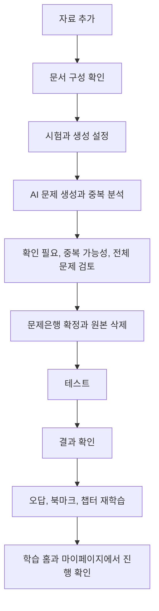
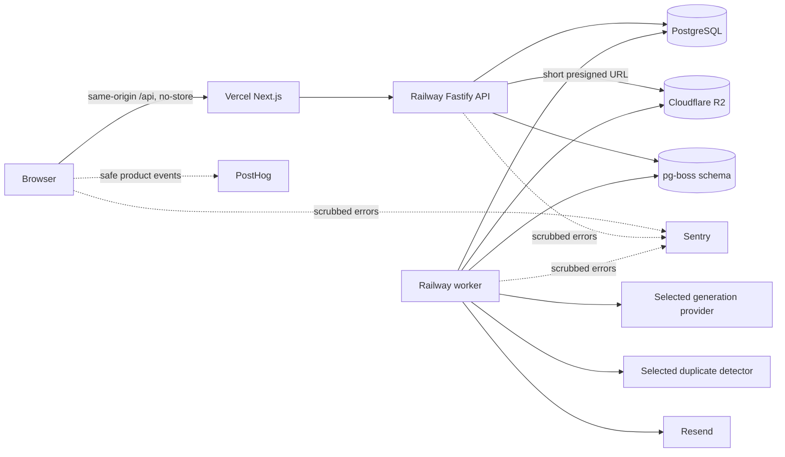
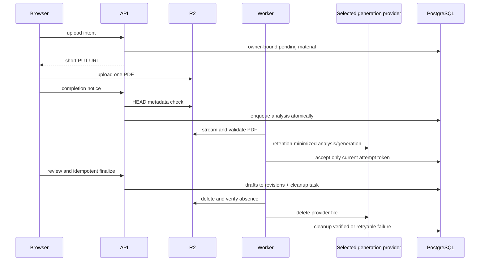
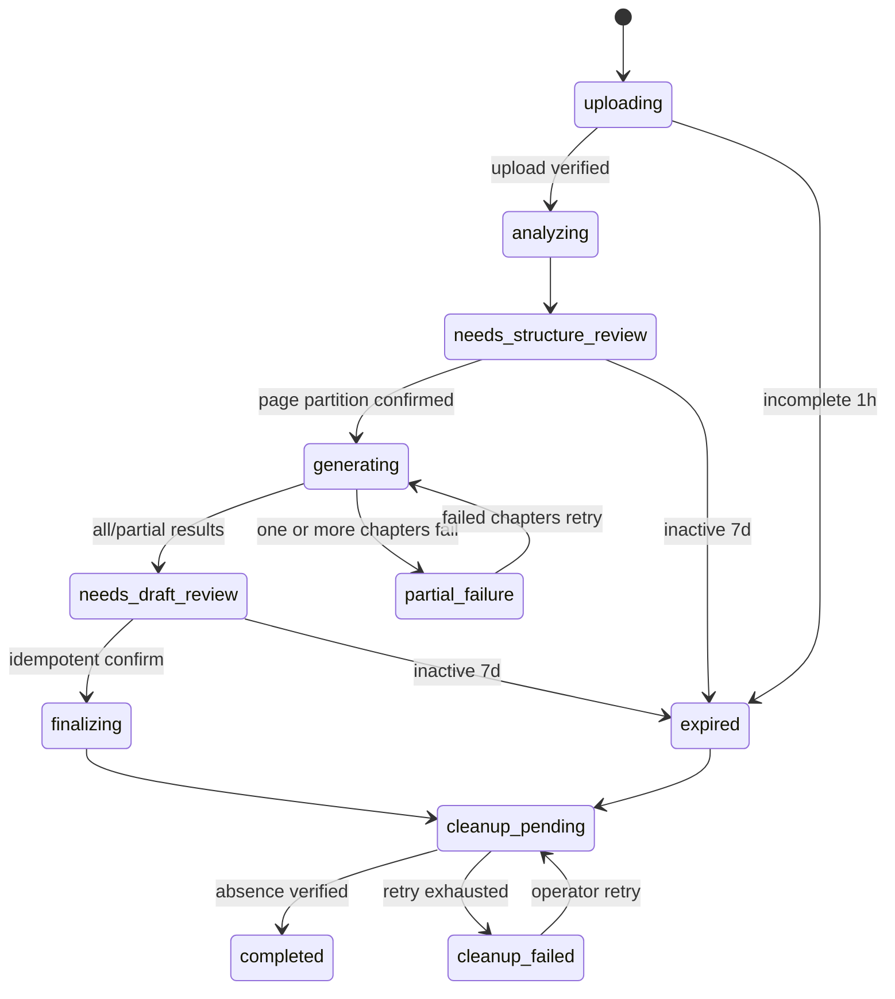
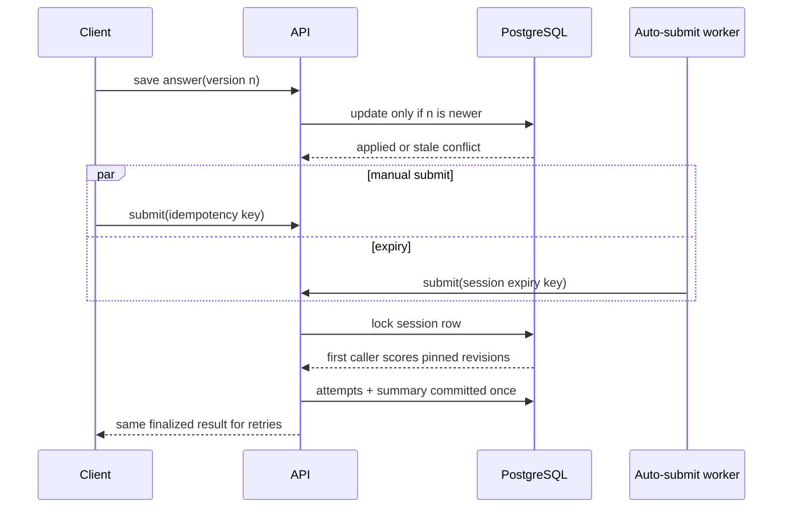
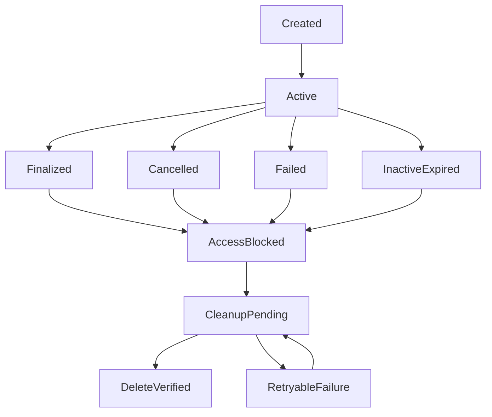
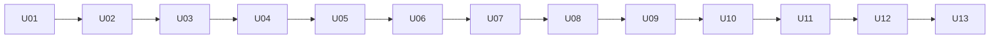

# AMUQ MVP Implementation Plan

## Goal Capsule

- **Objective:** 개인 학습자가 자신의 PDF 자료를 신뢰할 수 있는 비공개 문제은행으로 바꾸고, 한 서비스에서 시험 대비 학습과 재학습 현황을 이어서 관리할 수 있게 한다.
- **Means:** AI 제안과 사용자 검토를 결합한 단계형 문제 생성 흐름을 완전한 테스트, 재학습, 통계 경험에 연결한다.
- **Product authority:** `docs/STRATEGY.md`가 제품 방향과 경계를 정하며, 이 Product Contract가 AMUQ MVP의 사용자 행동과 범위를 구체화한다.
- **Open blockers:** 없음. AI 공급자와 모델, 페이지 및 문항 한도, 출시 시점의 생성 한도는 미해결 범위가 아니라 U04의 타당성 평가를 거쳐 확정할 구현 항목이다.

---

## Product Contract

### Summary

AMUQ는 하나 이상의 PDF를 비공개 문제은행에 차례로 추가하고, AI가 제안한 구성과 문제를 사용자가 검토하고 확정한 뒤 테스트, 재학습, 학습 통계까지 이용하는 서비스다.
MVP는 문제 생성만 제공하지 않고 사용자가 자신의 자료로 학습 성과를 확인하는 전체 순환을 완성한다.

### Problem Frame

개인 학습자는 여러 자료에서 문제를 만들고 정답, 오답, 북마크, 시험 기록을 직접 정리하는 데 많은 시간을 쓴다.
기록이 여러 도구에 흩어지면 현재 오답 상태, 최근 시험 점수, 취약 영역과 재학습 성과를 즉시 파악하기 어렵다.
자료가 많아질수록 빠뜨린 범위와 중복된 문제를 사람이 일일이 찾아내기도 어려워진다.

### Actors

- A1. **등록 학습자:** 자신의 비공개 문제은행을 만들고 편집하며 학습 기록을 축적한다.
- A2. **데모 방문자:** 계정 없이 AMUQ 데모의 독립 사본을 제한된 시간 동안 편집하고 학습한다.
- A3. **운영자:** 임시 자료 삭제 상태와 실패를 확인하고 필요한 정리 작업을 재처리한다.

### Key Decisions

- **완전한 학습 순환을 MVP로 제공한다.** (session-settled: user-directed — 문제 생성 전용 출시 대신 선택: 생성된 문제를 실제로 풀고 재학습할 수 있어야 제품 가치가 생긴다.) Governs R10, R27-R37.
- **사용자 문제은행의 입력은 PDF로 한정한다.** (session-settled: user-directed — 수동 입력과 JSON 가져오기 대신 선택: AMUQ의 첫 가치는 개인 자료의 자동 문제 변환에 있다.) Governs R10, R11.
- **문서 구성을 확정한 뒤 문제를 생성한다.** (session-settled: user-directed — 문제를 먼저 생성하고 나중에 분류하는 방식 대신 선택: 미분류 문제와 조용한 페이지 누락을 방지한다.) Governs R12-R16.
- **AI 생성물은 선택적 일괄 검토와 집중 검토를 함께 제공한다.** (session-settled: user-directed — 모든 초안을 하나씩 열게 하는 방식 대신 선택: 많은 문제를 검토할 때의 피로를 줄이면서 오류와 중복 후보는 놓치지 않는다.) Governs R22-R24.
- **하나의 문제은행에 PDF를 차례로 추가할 수 있다.** (session-settled: user-approved — PDF마다 문제은행을 따로 만드는 방식 대신 선택: 같은 시험의 자료와 학습 통계가 여러 문제은행으로 갈라지지 않는다.) Governs R11, R17, R25.
- **모든 핵심 학습 모드를 MVP에 포함한다.** (session-settled: user-directed — 일부 테스트 모드만 제공하는 범위 대신 선택: 미니 테스트, 모의고사와 세 종류의 릴레이가 하나의 학습 순환을 이룬다.) Governs R30-R37.
- **현재 학습 행동을 돕는 통계를 과거 문항 복기보다 우선한다.** (session-settled: user-approved — 과거 테스트를 문항별로 다시 보는 기능 대신 선택: 최근 성과와 재학습 상태를 간결하게 보여주는 것이 MVP 목표에 더 가깝다.) Governs R31, R35-R37.
- **문제은행 보관과 복원 기능은 만들지 않는다.** (session-settled: user-directed — 보관 상태를 추가하는 방식 대신 선택: 검증되지 않은 정리 기능보다 유지와 영구 삭제만 제공하는 편이 단순하다.) Governs R8-R9.
- **AMUQ 데모는 읽기 전용 기준본의 임시 사본을 사용한다.** (session-settled: user-directed — 모든 방문자가 같은 데모 문제은행을 수정하는 방식 대신 선택: 방문자끼리 영향을 주지 않으면서 편집 기능까지 체험하게 한다.) Governs R4.
- **데모 데이터는 생성 후 6시간 동안만 유지한다.** (session-settled: user-approved — 12시간보다 짧게 유지하되 중간 이탈 후 복귀할 가능성을 고려해 3시간보다 여유를 둔다. 페이지 이탈 감지는 삭제 보장이 아니므로 서버 만료 시각을 기준으로 한다.) Governs R4, F6, AE10.
- **데모 기준본에는 자체 작성하거나 이용 조건을 확인한 정보처리기사형 범용 IT 예제를 사용한다.** (session-settled: user-directed — 기존 서비스 데이터 이전 없이 승인된 Figma의 정보 구조와 예시 맥락을 유지한다.) Governs R4, F6.
- **PDF 한 파일의 업로드 상한은 50MB다.** (session-settled: user-approved — 브라우저와 서버 양쪽에서 강제하고, 페이지 수와 생성 문항 수는 U04의 품질, 비용, 처리시간 평가로 결정한다.) Governs R10-R11.

### Requirements

**Accounts, privacy, and demo**

- R1. 등록 학습자는 이메일과 비밀번호 또는 Google로 가입하고 로그인할 수 있으며, 이메일 가입에는 인증과 비밀번호 재설정 흐름이 포함되어야 한다.
- R2. 계정 삭제는 최근 본인 확인 후 시작하고 14일 동안 취소할 수 있다. 최종 삭제 시 AMUQ가 통제하는 문제은행과 관련 데이터를 모두 제거해야 한다. Resend가 정책상 보존하는 최소 인증 및 재설정 메일과 전달 로그는 발송 후 최대 30일 동안 남을 수 있으며, 이 보존 기간을 사용자에게 알려야 한다.
- R3. 등록 학습자의 문제은행과 학습 기록은 비공개이며 다른 사용자가 열람하거나 변경할 수 없어야 한다.
- R4. AMUQ 데모는 `체험하기`를 누를 때마다 자체 작성하거나 이용 조건을 확인한 정보처리기사형 범용 IT 기준본에서 방문자 전용 사본과 세션을 만들고, 생성 6시간 후 수정 내용과 학습 데이터를 함께 삭제해야 한다. PDF 업로드, AI 문제 생성과 계정으로의 기록 이전은 데모에서 제공하지 않는다.

**Navigation and bank management**

- R5. 전역 홈은 사용자의 문제은행 목록과 `문제 생성` 진입점을 보여주며, 각 문제은행에는 이름, 강조색, 현재 문제 수와 최근 학습일을 표시해야 한다.
- R6. 전역 홈과 문제은행 학습 홈의 헤더 좌측에는 `AMUQ` 로고를 표시해야 한다. 문제은행의 하위 화면에서는 같은 위치를 `← 문제은행 이름`으로 교체하며, 이를 누르면 해당 문제은행의 학습 홈으로 이동해야 한다.
- R7. 전역 화면은 Mammo의 초록색을 고정 강조색으로 사용해야 한다. 각 문제은행에는 초록색을 제외한 접근 가능한 5가지 테마 중 하나를 서비스가 지정하며, 사용자가 직접 선택하거나 수정하지 않게 한다. 지정된 색은 카드와 현재 문제은행의 주요 강조 요소에만 적용되어야 한다.
- R8. 사용자는 문제은행 이름을 다시 입력해 영구 삭제를 확인해야 하며, 삭제 시 문제, 챕터, 생성 작업, 학습 기록, 오답 상태와 북마크를 함께 제거해야 한다.
- R9. 문제은행은 유지 또는 영구 삭제만 지원하며 보관과 복원 상태를 제공하지 않아야 한다.

**PDF analysis and generation**

- R10. 사용자 문제은행의 새 문제는 PDF 업로드를 통해서만 생성하며, 파일 하나의 크기는 최대 50MB로 제한한다. MVP는 한국어와 영어 텍스트 PDF, 인쇄된 스캔 또는 이미지형 PDF를 최선 노력 방식으로 지원해야 한다.
- R11. 하나의 문제은행은 PDF를 한 번에 하나씩 반복해서 추가할 수 있으며, 각 추가 작업은 독립적으로 분석하고 검토한 뒤 확정해야 한다.
- R12. 생성 흐름은 자료 추가, 문서 구성 확인, 생성 설정, AI 생성과 중복 분석, 문제 검토, 최종 확정의 순서로 진행되어야 한다.
- R13. 문서 구성 단계에서 AI 자동 분류를 기본으로 제공하되 사용자가 직접 분류를 선택할 수 있어야 한다. AI는 평면형 챕터 이름, PDF 뷰어 기준 페이지 범위와 `생성 제외` 범위를 먼저 제안해야 한다.
- R14. 사용자는 챕터와 페이지 범위를 추가, 수정, 삭제, 병합, 정렬할 수 있으며, 모든 PDF 페이지는 정확히 하나의 챕터 또는 `생성 제외`에 속해야 한다.
- R15. 인식하기 어려운 페이지는 `확인 필요`로 표시하고 자동 제외하지 않아야 한다. 미해결 페이지, 비어 있는 범위 또는 겹친 범위가 남아 있으면 문제 생성을 시작할 수 없어야 한다.
- R16. 사용자가 문서 구성을 확정한 뒤에만 문제를 생성하며, 생성된 문제는 확정된 챕터를 물려받아 미분류 상태가 생기지 않아야 한다.
- R17. 추가 PDF에서는 AI가 새 페이지를 기존 챕터에 연결하거나 새 챕터 생성을 제안해야 하며, 기존 문제와 챕터는 사용자 확인 없이 변경하지 않아야 한다.
- R18. 생성 전에 실제 시험의 출제 문항 수, 제한시간과 기본 선택지 수를 설정해야 한다. 모르는 값에는 각각 50문제, 60분, 4지선다를 적용하고 선택지 수는 2~6개 범위에서 수정할 수 있어야 한다.
- R19. AI는 챕터별 내용량과 시험 설정을 바탕으로 생성 문제 수를 제안하고, 사용자는 전체 및 챕터별 문제 수를 조정할 수 있어야 한다.
- R20. 자료 분석과 문제 생성은 화면을 떠나도 계속되어야 하며, 관리 화면에는 `자료 분석 중`, `문제 생성 중`, `검토 필요`, `일부 실패`와 확인 가능한 챕터 완료 수를 지속적으로 표시해야 한다. 사용자가 서비스를 열어둔 상태에서 처리가 끝나면 일회성 토스트로도 알려야 한다.
- R21. 일부 챕터의 생성만 실패하면 성공한 초안은 유지하고 실패한 챕터만 다시 생성할 수 있어야 한다.
- R22. 시스템은 새 초안을 같은 생성 묶음과 기존 문제은행에서 비교해 `중복 가능성` 후보와 비교 대상을 제시해야 한다. 이 신호는 검토를 돕지만 자동 삭제하거나 확정을 차단하지 않아야 한다.
- R23. 문제 검토는 `확인 필요`, `중복 가능성`, `전체 문제` 보기를 제공해야 한다. 사용자는 필요한 문제만 열어 수정하고 여러 초안을 일괄 확정하거나 삭제할 수 있어야 한다.
- R24. 구조 또는 내용 오류가 있는 초안은 개별 확인을 요구하고, 모든 AI 결과는 사용자 확인 전까지 학습에 사용할 수 없어야 한다.
- R25. 검토 중에는 질문, 정답, 선지, 해설과 원본 페이지를 함께 확인할 수 있어야 한다. 확정 후에는 원본 미리보기 없이 `p.51 (the_file_n….pdf)`처럼 PDF 순번과 파일명을 표시하되, 확장자를 제외한 이름은 10자 뒤에서 생략하고 전체 이름을 마우스 오버와 키보드 포커스로 확인할 수 있어야 한다.
- R26. 각 PDF 작업을 확정하면 원본과 임시 산출물을 삭제해야 한다. 중단 작업은 안내된 임시 보관 기한이 지나면 삭제하고, 운영자는 삭제 상태와 실패를 확인하고 재처리할 수 있어야 한다.

**Question lifecycle**

- R27. 확정된 문제는 문제 목록과 풀이 결과의 보조 메뉴에서 수정할 수 있어야 하며, 이후 학습에는 수정된 문제가 적용되어야 한다.
- R28. 문제 수정은 과거 점수와 정오답 결과를 다시 계산하지 않아야 하며, 과거 기록은 응시 당시 문제 버전과 연결되어야 한다. 이전 버전을 사용자가 열람하는 기능은 MVP에서 제공하지 않는다.
- R29. 확정된 문제를 삭제하면 현재 목록, 문제 수와 이후 출제에서 제외해야 한다. 복원 기능은 제공하지 않되 과거 통계를 유지하는 데 필요한 기록은 문제은행이 삭제될 때까지 보존해야 한다.

**Study modes and scoring**

- R30. 미니 테스트는 사용자가 챕터 범위와 5, 10, 15, 20, 30개 중 문제 수를 선택하면 해당 범위에서 문제를 중복 없이 무작위로 출제해야 한다. 출제 가능한 문제보다 큰 선택지는 비활성화하고 시간 제한을 두지 않아야 한다.
- R31. 모의고사는 문제은행의 실제 시험 문항 수와 제한시간을 사용해 전체 문제은행에서 중복 없이 무작위 출제해야 한다.
- R32. 모의고사에 필요한 문제보다 보유 문제가 적으면 모든 문제를 출제하고 차이를 안내해야 한다. 제한시간은 실제 시험의 문제당 시간을 유지하도록 출제 비율에 맞춰 줄여야 한다.
- R33. 미니 테스트와 모의고사는 문제 목록을 데스크톱에서 페이지당 10문항, 모바일에서 페이지당 5문항으로 나누어 보여주고, 선택 답안과 진행 위치를 자동 저장해 마지막 지점부터 재개할 수 있어야 한다. 모의고사 시간은 이탈 중에도 흐르며 만료되면 자동 제출되어야 한다.
- R34. 미니 테스트와 모의고사는 전체 제출 후 점수, 정답과 해설을 보여줘야 한다. 미응답 문제가 있으면 제출 전에 이를 알리고 해당 문제로 이동하거나 미응답을 포함해 제출할 수 있어야 한다.
- R35. 챕터, 오답, 북마크 릴레이는 시작 시점의 대상 문제를 섞어 중복 없이 한 번씩 제시해야 한다. 답을 선택하고 `확인`하면 즉시 정답과 해설을 보여주며 진행 위치는 저장하지 않아야 한다.
- R36. 릴레이에서 한 문제 이상 풀면 해당 세션의 풀이 수와 정답 수를 기록해야 한다. 중단 후 다시 시작하면 현재 대상 문제를 기준으로 새 릴레이를 만들어야 한다.
- R37. 틀리거나 미응답한 문제는 현재 오답이 되고, 이후 어느 학습 모드에서든 한 번 맞히면 현재 오답에서 해제되어야 한다. 과거 결과는 유지하며 북마크는 정오답과 별개로 사용자가 직접 설정하고 해제해야 한다.

**Learning home and progress**

- R38. 문제은행 학습 홈은 큰 최근 모의고사 점수, 모든 학습 모드 진입점과 최근 학습 3건을 보여줘야 한다. 오답 수와 북마크 수는 홈의 `내 학습 요약`에서 표시하지 않아야 한다.
- R39. 최근 학습은 최신순으로 유형, 정답 수/전체 문제 수와 응시일을 표시해야 한다. 릴레이의 전체 문제 수는 해당 세션에서 실제로 푼 문제 수이며, 기록은 문항별 과거 결과 화면으로 연결하지 않아야 한다.
- R40. 문제은행별 마이페이지는 전체 출제 수, 정답률, 미응답 수, 현재 오답 수, 북마크 수, 오답 재도전 정답률, 모의고사 점수 추이와 취약 챕터를 제공해야 한다.
- R41. 마이페이지 통계는 1개월, 6개월, 1년, 3년, 전체 기간으로 조회할 수 있어야 하며 기본 기간은 1년이어야 한다.
- R42. 모든 점수와 통계는 현재 문제은행 범위에서 계산하고 서로 다른 시험의 기록을 합치지 않아야 한다. 문제 수정이나 삭제가 이미 확정된 과거 점수를 바꾸지 않아야 한다.

**Cross-cutting experience**

- R43. 주요 흐름은 모바일과 데스크톱에서 사용할 수 있어야 하며 키보드 조작, 명확한 포커스, 읽을 수 있는 대비와 보조기술용 이름을 제공해야 한다.
- R44. 로그인, 문제은행, 생성 작업, 검토, 테스트, 릴레이와 통계 화면에는 적용 가능한 로딩, 빈 상태, 오류, 비활성, 재시도 상태가 있어야 한다.
- R45. 사용자에게 원본과 중단 작업의 보관 기준, 현재 처리 상태와 삭제 결과를 명확히 안내해야 한다.

### Key Flows



- F1. **Private bank creation**
  - **Trigger:** A1이 전역 홈에서 문제 생성을 선택한다.
  - **Actors:** A1
  - **Steps:** 문제은행 기본 정보를 정하고 첫 PDF를 추가한 뒤 F2를 완료한다.
  - **Outcome:** 확정된 문제를 가진 비공개 문제은행이 학습 홈에 열린다.
  - **Covered by:** R3, R5-R7, R10-R26
- F2. **PDF analysis and confirmation**
  - **Trigger:** A1이 새 문제은행 또는 기존 문제은행에 PDF를 추가한다.
  - **Actors:** A1, A3
  - **Steps:** OCR 상태와 챕터를 확인하고 시험 수와 문제 수를 설정한 뒤 생성 결과와 중복 후보를 검토한다.
  - **Outcome:** 사용자 확인을 거친 문제만 학습 대상이 되고 작업 원본은 삭제된다.
  - **Covered by:** R11-R26
- F3. **Mini test and mock exam**
  - **Trigger:** A1 또는 A2가 학습 홈에서 미니 테스트나 모의고사를 선택한다.
  - **Actors:** A1, A2
  - **Steps:** 출제 조건에 따라 세션을 시작하고 답안을 저장하며 제출 후 결과를 확인한다.
  - **Outcome:** 점수와 문제별 정오답이 기록되고 현재 오답 상태와 통계가 갱신된다.
  - **Covered by:** R30-R34, R37-R42
- F4. **Relay learning**
  - **Trigger:** A1 또는 A2가 챕터, 오답, 북마크 릴레이를 선택한다.
  - **Actors:** A1, A2
  - **Steps:** 시작 시 구성된 문제를 한 번씩 풀고 각 문제의 정답과 해설을 즉시 확인한다.
  - **Outcome:** 진행 위치 없이 세션 요약과 정오답 기록만 남는다.
  - **Covered by:** R35-R39
- F5. **Question correction or removal**
  - **Trigger:** A1이 확정된 문제의 오류나 불필요함을 발견한다.
  - **Actors:** A1
  - **Steps:** 보조 메뉴에서 문제를 수정하거나 삭제한다.
  - **Outcome:** 이후 학습에는 최신 상태만 사용되며 과거 결과와 통계는 유지된다.
  - **Covered by:** R27-R29, R42
- F6. **AMUQ demo**
  - **Trigger:** A2가 `체험하기`를 선택한다.
  - **Actors:** A2
  - **Steps:** 독립 사본에서 문제은행 편집과 학습 기능을 사용한다.
  - **Outcome:** 다른 방문자와 기준본에 영향을 주지 않고 체험하며 6시간 후 모든 임시 데이터가 삭제된다.
  - **Covered by:** R4

### Acceptance Examples

- AE1. **Covers R14-R16.**
  - **Given:** PDF 페이지 일부가 어느 챕터에도 속하지 않거나 두 챕터에 겹쳐 있다.
  - **When:** 사용자가 문제 생성을 시도한다.
  - **Then:** 생성은 시작되지 않고 수정해야 할 페이지 범위를 보여준다.
- AE2. **Covers R15.**
  - **Given:** 스캔 PDF의 120페이지 중 3페이지를 충분히 인식하지 못했다.
  - **When:** 문서 구성 결과가 열린다.
  - **Then:** 세 페이지를 `확인 필요`로 보여주고 사용자가 더 선명한 PDF로 교체하거나 `생성 제외`를 선택하기 전까지 생성을 막는다.
- AE3. **Covers R20-R21.**
  - **Given:** 다섯 챕터 중 세 챕터는 생성에 성공하고 두 챕터는 실패했다.
  - **When:** 사용자가 작업 상태를 다시 연다.
  - **Then:** 성공한 초안을 유지하고 실패한 두 챕터만 재시도할 수 있다.
- AE4. **Covers R22-R23.**
  - **Given:** 새 초안이 기존 문제와 의미상 유사한 후보로 탐지되었다.
  - **When:** 사용자가 `중복 가능성` 보기를 연다.
  - **Then:** 새 문제와 비교 대상을 필요할 때만 함께 보여주고 유지, 수정, 삭제를 선택하게 하며, 미검토 상태여도 최종 확정을 허용한다.
- AE5. **Covers R25-R26.**
  - **Given:** 사용자가 `long_private_filename.pdf`의 PDF 뷰어 기준 51페이지에서 생성된 문제를 검토한다.
  - **When:** 문제은행을 확정한다.
  - **Then:** 검토 중에는 원본 페이지를 볼 수 있지만 확정 후에는 원본 없이 `p.51 (long_priva….pdf)`와 전체 파일명 확인 수단만 남는다.
- AE6. **Covers R32.**
  - **Given:** 실제 시험 설정은 100문제, 120분이고 현재 문제은행에는 72문제만 있다.
  - **When:** 모의고사를 시작한다.
  - **Then:** 72문제를 모두 중복 없이 출제한다는 안내를 보여주고 제한시간을 86분 24초로 조정한다.
- AE7. **Covers R33.**
  - **Given:** 사용자가 진행 중인 모의고사를 닫았다가 제한시간 안에 돌아온다.
  - **When:** 같은 세션을 다시 연다.
  - **Then:** 저장된 답과 위치를 복원하고 화면을 떠난 동안 흐른 시간을 제외한 남은 시간을 보여준다.
- AE8. **Covers R35-R36.**
  - **Given:** 사용자가 오답 릴레이에서 12문제 중 8문제를 맞힌 뒤 화면을 나간다.
  - **When:** 학습 홈으로 돌아온다.
  - **Then:** 최근 학습에 `오답 릴레이  8/12 - 응시일(0000. 00. 00)`을 남기고 다음 릴레이는 새 문제 순서로 시작한다.
- AE9. **Covers R27-R29, R42.**
  - **Given:** 과거 풀이 기록이 있는 문제를 수정하거나 삭제한다.
  - **When:** 이후 학습과 마이페이지를 연다.
  - **Then:** 수정된 문제만 출제하거나 삭제된 문제를 제외하면서 과거 점수는 변경하지 않는다.
- AE10. **Covers R4.**
  - **Given:** 데모 방문자가 기준 문제를 수정하고 테스트를 완료했다.
  - **When:** 체험 세션 생성 후 6시간이 지났거나 새 체험 세션을 시작한다.
  - **Then:** 이전 수정과 기록은 보이지 않고 변경되지 않은 AMUQ 데모 기준본에서 새 사본을 만든다.

### Success Criteria

- **문제은행 학습 전환율:** 자료로 문제를 생성하고 검토한 사용자 중 24시간 이내 첫 테스트를 완료한 비율을 측정한다.
- **14일 반복 학습률:** 첫 테스트 후 14일 이내 서로 다른 3일에 걸쳐 총 5회 이상 테스트를 완료한 사용자 비율을 측정한다.
- **재학습 순환 완료율:** 오답이나 북마크가 생긴 사용자 중 14일 이내 오답 및 북마크 릴레이를 합계 2회 이상 완료한 비율을 측정한다.
- **재도전 정답 전환율:** 처음 틀리거나 답하지 못한 문제 중 이후 재학습에서 정답으로 전환된 문제의 비율을 측정한다.
- **원본 자료 삭제 준수율:** 검토가 끝난 생성 작업의 원본과 임시 산출물이 정해진 시간 안에 검증 가능하게 삭제된 비율을 측정하며 목표는 100%다.

### Scope Boundaries

**Deferred for later**

- 수동 문제 생성, JSON 가져오기, 단답형, 서술형, 복수정답, O/X, 이미지, 수식 문제
- 공개 또는 공유 문제은행, 운영자 제작 공용 문제은행, 협업, 순위와 적응형 학습
- 과거 테스트의 문항별 상세 열람과 이전 문제 버전 비교
- 문제은행 보관 및 복원과 삭제 문제 복원
- 데모의 PDF 및 AI 생성, 데모 기록의 계정 이전, 알림함, 이메일과 푸시 생성 완료 알림
- PDF 속 예시 문제를 문제은행 초안으로 변환하고, 추가 또는 스타일 참고 중 사용자가 선택하는 기능

**Outside this product's identity**

- 사용자 원본 자료를 편의 기능으로 장기 보관하는 문서 저장 서비스
- 문제를 생성만 하고 풀이, 기록, 재학습 수단을 제공하지 않는 도구
- 사용자 자료를 동의 없이 공개 문제은행이나 다른 사용자의 결과물에 사용하는 기능

### Dependencies and Assumptions

- 사용자는 업로드한 자료를 처리할 권한이 있으며, 서비스는 이 책임과 처리 방침을 명확히 안내한다.
- 지원 모델이 한국어 및 영어 텍스트와 인쇄 스캔에서 검토 가능한 문제 초안을 생성할 수 있다는 가정은 실제 샘플 평가로 검증해야 한다.
- 이메일 인증과 Google 로그인을 제공할 외부 서비스가 운영 환경에서 사용 가능해야 한다.
- 임시 파일과 생성 작업을 비공개로 처리하고 삭제 상태를 추적할 수 있는 운영 환경이 필요하다.
- 중복 가능성 탐지는 완전한 판정이 아니라 검토 우선순위를 정하는 보조 신호로 취급한다.

### Planning Resolution

- PDF 분석 및 문제 생성 공급자와 모델은 U04에서 OpenAI, Google, Anthropic 후보를 같은 한국어와 영어 텍스트 및 스캔 PDF로 비교한 뒤 하나만 선택한다. 모든 입력 유형의 품질 합격선을 통과한 후보 중 유효 문항당 비용이 가장 낮은 후보를 우선하며, 운영 구현에는 선택한 생성 공급자만 연결한다.
- PDF에서 감지한 예시 문제는 자동 추가하지 않고 출제 형식 참고에만 사용한다. 사용자 설정과 Question Package 계약이 우선하며, 원문에 가까운 복제와 근거 없는 변형은 허용하지 않는다.
- PDF 업로드 크기는 파일당 50MB, 즉 50,000,000 bytes로 고정하고 클라이언트, 업로드 완료 검증과 처리 시작 경계에서 반복 확인한다.
- 완료, 취소, 실패 작업은 즉시 삭제 큐에 넣고 24시간 안에 검증 가능한 삭제 상태에 도달해야 한다. 검토 대기 작업은 마지막 사용자 활동 후 7일, 불완전 업로드는 1시간 뒤 만료한다.
- 중복 탐지는 자동 판정이 아니다. U04의 라벨링된 유사 및 비유사 쌍으로 임계값을 정하고 한 초안에 최대 3개의 비교 후보만 노출한다.
- 데모는 방문자별로 격리하고 생성 후 6시간에 만료한다.

### Sources

- `docs/STRATEGY.md` — AMUQ의 사용자, 문제, 포지셔닝, MVP 경계와 성공 지표
- `docs/planning/project-handoff.md` — 인증, 계정 수명주기, AI 처리와 대시보드에 관한 선행 결정
- `docs/planning/question-schema-and-data-model-v1.md` — 단일정답 2~8지선다, 평면 챕터, 문제 버전과 학습 기록의 선행 계약
- `docs/DESIGN.md`와 승인된 Figma — 화면, 상태, 반응형, 접근성과 구현 충실도의 계약
- `docs/planning/stage-4-input-audit.md` — 계획 입력 우선순위, 해소된 충돌과 greenfield 기준선
- `AGENTS.md` — 개인정보, AI 초안 확인, 서버 채점, 삭제와 검증에 관한 프로젝트 가드레일
- [OpenAI embeddings](https://developers.openai.com/api/docs/guides/embeddings)와 [Gemini embeddings](https://ai.google.dev/gemini-api/docs/embeddings) — U04 중복 탐지 모델 후보의 근거
- [OpenAI file inputs](https://developers.openai.com/api/docs/guides/file-inputs), [pricing](https://developers.openai.com/api/docs/pricing)과 [data controls](https://platform.openai.com/docs/models/default-usage-policies-by-endpoint) — PDF 입력 경계, 후보 모델 비용과 보존 정책
- [Gemini document processing](https://ai.google.dev/gemini-api/docs/document-processing), [pricing](https://ai.google.dev/gemini-api/docs/pricing)과 [zero data retention](https://ai.google.dev/gemini-api/docs/zdr) — PDF 처리 경계, 후보 모델 비용과 보존 정책
- [Claude PDF support](https://platform.claude.com/docs/en/build-with-claude/pdf-support), [structured outputs](https://platform.claude.com/docs/en/build-with-claude/structured-outputs), [pricing](https://platform.claude.com/docs/en/about-claude/pricing)과 [data retention](https://platform.claude.com/docs/en/build-with-claude/api-and-data-retention) — PDF 처리 경계, 구조화 출력 제약, 후보 모델 비용과 보존 정책

현재 대화에서 확정한 PDF 전용 입력, 문제은행 보관 제외, 모든 핵심 학습 모드, 6시간 AMUQ 데모, 50MB PDF 상한과 기존 데이터 이전 제외는 충돌하는 선행 문서보다 우선한다.

---

## Product Contract Preservation

- R1-R45, F1-F6, AE1-AE10의 식별자와 사용자 의미를 유지한다.
- 이 Planning Contract는 Product Contract를 구현 단위, 파일, 데이터, 테스트와 운영 검증으로 구체화하며 승인된 요구사항이나 디자인을 재해석하지 않는다.
- U04의 평가 게이트는 AI 공급자와 모델 및 구현 한도를 측정해 확정하기 위한 것이며 PDF 생성 또는 학습 순환을 MVP에서 제외할 수 있는 범위 축소 게이트가 아니다.
- 하위 선행 문서의 수동 및 JSON 입력, 문제은행 보관 및 복원, 기존 데이터 이전과 데모 AI 가정은 활성 범위로 되살리지 않는다.

## Planning Contract

### Delivery Posture

- 저장소에는 애플리케이션 코드와 패키지 기반이 없으므로 실행에 필요한 최소 구조만 만든다. 별도 서비스, 범용 제공자 인터페이스, 이벤트 버스와 캐시 계층은 실제 필요가 생기기 전까지 추가하지 않는다.
- 하나의 `pnpm` workspace에 웹과 API를 둔다. 같은 API 패키지를 Railway의 HTTP 서비스와 worker 서비스가 서로 다른 시작 명령으로 실행한다.
- 하나의 PostgreSQL을 트랜잭션 데이터와 `pg-boss` 작업 큐에 함께 사용한다. MVP에서 Redis나 별도 메시지 브로커를 운영하지 않는다.
- 웹과 API가 실제로 공유하는 DTO, 이벤트 이름과 검증 스키마만 `packages/contracts`에 둔다. 구현이 하나뿐인 인터페이스나 팩토리는 만들지 않는다.
- Stage 5에서 U-ID를 한 개 이상의 GitHub Issue로 나누되, Stage 6에서는 한 Issue만 활성화하고 각 Issue에서 테스트 실패를 먼저 확인한 뒤 최소 구현을 작성한다.

### Repository and Runtime Shape

```text
/
├─ apps/
│  ├─ web/                         # Next.js App Router, Vercel
│  │  ├─ app/
│  │  ├─ components/
│  │  ├─ features/
│  │  ├─ lib/api/
│  │  └─ lib/telemetry/
│  └─ api/                         # Fastify HTTP + 같은 패키지의 worker entry
│     ├─ src/http/
│     ├─ src/modules/
│     ├─ src/jobs/
│     ├─ src/db/
│     └─ src/telemetry/
├─ packages/
│  └─ contracts/                   # API DTO, Question Package, 분석 이벤트 계약
├─ tests/e2e/                      # Playwright 핵심 사용자 흐름
├─ docs/contracts/                 # 승인된 JSON Schema 유지
├─ package.json
├─ pnpm-workspace.yaml
└─ tsconfig.base.json
```

| 영역      | 결정                                                     | 이유와 경계                                                                                                                                                                               |
| --------- | -------------------------------------------------------- | ----------------------------------------------------------------------------------------------------------------------------------------------------------------------------------------- |
| 웹        | Next.js App Router + TypeScript, Vercel                  | 승인된 웹 기준선을 유지하고 일반 서버 상태는 동일 출처 `/api` 프록시를 통해 호출한다. R2가 업로드 전에 파일 크기를 50MB로 제한하지 못하면, 브라우저가 PDF를 Railway API로 보내고 API가 데이터를 조금씩 R2에 전달하면서 50MB를 넘는 즉시 중단하는 대체 경로를 사용한다. 이 경로는 5분 동안 한 번만 사용할 수 있는 사용자별 업로드 토큰으로 보호한다. |
| API       | Fastify 5 + TypeScript, Railway                          | JSON Schema로 요청을 검증하고 Fastify의 `inject` 통합 테스트와 Pino 로그를 사용한다.                                                                                                       |
| DB        | PostgreSQL + Drizzle ORM/Kit                             | 관계와 `CHECK`, `UNIQUE`, 외래 키, 트랜잭션을 우선하고 생성된 마이그레이션 SQL을 코드 리뷰에 포함한다.                                                                                       |
| worker    | 같은 API 패키지의 `pg-boss` worker, 별도 Railway service | 별도 메시지 브로커 없이 PostgreSQL에서 재시도, 중복 방지와 예약 정리를 처리한다.                                                                                                          |
| 인증      | 서버 소유 opaque session, Argon2id, Google OIDC          | 클라이언트가 보낸 사용자 ID를 신뢰하지 않고 이메일과 Google 계정을 한 사용자에게 명시적으로 연결한다.                                                                                    |
| 파일      | 비공개 Cloudflare R2                                     | 자동 저장 암호화와 객체 수명 주기 규칙으로 개인 PDF 삭제 계약을 보강한다.                                                                                                                 |
| 이메일    | Resend                                                   | 소량의 인증 및 재설정 메일에 필요한 API, 수신 거부 관리와 webhook을 적은 운영 부담으로 제공한다.                                                                                             |
| AI        | U04에서 선정한 단일 생성 공급자 API                      | OpenAI, Google, Anthropic 후보를 평가한 뒤 PDF 분석과 문제 생성에는 하나만 연결한다. 공급자별 보존 최소화 설정과 파일 삭제를 적용하고 모든 결과를 사용자 검토 전 초안으로 취급한다.          |
| 차트      | Recharts                                                 | 승인된 점수 추이 차트의 반응형 축, 포인트, 키보드 툴팁을 직접 SVG로 다시 만들지 않는다. 같은 데이터를 표로도 제공한다.                                                                      |
| 오류 관측 | Sentry                                                   | 프론트엔드, API, worker의 예외를 배포 버전과 연결한다. Session Replay, profiling과 전체 로그 수집은 사용하지 않는다.                                                                         |
| 제품 분석 | PostHog                                                  | 명시적 이벤트로 핵심 퍼널과 이동 경로를 측정한다. 자동 수집 확대, feature flag와 실험은 MVP에서 사용하지 않는다.                                                                          |

### Key Technical Decisions

- **KTD1. `web`, `api`, 공용 계약 패키지로 구성한 pnpm workspace를 사용한다.** 별도 worker 애플리케이션이나 범용 공용 계층은 만들지 않는다. API 패키지의 두 실행 진입점으로 Railway의 HTTP 서비스와 worker를 배포한다. Governs U01-U13.
- **KTD2. Fastify 5, Drizzle, PostgreSQL과 pg-boss를 사용한다.** Redis나 별도 메시지 브로커를 추가하지 않고 하나의 DB에서 제약, 트랜잭션과 작업 재시도를 관리한다. 오래 걸리는 외부 호출은 트랜잭션 밖에서 실행한다. Governs U01-U12.
- **KTD3. 비공개 객체 저장소는 Cloudflare R2를 사용한다.** (session-settled: user-approved — Railway Buckets 대신 선택: R10과 R26의 비공개 PDF와 검증 가능한 삭제에는 저장 암호화와 객체 수명 주기 안전망이 필요하다.) Governs U04-U06, U12.
- **KTD4. 트랜잭션 이메일은 Resend를 사용한다.** (session-settled: user-approved — Postmark 대신 선택: R1-R2의 저용량 인증 및 재설정 메일에는 Resend의 단순한 API, suppression과 webhook이면 충분하고 맞춤 보존과 Message Stream은 불필요하다.) Governs U02, U12.
- **KTD5. Sentry는 오류 관측, PostHog는 제품 행동 분석으로 역할을 분리한다.** (session-settled: user-approved — 한 도구의 모든 기능을 켜는 방식 대신 선택: Sentry replay, PostHog error tracking을 끄고 R43-R45와 성공 지표에 필요한 최소 telemetry만 수집한다.) Governs U13.
- **KTD6. U04에서 AI 공급자와 모델 하나를 선택하고 운영에는 그 결과만 연결한다.** (session-settled: user-approved — GPT 계열을 미리 고정하거나 여러 공급자를 운영 중 전환하는 구조 대신 선택: 같은 PDF와 출력 계약으로 품질과 유효 문항당 비용을 측정한 뒤 가장 경제적인 합격 후보만 구현한다.) 이 단일 공급자 경계는 PDF 분석과 문제 생성에 적용한다. U04가 별도로 고정하는 중복 탐지 모델은 생성 경로의 runtime fallback으로 사용하지 않는다. 평가용 runner는 공급자별로 둘 수 있지만 범용 provider abstraction과 runtime fallback은 만들지 않는다. Governs U04-U06, U12.

### High-Level Technical Design

다음 그림은 구성 요소 간 호출과 상태 흐름을 보여준다. 정확한 함수 구조와 데이터 계약은 각 U-ID에서 구체화한다.

#### System context



#### PDF generation and cleanup sequence



#### Generation job state machine



#### Study answer and submission concurrency



#### Data lifecycle



### Infrastructure Decision Records

#### Cloudflare R2

R2는 사용자 PDF, 페이지 파생물과 처리가 끝나기 전의 내용 포함 중간 산출물만 저장한다. 객체는 공개하지 않고 DB에는 URL이 아니라 소유 범위를 포함한 `storage_key`만 기록한다.

- Railway Buckets도 private S3 API, presigned URL, multipart upload와 환경별 자격 증명을 제공하므로 기본 업로드 기능이 부족해서 제외한 것이 아니다.
- Railway Buckets 공식 지원표에는 현재 server-side encryption 설정, object versioning, object locks와 bucket lifecycle configuration이 지원되지 않는다고 명시되어 있다. 버전 관리와 Object Lock은 삭제 중심인 AMUQ에 필요하지 않지만, 저장 암호화 계약과 lifecycle 안전망은 직접 관련된다.
- R2는 객체와 메타데이터의 저장 중 암호화를 자동 적용하고 lifecycle rule, 설정 감사 로그와 객체 이벤트 알림을 제공한다.
- 애플리케이션 정리 작업이 주 삭제 수단이다. R2 lifecycle은 작업 장애로 남은 고아 객체를 제거하는 방어선이며, lifecycle 삭제가 최대 약 24시간 늦을 수 있으므로 완료 증거로 대신 사용하지 않는다.
- 업로드는 5분 PUT, 검토용 다운로드는 60초 GET presigned URL을 기본값으로 하고, 발급 전에 서버 세션 소유권을 다시 확인한다. URL은 bearer token처럼 취급해 로그와 분석 이벤트에 남기지 않는다.

근거: [Railway Storage Buckets](https://docs.railway.com/storage-buckets), [R2 data security](https://developers.cloudflare.com/r2/reference/data-security/), [R2 object lifecycles](https://developers.cloudflare.com/r2/buckets/object-lifecycles/), [R2 presigned URLs](https://developers.cloudflare.com/r2/api/s3/presigned-urls/), [R2 audit logs](https://developers.cloudflare.com/r2/platform/audit-logs/).

#### Resend

Resend는 이메일 인증, 비밀번호 재설정과 계정 상태 알림만 보낸다. 마케팅이나 뉴스레터, 첨부 파일과 개인 학습 내용은 보내지 않는다.

- AMUQ는 소수의 인증 및 재설정 메일만 보낸다. Resend는 REST API와 공식 SDK, 도메인 인증, 수신 거부 관리, 전달 및 반송 webhook과 발송 요청용 idempotency key를 제공하므로 이 범위에 맞는다.
- Postmark의 Message Stream 분리, 7~365일 맞춤 보존과 Data Removal API는 여러 메일 흐름과 세밀한 보존 통제가 필요할 때 유리하다. 현재 범위에서는 Resend의 단순한 설정과 중복 발송 방지가 더 직접적인 이점이다.
- Resend의 Free, Pro, Scale 요금제는 메일 본문과 전달 로그를 30일 보존한다. 인증 및 재설정 메일에는 필요한 안내와 1회용 링크만 넣고 열람과 클릭 추적은 끈다. 인증 token은 24시간, 재설정 token은 30분 안에 만료되므로 보존 기간에 다시 사용할 수 없다.
- 메일 제공자 호출은 DB transaction 안에서 직접 수행하지 않는다. 사용자 상태 변경과 `email_outbox` 삽입을 하나의 transaction으로 확정하고 worker가 발송 및 재시도한다.
- outbox의 안정적인 업무 고유 키를 발송 전에 저장하고 같은 값을 Resend idempotency key로 모든 재시도에 재사용한다. Resend의 24시간 key 보존 안에서 자동 재시도하며, 응답 유실 상태가 그보다 길어지면 자동 재발송하지 않고 운영 확인 대상으로 전환한다.
- webhook은 서명을 검증하고 event id를 unique로 저장한 뒤 전달, 반송, suppression 상태만 반영한다. 메일 본문은 AMUQ DB와 로그에 저장하지 않는다.

근거: [Resend Email API](https://resend.com/features/email-api), [Resend idempotency keys](https://resend.com/changelog/idempotency-keys), [Resend GDPR and retention](https://resend.com/security/gdpr), [Resend tracking settings](https://resend.com/changelog/update-click-open-tracking-via-api), [Postmark pricing and retention](https://postmarkapp.com/pricing), [Postmark Data Removal API](https://postmarkapp.com/developer/api/data-removals-api).

#### Sentry

Sentry의 목적은 실제 배포 환경에서 “무엇이 어디서 실패했는가”를 확인하는 것이다.

- 브라우저에서 처리되지 않은 예외, API 5xx와 worker 실패를 수집한다. 배포 버전, 환경, route와 job 종류, 민감 정보가 없는 오류 코드를 함께 기록한다.
- production source map을 배포 버전에 연결하되 공개 산출물에서는 source map을 제공하지 않는다.
- request body, cookie, authorization header, 이메일, 파일명, PDF와 문제 및 해설 내용, signed URL과 AI 원문은 `beforeSend`와 서버 scrubber에서 제거한다.
- Session Replay, profiling, 전체 로그 전송과 광범위 tracing은 활성화하지 않는다. 성능 문제의 증거가 생긴 경우 별도 변경으로 추가한다.
- 정리 worker의 최종 실패와 연속 AI job 실패만 action 가능한 경보로 만들고 예상 가능한 사용자 validation 오류는 전송하지 않는다.

#### PostHog

PostHog의 목적은 “사용자가 어느 흐름을 거쳐 어디에서 중단하는가”를 측정해 제품 흐름을 개선하는 것이다.

- 명시적 이벤트: `demo_started`, `signup_completed`, `pdf_upload_completed`, `generation_completed`, `draft_review_started`, `question_bank_confirmed`, `study_session_started`, `study_session_completed`, `study_session_abandoned`, `result_viewed`.
- 분석 산출물: 데모 진입→학습→결과 퍼널, 가입→PDF→생성→검토→확정→첫 학습 퍼널, 모드별 완료율, 디바이스별 중단 지점과 사용자 경로.
- 제품 성공 지표의 최종 수치는 PostgreSQL의 확정된 세션 및 작업 상태에서 계산한다. PostHog는 탐색과 행동 경로 분석에 사용하며 서버 기록을 대체하지 않는다.
- 이벤트 속성에는 mode, 화면, 기기 분류, 수량 구간과 민감 정보가 없는 상태값만 허용한다. 이메일, 파일명, PDF, 문제, 선지, 해설, 자유 입력, 사용자 제공 제목, token과 URL은 금지한다.
- 기본 자동 수집과 Session Replay는 끄고 명시 이벤트와 필요한 pageview만 보낸다. 이동 경로와 중단 지점은 Paths와 funnel로 분석하며 DOM, 입력값과 문제 내용을 녹화하지 않는다.
- 브라우저의 탐색 및 중단 이벤트는 페이지 종료, 네트워크 차단과 광고 차단 도구 때문에 유실될 수 있다. Playwright는 이벤트 발생 시점, schema와 금지 필드를 network interception으로 검증하되 PostHog 수신 여부를 제품 동작이나 E2E 성공 조건으로 삼지 않는다.
- 실제 사용 증거가 생기기 전에는 feature flag, 실험, 설문과 PostHog error tracking을 추가하지 않는다. 오류 관측은 Sentry 한 곳으로 제한한다.

근거: [PostHog paths](https://posthog.com/docs/product-analytics/paths), [PostHog funnels](https://posthog.com/docs/product-analytics/funnels), [PostHog pricing](https://posthog.com/pricing).

### Security and Data-Lifecycle Invariants

1. 현재 사용자와 데모 주체는 검증된 서버 세션에서만 파생한다. 모든 private query와 mutation은 `resource.owner = session.subject` 조건을 같은 SQL 또는 transaction 안에서 확인한다.
2. 비밀번호는 Argon2id로 해시하고, opaque session raw token은 `__Host-session` cookie에만 둔다. DB에는 SHA-256 hash만 저장한다.
3. cookie 인증을 쓰는 브라우저 상태 변경 요청은 same-origin, `Origin`/CSRF 검증과 safe relative `returnTo`를 강제한다. OAuth callback은 state와 nonce로, provider webhook은 서명, timestamp, event id로 별도 검증하며 이 두 경계에 브라우저 Origin 규칙을 잘못 적용하지 않는다.
4. PDF는 확장자가 아니라 MIME, magic bytes, 실제 크기와 파서 결과를 서버에서 검증한다. 50MB 초과, 암호화되었거나 손상된 PDF와 허용되지 않은 형식은 job 생성 전에 거절한다.
5. 업로드 완료 후 R2 `HEAD` 결과의 길이와 owner-bound metadata를 확인하고, worker가 객체를 스트리밍하며 SHA-256, magic bytes, parser 결과를 검증하기 전에는 AI 분석을 시작하지 않는다.
6. AI 공급자의 입력과 출력은 신뢰하지 않는다. JSON Schema, semantic validator, 출처 페이지 범위와 금지 콘텐츠 검증을 통과한 결과만 draft로 저장한다.
7. AI draft는 사용자 확정 transaction 전까지 `ready` revision이 될 수 없다. 부분 확정, 재시도와 최종 확정은 idempotency key와 unique constraint로 중복을 막는다.
8. 시험은 시작 시 question revision과 option order를 고정한다. 답안 저장에는 단조 증가 version을 사용해 늦게 도착한 이전 요청이 최신 답을 덮지 않게 한다.
9. 수동 제출과 타이머 자동 제출은 같은 idempotent service를 사용하고 session row lock 안에서 한 번만 점수와 오답 상태를 확정한다.
10. 완료, 취소, 실패 job은 즉시 cleanup queue에 들어가며 24시간 안에 R2와 provider file의 부재를 재확인한다. 검토 대기는 마지막 활동 후 7일, 불완전 업로드는 1시간 뒤 만료하고 사용자에게 만료 시각을 표시한다.
11. 계정 최종 삭제와 6시간 데모 만료는 DB 행, R2 객체, provider file, outbox와 분석 identity 삭제를 단계별로 추적한다. 외부 삭제가 실패하면 계정 데이터 접근은 계속 차단한 채 재시도한다.
12. 애플리케이션 로그, Sentry와 PostHog에는 secret, cookie, token, signed URL, 이메일 주소, PDF와 문제 내용을 남기지 않는다. Resend에는 수신 주소와 최소 트랜잭션 메일 본문만 전송하며 학습 내용과 첨부 파일은 보내지 않고 열람과 클릭 추적을 끈다.

### Figma Fidelity and Scroll Contract

승인된 Figma Final Screens와 `docs/DESIGN.md`는 UI 구현의 필수 계약이다. 에이전트는 화면 이름이나 스크린샷 기억으로 값을 추정하지 않는다.

각 UI U-ID는 다음 순서를 완료 조건에 포함한다.

1. 구현 전에 정확한 Figma node를 열고 typography, fill, stroke, radius, spacing, size, alignment, constraints, variable mode와 모든 상태를 측정한다.
2. 기존 Figma component와 variant를 코드의 공유 component와 token에 매핑하고 화면별 복사본이나 임의의 디자인 값을 만들지 않는다.
3. loading, empty, error, disabled, hover, focus, validation, destructive와 retry 상태를 해당 node와 Product Contract에 맞춰 구현한다.
4. `1440×900`과 `390×844`는 시각 기준점으로 비교하되 프레임 높이를 고정 레이아웃으로 복제하지 않는다.
5. 짧거나 긴 콘텐츠, 짧거나 긴 viewport와 중간 폭에서 scroll ownership과 overflow를 검증한다.
6. 눈에 보이는 차이를 수정하고 같은 viewport와 상태에서 한 번 재검증한다. 접근성 또는 기술 제약으로 다르게 구현해야 하면 임의 변경하지 않고 충돌과 대안을 먼저 보고한다.

각 UI U-ID는 구현 전에 대표 화면과 짧거나 긴 fixture에서 스크롤을 담당할 영역을 `none`, `document`, `dialog/internal` 중 하나로 기록한다. Playwright는 실제로 스크롤되는 상위 요소, 짧은 fixture의 무스크롤, 긴 fixture의 마지막 내용과 행동 도달성, Dialog 배경 잠금을 이 계약과 비교한다.

스크롤 검증의 핵심 불변식:

- 콘텐츠가 viewport 안에 들어오면 불필요한 document 세로 스크롤이 생기지 않는다.
- 콘텐츠가 길면 모든 행동과 내용에 도달할 수 있도록 의도한 영역에 세로 스크롤이 생긴다.
- 지원 폭에서 의도하지 않은 가로 스크롤, 잘림과 겹침이 없다.
- 긴 문제, 선택지, 문제은행 이름과 validation 메시지가 고정 header/footer 또는 CTA에 가리지 않는다.
- Dialog가 열리면 배경 스크롤이 잠기고 긴 Dialog는 내부가 스크롤되며, 닫을 때 원래 trigger로 focus가 돌아온다.
- sticky/fixed 요소는 키보드 focus, 브라우저 확대 200%와 모바일 동적 viewport에서 내용을 가리지 않는다.
- Playwright는 최소 `320×568`, `390×844`, `768×1024`, `1440×700`, `1440×900`에서 짧거나 긴 fixture의 `scrollWidth/clientWidth`, `scrollHeight/clientHeight`와 주요 요소 가시성을 확인한다.

### Data Model and Transaction Boundaries

기존 `docs/planning/question-schema-and-data-model-v1.md`의 revision와 attempt 모델을 유지하되 활성 Product Contract에 맞춰 다음 그룹을 구현한다.

| 그룹         | 핵심 테이블                                                                                                         | 주요 불변식                                                                                                                                  |
| ------------ | ------------------------------------------------------------------------------------------------------------------- | -------------------------------------------------------------------------------------------------------------------------------------------- |
| 인증         | `users`, `auth_identities`, `sessions`, `verification_tokens`, `password_reset_tokens`, `account_deletion_requests` | 검증 전 로그인 금지, Google `sub` 식별, raw token 비저장, token 1회 사용                                                                     |
| 남용 제한    | `rate_limit_counters`                                                                                               | 주체 HMAC, 작업, 시간창 조합을 unique로 유지한다. IP와 이메일 원문은 저장하지 않고, 만료 시 다시 허용하거나 행을 삭제하며, 비용성 작업을 enqueue하기 전에 원자적으로 차감한다. |
| 이메일       | `email_outbox`, `email_delivery_events`                                                                             | 업무 고유 키 unique, provider event id unique, 상태 변경과 outbox 원자적 저장                                                                |
| 소유권       | `question_banks`, `bank_sections`, `demo_sessions`                                                                  | user 또는 demo session 중 정확히 한 owner, title-confirmed 영구 삭제, 사용자용 archive 상태 없음                                             |
| 소스 및 작업 | `source_materials`, `generation_jobs`, `generation_job_sections`, `cleanup_tasks`                                   | owner-bound storage key, 상태 전이 검증, job idempotency, terminal cleanup 추적                                                              |
| 초안         | `question_drafts`, `draft_options`, `draft_sources`, `duplicate_candidates`                                         | schema와 semantic validation 상태, ready revision과 분리, 후보는 자동 삭제 및 차단 금지                                                      |
| 확정 문제    | `questions`, `question_revisions`, `question_options`, `question_revision_sources`                                  | revision 불변, 정답 option FK, archived 문제는 신규 출제 제외 또는 과거 attempt 유지                                                         |
| 학습         | `study_sessions`, `question_attempts`, `bookmarks`                                                                  | session별 revision와 순서 고정, 미응답 보존, 서버 채점, submit 1회                                                                           |

중요 transaction:

- **이메일 가입:** user, identity, verification token, outbox를 함께 저장한다. 하나라도 실패하면 사용자도 만들지 않는다.
- **Google identity 연결:** link request 검증, identity unique 확인, 기존 세션 회전과 연결을 한 transaction에서 처리한다.
- **문서 구성 확정:** 모든 페이지가 정확히 한 section 또는 제외 범위에 속하는지 잠금 후 검증하고 generation snapshot을 만든다.
- **문제 최종 확정:** 선택된 draft를 immutable revision으로 변환하고 bank count를 갱신한 뒤 cleanup task를 같은 transaction에 넣는다.
- **문제 수정:** question row를 잠그고 다음 revision 번호를 삽입한다. 이전 attempt 참조를 바꾸지 않는다.
- **시험 시작:** ready revision을 선택하고 순서, option order, 만료 시각을 한 번 저장한다.
- **답안 저장:** attempt version이 현재보다 새로울 때만 선택 답안을 갱신한다.
- **시험 제출:** session row lock, revision 기반 채점, attempt result, session summary와 현재 오답 계산을 한 번에 확정한다.
- **계정과 문제은행 삭제:** 접근 차단과 DB 삭제 요청을 먼저 원자적으로 확정하고 외부 식별자를 비식별 cleanup ledger로 옮긴다. 외부 삭제와 부재 확인 뒤 도메인 행을 삭제하며 중간 실패는 같은 ledger에서 재시도한다.

MVP에서는 오답 및 통계 projection과 materialized view를 만들지 않는다. 제출된 attempt와 session을 원본으로 쿼리하고 측정된 병목이 생길 때만 추가한다.

### HTTP and Worker Boundaries

| 경계                          | 책임                                                                                                                                                       |
| ----------------------------- | ---------------------------------------------------------------------------------------------------------------------------------------------------------- |
| `/api/auth/*`                 | 가입, 인증, 로그인, 로그아웃, 비밀번호 재설정, Google 시작, 콜백, 연결                                                                                       |
| `/api/account/*`              | 현재 사용자, 재인증, 삭제 예약과 취소                                                                                                                        |
| `/api/demo-sessions`          | 6시간 demo session과 격리 bank 생성                                                                                                                        |
| `/api/banks/*`                | 소유자 범위의 목록 및 상세 조회, 이름 변경과 영구 삭제                                                                                                        |
| `/api/banks/:bankId/uploads/*`| presigned PUT 발급, 업로드 완료 검증과 취소                                                                                                                |
| `/api/generation-jobs/*`      | 분석 상태, 분류 수정과 확정, 생성 설정, 생성과 재시도                                                                                                        |
| `/api/drafts/*`               | 필터, 상세 조회, 수정과 삭제, 중복 비교와 일괄 확정                                                                                                          |
| `/api/questions/*`            | 확정 문제 목록, revision 추가와 archive                                                                                                                    |
| `/api/study-sessions/*`       | 시작, 답안 저장, 재개, 제출과 relay 확인                                                                                                                   |
| `/api/banks/:bankId/summary`  | 학습 홈과 기간별 통계 read model                                                                                                                           |
| worker jobs                   | `analyze_pdf`, `generate_questions`, `detect_duplicates`, `send_email`, `auto_submit_exam`, `expire_demo`, `cleanup_material`, `finalize_account_deletion` |

- HTTP handler는 인증, 요청 검증과 응답 변환만 담당한다. 트랜잭션 규칙은 module service에 둔다.
- 공개 API 응답은 `AuthorQuestionDTO`, `TestQuestionDTO`, `ReviewQuestionDTO`를 분리한다. `TestQuestionDTO`에는 정답, 해설, 출처를 포함하지 않는다.
- job payload에는 DB ID와 안전한 분류값만 넣고 PDF 내용, signed URL, AI 응답 원문을 넣지 않는다.
- 이메일 발송 요청, 업로드 완료 callback, 생성 시작과 재시도 및 최종 확정, 시험 제출, 제공자 callback과 cleanup job에는 호출자 idempotency key 또는 서버 업무 고유 키를 사용한다. 이름 변경이나 bookmark 설정처럼 본래 멱등적인 변경은 PUT과 DELETE의 의미와 DB 제약으로 중복 요청을 처리한다.
- 인증 메일, 비밀번호 재설정, 데모, presigned upload와 AI 생성은 비용이 발생하기 전에 PostgreSQL rate limit을 적용한다. 제한 주체는 검증된 proxy 경계의 client address, 정규화한 식별자 또는 계정이다. IP와 이메일 원문 대신 환경별 비밀키로 만든 HMAC만 저장하고 가장 긴 제한 시간과 한 번의 복구 여유가 지난 뒤 삭제한다. U04의 비용 측정으로 출시 시 제한값을 확정하고 초과 응답에는 `429`와 `Retry-After`를 포함한다.

## Implementation Units

### U01 — 실행 가능한 저장소 및 배포 기반

- **Covers:** R43-R45의 공통 기반.
- **Depends on:** None.
- **Outcome:** 웹, API, worker, PostgreSQL을 로컬과 CI에서 실행하고 Vercel→Railway 동일 출처 `/api` 경계를 검증할 수 있다.
- **Primary files:** `package.json`, `pnpm-workspace.yaml`, `tsconfig.base.json`, `apps/web/app/layout.tsx`, `apps/web/app/api/[...path]/route.ts`, `apps/api/src/http/server.ts`, `apps/api/src/worker.ts`, `apps/api/src/db/schema.ts`, `.github/workflows/ci.yml`, `.env.example`.
- **Work:**
  1. Node 22(최소 22.12)와 pnpm workspace, TypeScript strict, ESLint, Prettier, Vitest와 Playwright의 최소 설정을 만든다.
  2. Next.js shell과 Fastify health/readiness endpoint를 만들고 request id를 전 구간에 전달한다.
  3. Drizzle이 생성한 SQL과 snapshot을 함께 커밋하고 CI PostgreSQL service에 적용한다. API와 worker가 같은 pre-deploy migration entrypoint를 실행하되 PostgreSQL advisory lock 아래 Drizzle→pg-boss migration을 한 번만 직렬 적용하고 목표 schema version을 확인한 뒤 시작한다. runtime 자동 migration과 `drizzle push`는 사용하지 않는다.
  4. API와 worker를 같은 package의 별도 entry로 실행하고 graceful shutdown을 검증한다. Railway PostgreSQL의 실제 connection 한도에서 migration와 운영 여유를 먼저 제외하고 API 및 worker pool 예산을 정하며 U04 worker 동시성이 그 합계를 넘지 않게 한다.
  5. development, test, production 환경의 secret과 DB/R2/PostHog/Sentry project를 분리하며 `.env.example`에는 이름만 둔다.
  6. Railway의 신뢰할 proxy hop을 명시하고 그 밖의 `Forwarded`와 `X-Forwarded-For` 입력을 rate limit 주체나 보안 판단에 사용하지 않는다.
- **Tests:** health `inject` test, proxy contract와 spoofed forwarded-header test, 동시 pre-deploy migration lock, migration up test, DB pool 고갈 및 queue polling 부하, worker boot/shutdown test, secret 누락 시 fail-fast test.
- **Completion:** `pnpm lint`, `pnpm typecheck`, `pnpm test`, `pnpm build`가 통과하고 preview 환경에서 web→API health 요청이 같은 출처로 성공한다.

### U02 — 인증, 세션, 트랜잭션 이메일

- **Covers:** R1-R3, R43-R45.
- **Depends on:** U01.
- **Outcome:** 이메일/비밀번호와 Google 로그인, 인증 및 재설정, 명시적 identity 연결과 안전한 서버 세션을 제공한다.
- **Primary files:** `apps/api/src/modules/auth/schema.ts`, `apps/api/src/modules/auth/service.ts`, `apps/api/src/modules/auth/routes.ts`, `apps/api/src/modules/auth/session.ts`, `apps/api/src/modules/email/outbox.ts`, `apps/api/src/jobs/send-email.ts`, `apps/web/app/(auth)/*`, `apps/web/features/auth/*`, `packages/contracts/src/auth.ts`.
- **Work:**
  1. Argon2id password, hashed one-time verification/reset token과 `__Host-session` cookie를 구현한다.
  2. 24시간 인증 token, 30분 reset token, 7일 idle 및 30일 absolute session 만료와 인증 상태 변경 후 session rotation을 적용한다.
  3. Google OIDC는 stable `sub`를 사용하고 같은 email만으로 자동 연결하지 않는다. 기존 password 재확인과 동의를 거친 10분 link request만 허용한다.
  4. Resend outbox와 signed webhook을 구현하고 사용자 상태 변경과 발송 요청을 원자적으로 기록한다. 발송 전 확정한 업무 고유 키를 Resend idempotency key로 재사용하고 open/click tracking을 끈다.
  5. Figma의 가입, 인증 대기, 로그인, 재설정, Google 취소 및 오류 상태를 정확한 node에서 구현한다.
  6. 가입, 인증 재발송, 비밀번호 재설정은 검증된 proxy 경계의 client address와 정규화한 식별자별 PostgreSQL rate limit을 발송 enqueue 전에 적용하고 초과 시 `429`와 `Retry-After`를 반환한다. 키는 원문이 아닌 환경별 HMAC으로 저장하고 만료 행을 정리한다.
- **Tests:** password/token unit, session expiry/rotation, CSRF/Origin, open redirect, token replay, email enumeration, Google state/nonce/link conflict, outbox 요청 성공 후 응답 유실, worker 종료, 재전달 idempotency, webhook signature/replay, rate limit, raw 식별자 부재, 환경 간 digest 분리, 만료 복구, cross-user denial.
- **E2E:** 이메일 가입→인증→로그인, 잘못된 로그인, reset, Google 취소/오류를 desktop과 mobile에서 검증한다.
- **Completion:** 인증되지 않은 사용자는 private API에 접근할 수 없다. 애플리케이션 로그, Sentry, PostHog에는 token과 개인 내용이 없고 Resend에는 만료가 짧은 1회용 링크를 포함한 최소 인증 및 재설정 메일만 남는다.

### U03 — 비공개 문제은행 shell과 문제 계약

- **Covers:** R3, R5-R9, R27-R29의 기반.
- **Depends on:** U02.
- **Outcome:** 사용자별 private bank 목록, 상세, 테마, 영구 삭제와 immutable question revision 계약이 작동한다.
- **Primary files:** `apps/api/src/modules/banks/*`, `apps/api/src/modules/questions/*`, `apps/api/src/db/schema/banks.ts`, `apps/api/src/db/schema/questions.ts`, `packages/contracts/src/questions.ts`, `apps/web/app/(app)/banks/*`, `apps/web/features/banks/*`, `apps/web/components/*`.
- **Work:**
  1. bank, flat section, question, revision, option과 source relation을 제약 조건과 함께 migration으로 만든다.
  2. owner-scoped query를 service 공통 경계에서 강제하고 bank ID만으로 조회하는 repository 함수를 금지한다.
  3. 초록색을 제외한 접근 가능한 5가지 테마를 서버가 안정적으로 배정하고 사용자가 수정하는 API를 만들지 않는다.
  4. bank 이름 재입력 영구 삭제를 구현하고 archive/restore route, 상태, UI를 만들지 않는다.
  5. 승인된 Header, Button, Field, Dialog, empty/error/loading 상태를 Figma node와 매핑한다.
- **Tests:** DB FK/CHECK/unique, 다른 사용자 bank 읽기, 수정, 삭제 거부, title mismatch, cascade와 과거 revision 보존 규칙, theme assignment.
- **E2E:** 빈 전역 홈, 여러 bank 목록, bank 진입 및 복귀, 이름 확인 삭제, unauthorized URL 접근과 스크롤 matrix.
- **Completion:** private bank 소유권과 영구 삭제 불변식이 실제 PostgreSQL integration test에서 증명된다.

### U04 — PDF와 AI 공급자 평가 및 한도 확정

- **Covers:** R10-R19, R22의 기술 게이트.
- **Depends on:** U01, Question Package 계약.
- **Outcome:** PDF 분석 및 문제 생성 공급자와 모델 하나, 중복 탐지 모델, 페이지 및 생성 문항 한도와 출시 시점의 생성 한도를 재현 가능한 evidence로 선택한다.
- **Primary files:** `apps/api/src/modules/generation/evaluation/*`, `apps/api/src/modules/generation/validators/*`, `packages/contracts/src/question-package.ts`, `docs/planning/ai-feasibility-results.md`, `tests/fixtures/pdf/*`.
- **Work:**
  1. 한국어와 영어의 text, scan, 예시 문제가 섞인 PDF와 20, 50, 100페이지 및 50,000,000-byte 경계 fixture를 준비한다.
  2. 네 언어 및 형식 구간이 구조, 출처, 정답 근거, 중대 오류와 수정 필요율 합격선을 각각 통과하게 한다. 예시 문제 감지, 스타일 반영, 원문 비복제와 근거 부족 거절도 평가한다.
  3. paid API의 학습 미사용, 저장 비활성화와 provider file 삭제를 개인정보 합격 조건으로 둔다. 공급자가 통제하는 잔존 기간은 기록하고 최종 선택 전에 사용자 승인을 받는다.
  4. GPT-5.6 Luna, Gemini 3.8 Flash와 Claude Haiku 4.5를 먼저 비교한다. 필요할 때만 같은 기준으로 공급자별 stable quality-oriented 모델을 하나씩 추가 평가하며, 평가용 runner를 운영용 범용 abstraction으로 만들지 않는다.
  5. production과 같은 page ID, 전처리, 분할과 provider 호출 경로로 정확한 50MB 경계를 검증한다. 품질 합격 후보 중 API와 후보별 OCR, worker, 저장 및 egress 변동비를 포함한 유효 문항당 비용이 가장 낮은 모델을 선택한다.
  6. 중복 탐지 모델과 threshold를 별도로 평가한다. 결과 문서에 선택한 생성 공급자와 모델, 호출 및 페이지 출처 계약, 삭제 규칙, 처리 및 생성 한도와 출시 생성 한도를 고정한다. 모든 후보가 실패하면 요구 범위를 낮추지 않고 계획 충돌로 보고한다.
- **Tests:** 구간별 품질 gate, 예시 문제 감지와 비복제, 유효 문항당 비용, 정확한 byte boundary, malformed PDF 거절, page locator, provider file 삭제와 duplicate benchmark.
- **Completion:** 결과가 재실행 가능하고 단일 생성 공급자, 중복 탐지 모델과 사용자 생성 한도의 근거가 수치로 남는다. 선택된 production integration contract가 개인정보 및 50MB 경계와 page provenance를 증명하며 어떤 AI 출력도 validator와 사용자 확인을 우회하지 않는다.

### U05 — 안전한 PDF 업로드, 분석, 문서 구성

- **Covers:** R10-R17, R20, R25-R26, AE1-AE2.
- **Depends on:** U03, U04.
- **Outcome:** 사용자가 한 번에 PDF 하나를 비공개로 올리고 분석 상태를 떠났다 돌아와도 복원하며 모든 페이지를 분류한 뒤에만 생성을 시작한다.
- **Primary files:** `apps/api/src/modules/materials/*`, `apps/api/src/modules/generation/analysis-service.ts`, `apps/api/src/jobs/analyze-pdf.ts`, `apps/api/src/jobs/cleanup-material.ts`, `apps/web/app/(app)/banks/[bankId]/generate/*`, `apps/web/features/generation/*`, `packages/contracts/src/generation.ts`.
- **Work:**
  1. upload intent에서 예상 크기가 50MB 이하인지 검사하고 크기, `application/pdf`, owner metadata를 5분짜리 PUT 서명에 포함한다. R2 contract test는 다른 크기의 요청이 저장 전에 거절되는지 확인한다. R2가 이를 지원하지 않으면 브라우저가 Vercel을 거치지 않고 Railway upload endpoint로 전송한다. 이 경로는 5분짜리 일회용 owner-bound token과 고정 origin CORS로 보호하며, 50MB를 넘는 즉시 스트리밍을 중단하고 부분 객체를 삭제한다. 완료 callback은 R2 `HEAD`의 존재, 실제 크기와 metadata를 upload intent와 비교한다. worker는 객체를 스트리밍하며 SHA-256, PDF magic bytes와 parser 결과를 검증한다. R2가 제공하지 않는 전체 객체 checksum에는 의존하지 않는다. U04에서 정한 처리 시간, 메모리, 페이지와 parser object 한도를 별도 worker에서 강제한다. 한도 초과와 결정적 parser 실패는 재시도하지 않고 cleanup으로 보낸다.
  2. 한 bank에는 종료되지 않은 PDF 작업을 하나만 허용하고 두 번째 시작은 기존 작업 재진입 정보를 포함한 409를 반환한다. job 또는 chapter별 `attempt_no`와 fencing token, `pg-boss` unique job key로 중복 callback, 재시도, 늦은 AI 응답이 최신 결과를 덮지 않게 한다.
  3. AI 자동 분류와 수동 분류를 같은 flat section/page-range 계약으로 저장하고 미해결이거나 비었거나 겹친 범위를 서버에서 차단한다.
  4. 분석 진행 수, 확인 필요, 일부 실패, 만료 시각과 재시도를 read model로 제공하고 단계 전환, 완료, 실패를 비간섭 상태 영역으로 알린다.
  5. Figma의 PDFs→Analysis→OCR Review→Classification Overview→Editable Criteria 화면과 desktop/mobile 상태를 구현한다.
- **Rate limits:** 계정별 활성 PDF/AI 작업 수와 기간별 업로드 및 생성량을 U04에서 확정한 출시 값으로 API와 DB에서 제한한다. 웹은 공급자 토큰 사용량을 노출하지 않고 한도 소진 시 승인된 오류, 비활성 및 재시도 상태로 다음 사용 가능 시각을 안내한다. 별도 크레딧 원장이나 요금제 UI는 만들지 않는다. 여러 bank를 이용한 우회도 계정 주체로 합산하고 presigned URL 발급 또는 job enqueue 전에 거절한다.
- **Tests:** presigned URL owner/expiry, signed 길이와 MIME 불일치의 저장 전 거부와 API-stream fallback contract, callback 없는 객체 만료, direct upload tampering, size/MIME/magic mismatch, 병적 압축 또는 과도한 객체 구조의 resource budget 거부, 계정 합산 rate limit와 여러 bank 우회와 시간창 복구, duplicate completion callback, page partition property test, worker retry, cleanup expiration과 cross-user denial.
- **E2E:** valid text PDF, scan fixture의 OCR review, 정확한 50MB 경계와 초과 차단, 범위 겹침 및 누락 차단, 화면 이탈 후 상태 복원, 생성 한도 소진과 시간창 복구, 짧고 긴 재시도 안내의 focus 및 scroll contract.
- **Completion:** 어떤 PDF도 owner와 파일 검증 없이 분석되지 않고 모든 페이지 partition이 확정되기 전 generation job이 생성되지 않는다.

### U06 — AI 생성, 중복 검토, 확정, 원본 삭제

- **Covers:** R18-R26, F1-F2, AE3-AE5.
- **Depends on:** U05.
- **Outcome:** AI 초안을 부분 실패에서 복구하고 필요한 문제를 검토, 수정, 삭제, 비교한 뒤 한 번에 확정하며 원본 삭제를 검증한다.
- **Primary files:** `apps/api/src/modules/generation/generation-service.ts`, `apps/api/src/modules/drafts/*`, `apps/api/src/jobs/generate-questions.ts`, `apps/api/src/jobs/detect-duplicates.ts`, `apps/api/src/jobs/cleanup-material.ts`, `apps/web/features/review/*`, `apps/web/app/(app)/generation-jobs/[jobId]/*`.
- **Work:**
  1. 시험 설정과 챕터별 문항 수 snapshot을 저장하고 U04에서 선택한 production integration contract와 schema version으로 chapter 단위 job을 실행한다. 긴 AI 호출은 DB transaction 밖에서 수행하고 현재 fencing token과 일치하는 결과만 짧은 transaction으로 수락한다.
  2. PDF의 예시 문제는 출제 형식 참고에만 사용한다. 사용자 설정과 스키마를 우선하고 자동 추가나 가까운 복제를 막으며, 학습 내용이나 예시 해설에서 정답 근거를 찾지 못한 챕터는 실패 처리한다.
  3. raw AI 결과를 장기 저장하지 않고 schema, semantic, source validation 결과와 안전한 오류 코드만 남긴다.
  4. 성공 chapter draft를 유지한 채 실패 chapter만 같은 업무 키로 재시도한다.
  5. 같은 batch와 현재 bank의 ready revision을 U04에서 고정한 중복 탐지 모델로 비교해 threshold 이상 top 3만 후보로 저장한다.
  6. 확인 필요, 중복 가능성, 전체 필터와 편집, 삭제, duplicate compare, 일괄 확정을 구현한다. 검토하지 않은 유효 draft도 일괄 확정할 수 있으며 생성 단계 전환, 완료, 실패를 비간섭 상태 영역으로 알린다.
  7. 확정 transaction 뒤 원본 접근을 즉시 차단하고 bank home은 사용할 수 있게 한다. R2, 선택한 AI 공급자의 file과 중간 산출물 cleanup은 비동기로 실행하며 `delete_pending/deleted/failed/retrying` 상태와 운영 재처리를 제공한다.
- **Tests:** 예시 문제가 섞인 PDF의 스타일 반영, 자동 추가 및 가까운 복제 방지, 근거 부족 거절, invalid AI output quarantine, partial failure retry, duplicate candidate non-blocking, finalize idempotency, revision/source creation과 provider/R2 delete retry.
- **E2E:** 설정→생성 진행→일부 실패 재시도→필터 검토→중복 비교→최종 확정→bank home, long content와 Dialog scroll.
- **Completion:** 사용자 확정 전 draft가 학습 후보가 되지 않고 terminal 작업의 content-bearing 객체가 24시간 안에 검증 가능하게 삭제된다.

### U07 — 확정 문제 수정 및 삭제

- **Covers:** R27-R29, R42, F5, AE9.
- **Depends on:** U06.
- **Outcome:** 사용자가 확정 문제를 수정하거나 이후 출제에서 제거하되 과거 점수와 당시 revision을 보존한다.
- **Primary files:** `apps/api/src/modules/questions/service.ts`, `apps/api/src/modules/questions/routes.ts`, `apps/web/features/questions/*`, `packages/contracts/src/questions.ts`.
- **Work:**
  1. 수정 시 row lock 안에서 다음 immutable revision과 option 및 source를 함께 삽입한다.
  2. 삭제는 question을 `archived`로 전환해 신규 출제에서 제외하고 복원 API와 UI를 만들지 않는다.
  3. 문제 목록과 풀이 결과 보조 메뉴에서 같은 편집 Dialog를 재사용한다.
  4. 과거 session/attempt read model은 pinned revision을 계속 사용하고 현재 통계의 확정 점수를 재계산하지 않는다.
- **Tests:** concurrent revision creation, option cardinality/correct FK, archived selection exclusion, historical attempt stability, cross-user edit/delete denial.
- **E2E:** 목록과 결과에서 수정, 이름이 긴 출처 표시, 삭제 후 count 및 출제 제외, 과거 점수 불변.
- **Completion:** 최신 revision만 새 학습에 사용되고 이전 revision을 참조하는 결과가 바뀌지 않는다.

### U08 — 학습 세션 엔진과 미니 테스트

- **Covers:** R30, R33-R34, R37, F3, AE7의 재개 부분.
- **Depends on:** U07.
- **Outcome:** 범위와 문항 수를 선택해 중복 없는 미니 테스트를 시작하고 답안을 안전하게 저장하고 재개한 뒤 제출한다.
- **Primary files:** `apps/api/src/modules/study/session-service.ts`, `apps/api/src/modules/study/answer-service.ts`, `apps/api/src/modules/study/submission-service.ts`, `apps/api/src/db/schema/study.ts`, `apps/web/features/study/*`, `apps/web/app/(app)/banks/[bankId]/mini-test/*`.
- **Work:**
  1. session 시작 시 revision, question order와 option order를 고정하고 answer-free `TestQuestionDTO`만 반환한다.
  2. 가능한 수보다 큰 문항 수를 서버와 UI에서 비활성화하고 요청 수가 조작되어도 실제 후보 수를 넘지 않는다.
  3. 답안 저장에 monotonic version을 사용하고 이동 또는 제출 전에 pending write를 flush한다.
  4. viewport 폭 `<768px`은 5문항, `>=768px`은 10문항 pagination을 사용한다. 재개 위치는 page 번호가 아니라 절대 question index로 저장해 풀이 중 breakpoint를 넘거나 다른 기기에서 재개해도 같은 문항을 유지한다.
  5. 미응답 목록, 첫 미응답 이동, 미응답 포함 제출과 서버 채점 결과를 구현한다.
- **Tests:** seeded random selection without duplicates, pinned revision/option order, stale write rejection, submit idempotency, unanswered scoring, concurrent submit, answer leakage contract.
- **E2E:** 설정→풀이→새로고침 재개→미응답 Dialog→제출→결과, 768px 경계 전후 page size와 같은 문항 재개, short/long scroll matrix.
- **Completion:** 네트워크 재시도, 두 탭, 새로고침에서도 한 session의 최신 답과 한 번의 확정 결과만 남는다.

### U09 — 모의고사, 서버 타이머, 자동 제출

- **Covers:** R31-R34, F3, AE6-AE7.
- **Depends on:** U08.
- **Outcome:** 실제 시험 설정을 사용하고 문제 부족 시 비율로 시간을 줄이며 서버 시각 기준 자동 제출한다.
- **Primary files:** `apps/api/src/modules/study/mock-exam-service.ts`, `apps/api/src/jobs/auto-submit-exam.ts`, `apps/web/features/study/ExamTimer.tsx`, `apps/web/app/(app)/banks/[bankId]/mock-exam/*`.
- **Work:**
  1. `adjusted_seconds = floor(configured_seconds × actual_count / configured_count)`를 서버에서 계산하고 안내한다.
  2. `expires_at`를 권위값으로 사용하며 브라우저는 표시만 계산한다.
  3. manual submit과 auto-submit을 U08의 같은 locked idempotent service로 연결한다.
  4. U08의 `<768px` 5문항, `>=768px` 10문항과 절대 question index 재개 규칙을 그대로 사용한다. background/재접속 시 남은 시간을 서버와 재동기화하고 만료 후 답안을 받지 않는다.
  5. Figma의 마지막 페이지 미응답 Dialog, 만료 상태와 결과 화면을 구현한다. 타이머 매초를 읽어 주지 않고 임박 경고, 만료와 자동 제출만 상태 영역으로 알리며 제출 완료 후 결과 제목으로 focus를 옮긴다.
- **Tests:** proportional time rounding, clock skew, delayed/duplicate jobs, manual-vs-auto race, answer at expiry boundary, insufficient bank count.
- **E2E:** 문제 부족 안내, 화면 이탈 중 타이머 경과, 768px 경계 전후 크기 변경 뒤 같은 문항 유지, 만료 자동 제출, manual/auto 경합, 결과와 미응답 표시.
- **Completion:** 클라이언트 시계 조작이나 중복 job이 점수, 제출 시각, 오답 상태를 바꾸지 않는다.

### U10 — 챕터, 오답, 북마크 릴레이

- **Covers:** R35-R37, F4, AE8.
- **Depends on:** U08.
- **Outcome:** 세 릴레이가 시작 시 대상을 고정해 한 문제씩 제시하고 즉시 해설과 세션 요약을 남긴다.
- **Primary files:** `apps/api/src/modules/study/relay-service.ts`, `apps/api/src/modules/bookmarks/*`, `apps/web/features/relay/*`, `apps/web/app/(app)/banks/[bankId]/relay/*`.
- **Work:**
  1. 챕터 릴레이는 선택한 flat section, 오답은 stable question별 최신 제출 결과, 북마크는 현재 bookmark를 시작 시 snapshot한다.
  2. 대상은 중복 없이 한 번씩 섞고 option order는 session에 고정한다.
  3. `확인` 후 정답과 해설을 반환하고 한 문제 이상 확인한 session만 실제 풀이 수로 기록한다.
  4. 진행 위치 재개를 만들지 않는다. 다시 시작하면 현재 대상에서 새 session을 만든다.
  5. 어느 모드에서든 이후 정답이면 현재 오답에서 해제하고 bookmark는 독립적으로 유지한다.
- **Tests:** latest-attempt wrong query, bookmark independence, snapshot vs later mutation, no resume, one-question completion, repeated correctness transition.
- **E2E:** 각 릴레이 시작 및 즉시 피드백/중단/재시작, 오답 해제, bookmark toggle, empty state.
- **Completion:** 세 모드가 동일한 scoring invariant를 공유하면서 Product Contract의 서로 다른 대상과 재개 규칙을 지킨다.

### U11 — 학습 홈과 기간별 통계

- **Covers:** R38-R42, F6을 제외한 학습 요약, Success Criteria의 계산 기반.
- **Depends on:** U09, U10.
- **Outcome:** 최근 모의고사, 모든 학습 모드, 최근 학습과 기간별 진행 지표를 현재 bank 범위에서 제공한다.
- **Primary files:** `apps/api/src/modules/progress/queries.ts`, `apps/api/src/modules/progress/routes.ts`, `apps/web/features/dashboard/*`, `apps/web/features/charts/MockScoreTrend.tsx`, `apps/web/app/(app)/banks/[bankId]/page.tsx`, `apps/web/app/(app)/banks/[bankId]/my/*`.
- **Work:**
  1. 1개월, 6개월, 1년, 3년, 전체 기간을 서버 query로 구현하고 기본 1년을 적용한다.
  2. 현재 bank의 제출 session만 사용해 풀이, 정답률, 미응답, 현재 오답, bookmark, 재도전 정답률, 취약 section을 계산한다.
  3. 최근 학습 3건은 relay의 실제 풀이 수를 표시하고 문항별 과거 상세 링크를 만들지 않는다.
  4. Recharts 점수 추이의 축/포인트/44×44 hit target, hover/focus/tap tooltip과 접근 가능한 표 요약을 구현한다.
  5. 전역 계정 화면과 bank 내부 My Page의 tab과 theme 차이를 Figma대로 유지한다.
- **Tests:** 기간 경계/KST, zero denominator, archived/current revision, bank isolation, weak-section tie, latest-three ordering, chart accessible name.
- **E2E:** 데이터 없음/단일/다중 결과, 기간 변경, tooltip keyboard/tap/escape, 다른 bank 기록 비혼합, long/short page scroll.
- **Completion:** 화면의 count/progress/chart와 API summary가 같은 query source에서 파생되고 과거 확정 점수를 재계산하지 않는다.

### U12 — 6시간 격리 데모와 계정 및 데이터 수명 주기

- **Covers:** R2, R4, R8, R26, R45, F6, AE10.
- **Depends on:** U03, U06, U08-U11.
- **Outcome:** 자체 작성한 정보처리기사형 예제로 모든 학습 모드를 체험하고, 데모/계정/파일 데이터가 정책대로 접근 차단/삭제/재처리된다.
- **Primary files:** `apps/api/src/modules/demo/*`, `apps/api/src/modules/account/deletion-service.ts`, `apps/api/src/jobs/expire-demo.ts`, `apps/api/src/jobs/finalize-account-deletion.ts`, `apps/api/src/jobs/reconcile-cleanup.ts`, `apps/api/src/seed/demo-question-bank.json`, `apps/web/app/demo/*`, `apps/web/features/account/*`.
- **Work:**
  1. 라이선스 및 작성 출처가 확인된 범용 IT seed를 서버 fixture로 검증하고 수정 불가능한 기준본으로 사용한다. 기존 서비스 데이터 이전 작업은 만들지 않는다.
  2. `체험하기`마다 hashed cookie token을 가진 demo session과 독립 bank copy를 만들고 정확한 `expires_at = created_at + 6h`를 저장한다. 검증된 proxy 경계의 client address별 PostgreSQL rate limit을 생성 전에 적용하고 초과 시 `429`와 `Retry-After`를 반환한다.
  3. demo 주체를 user와 동일한 권한 interface로 가장하지 않고 owner 조건의 명시적 user/demo 분기로 제한한다. PDF, AI, 계정 이전 route는 demo에 거부한다.
  4. 계정 삭제는 최근 10분 안의 재인증을 요구하고 예약 즉시 모든 session을 revoke한다. `PENDING_DELETION` 계정은 일반 사용을 차단하고 재인증 후 취소만 허용하며 14일 뒤 race-safe finalization을 실행한다.
  5. 삭제 시작 transaction에서 계정/bank를 비활성화하고 활성 generation fencing token을 폐기하며 queued job을 취소 대상으로 표시한다. 모든 worker의 외부 객체 등록과 결과 저장은 owner 활성 상태와 현재 fencing token을 같은 transaction에서 확인한다. in-flight 작업이 새 객체를 등록할 수 없게 된 뒤 필요한 외부 식별자를 사용자 FK와 개인 내용을 갖지 않는 cleanup ledger로 옮긴다. 접근 차단→R2/선택한 AI 공급자/PostHog 삭제와 부재 확인→도메인 행 삭제 순서로 처리하고, ledger는 완료 뒤 식별자를 digest로 대체해 30일 후 자체 삭제한다.
  6. AMUQ가 통제하는 데이터는 위 순서로 제거한다. Resend가 보존하는 최소 메일 본문과 전달 로그는 제공자 정책상 발송 후 최대 30일 뒤 자동 만료되므로 최종 만료 시각을 삭제 상태에 기록하고 사용자 안내에 포함한다.
- **Tests:** demo isolation, fixed 6h boundary, expired token, 기준본 불변, demo 생성 rate limit과 복구, demo route prohibition, account cancellation/finalization race, 삭제 시작과 in-flight worker 결과 등록 경합, 각 삭제 단계의 중간 장애, user FK 없는 cleanup ledger 재처리/자체 삭제, cross-user object deletion denial, cleanup reconciliation.
- **E2E:** 두 브라우저 demo 상호 격리, 모든 학습 모드, 새 demo 초기화, 만료 후 접근 차단, 계정 삭제 예약과 취소.
- **Completion:** 만료/최종 삭제 대상은 즉시 사용할 수 없고 외부 삭제 실패가 숨겨지지 않으며 재처리 상태를 확인할 수 있다.

### U13 — Sentry, PostHog, 출시 검증

- **Covers:** R43-R45, Success Criteria 측정과 전체 MVP 운영 검증.
- **Depends on:** U01-U12.
- **Outcome:** 오류 원인과 사용자 흐름을 개인정보 없이 관측하고 승인된 디자인/보안/핵심 흐름을 배포 환경에서 재검증한다.
- **Primary files:** `apps/web/lib/telemetry/sentry.ts`, `apps/web/lib/telemetry/posthog.ts`, `apps/api/src/telemetry/sentry.ts`, `apps/api/src/telemetry/events.ts`, `packages/contracts/src/analytics-events.ts`, `tests/e2e/telemetry.spec.ts`, `docs/operations/runbook.md`.
- **Work:**
  1. browser/API/worker Sentry를 release/environment와 연결하고 scrubber, alert와 source map upload를 설정한다.
  2. PostHog 명시 이벤트와 두 핵심 funnel/path dashboard를 만들고 demo와 registered actor를 safe 분류값으로 구분한다.
  3. PostHog autocapture와 Session Replay가 모든 route에서 꺼져 있고, 명시 이벤트 또는 필요한 pageview의 속성이 allowlist만 통과하는지 확인한다.
  4. 브라우저 분석 이벤트는 비동기 또는 best-effort로 처리하며 유실 및 중복 가능성을 dashboard 해석에 명시한다. 성공 지표는 PostgreSQL 확정 상태에서 계산하고 telemetry failure가 사용자 transaction을 실패시키지 않으며 CSP와 ad-block 환경을 허용한다.
  5. production-like preview에서 전체 Validation Policy, Figma 비교와 data lifecycle drill을 수행한다. PostgreSQL connection saturation과 pg-boss queue lag를 경보로 만들고 U01에서 정한 pool 예산 또는 U04 처리 기준을 지속적으로 넘으면 단일 DB 결정을 재검토한다.
- **Tests:** Sentry scrub snapshot, PostHog event schema/allowlist와 금지 속성 검사, provider outage가 업무 transaction에 미치는 영향 없음, source map release match.
- **E2E:** 핵심 퍼널 이벤트의 발생 위치와 순서, 금지 속성 부재, autocapture와 replay payload 미발생, 의도적 safe test error의 Sentry 수신을 별도 test environment에서 확인한다.
- **Completion:** 관측 도구에 민감 정보가 없고 Sentry와 PostHog 역할이 겹치지 않으며 runbook으로 오류/정리 실패/분석 단절을 조사할 수 있다.

### Execution Order



- 한 Issue씩 구현하므로 위 순서를 기본으로 한다. U04는 사용자-facing 생성 흐름을 본격 구현하기 전에 생성 공급자와 모델, 한도, 중복 기준을 잠그는 필수 게이트다.
- U09와 U10은 기술적으로 U08 이후 독립 가능하지만 활성 Issue를 하나로 유지하기 위해 모의고사 다음 릴레이 순으로 진행한다.
- U12의 계정 삭제 schema와 API 골격은 U02에서 준비할 수 있지만 모든 하위 자원의 최종 삭제 검증은 U06-U11 이후에 완료한다.
- U13의 SDK 설정을 앞당겨 application code에 산재시키지 않는다. 각 unit은 structured logs와 safe error code만 준비하고 최종 관측 경계에서 한 번 연결한다.

### Traceability

| Product Contract | Implementation units  |
| ---------------- | --------------------- |
| R1-R3            | U02, U03, U12         |
| R4               | U12                   |
| R5-R9            | U03, U12              |
| R10-R17          | U04, U05              |
| R18-R26          | U04-U06, U12          |
| R27-R29          | U03, U07              |
| R30              | U08                   |
| R31-R34          | U08-U09               |
| R35-R37          | U08, U10              |
| R38-R42          | U07-U11               |
| R43-R45          | 모든 UI unit, U12-U13 |
| F1-F2            | U03-U06               |
| F3               | U08-U09               |
| F4               | U10                   |
| F5               | U07                   |
| F6               | U12                   |
| AE1-AE5          | U05-U06               |
| AE6-AE7          | U08-U09               |
| AE8              | U10                   |
| AE9              | U07                   |
| AE10             | U12                   |

## System-Wide Impact

### Entry points and contracts

- 브라우저 요청은 Vercel을 통해 들어온다. 개인 및 인증 응답에는 `Cache-Control: no-store`를 설정하고 외부 rewrite cache를 끈다.
- Railway API 주소는 공개 인터넷에서 직접 접근할 수 있다고 가정한다. 전달된 host와 protocol header는 인증과 Origin 판단에 사용하지 않고 고정된 허용 origin과 서비스 간 설정만 신뢰한다.
- Fastify의 body, params, query, header와 성공 및 오류 응답에는 애플리케이션이 관리하는 JSON Schema를 둔다. AI와 외부 입력을 schema compiler에 직접 전달하지 않는다.
- `packages/contracts`는 API payload와 분석 이벤트의 호환성 경계다. DB row와 외부 제공자 응답을 브라우저에 그대로 노출하지 않는다.
- Question Package JSON Schema는 AI 구조 검증에 재사용하지만 JSON import endpoint나 사용자 업로드 UI는 만들지 않는다.

### Failure propagation

- 사용자 validation 오류는 안정적인 4xx code와 수정 행동을 반환하고 Sentry에 오류로 보내지 않는다.
- AI, R2, Resend, PostHog와 Sentry의 장애를 하나의 일반 오류로 숨기지 않는다. 재시도할 작업, 사용자에게 보여줄 상태와 운영 경보를 구분한다.
- AI가 일부 챕터에서 실패해도 성공한 초안은 유지한다. 이전 시도의 늦은 결과는 폐기하고 현재 시도만 상태를 변경한다.
- Resend, PostHog와 Sentry의 실패는 이미 확정된 업무 트랜잭션을 되돌리지 않는다. outbox 또는 best-effort 전송으로 분리한다.
- R2 또는 provider cleanup 실패는 원본 접근을 다시 열지 않는다. `cleanup_failed` 상태와 재시도만 남긴다.
- DB가 사용 불가능하면 mutation과 job 완료를 성공으로 응답하지 않는다.

### State, cache, and lifecycle

- 비공개 API, 인증 callback, signed URL 발급과 작업 및 학습 상태에는 CDN이나 브라우저 cache를 사용하지 않는다.
- 정적 asset만 framework의 immutable cache를 사용한다. 사용자 데이터용 client cache key에는 서버 revision이나 version을 포함하고 변경 후에는 해당 문제은행 범위만 무효화한다.
- 세션, 작업, 초안, 학습과 정리 상태의 원본은 PostgreSQL이다. 브라우저 localStorage는 미확정 답안의 임시 UI 복원에만 사용하며 secret, 정답과 PDF 내용은 저장하지 않는다.
- 모든 timestamp는 UTC로 저장한다. 기간별 통계는 검증된 사용자 IANA timezone에서 `[start, end)` 경계를 계산하고 표시만 locale에 맞춘다.
- 기간 필터는 제출된 이벤트형 지표에 적용한다. “현재 오답”과 “현재 북마크”는 선택 기간의 과거 snapshot이 아니라 현재 상태임을 UI에 명시한다.

### Migration and deployment

- 아직 production 데이터가 없으므로 backfill은 필요하지 않다. 각 migration은 빈 DB와 직전 migration이 적용된 DB에서 CI로 검증한다.
- Drizzle 관리 대상과 pg-boss 내부 schema를 분리한다. 두 Railway 서비스는 하나의 migration 진입점과 PostgreSQL advisory lock을 공유한다. Drizzle과 pg-boss migration을 한 번만 적용하고 목표 schema version을 확인한 뒤 API와 worker를 시작한다.
- 배포 중 이전 API와 새 API가 함께 실행될 수 있으므로 schema는 먼저 확장하고 이전 필드를 나중에 제거한다. 파괴적인 migration은 기존 코드가 해당 필드를 더는 읽지 않는 다음 배포에서 실행한다.
- rollback은 애플리케이션 배포 버전을 되돌리는 방식으로 처리하고 이미 적용된 migration은 자동으로 내리지 않는다. 데이터 수정이 필요하면 별도의 전진 수정 migration을 사용한다.

## Risks and Dependencies

| Risk / dependency                | Impact                            | Mitigation and evidence                                                                                                                              |
| -------------------------------- | --------------------------------- | ---------------------------------------------------------------------------------------------------------------------------------------------------- |
| AI 공급자별 언어와 scan 품질 편차 | 잘못된 문제 및 누락               | U04 고정 corpus 평가, source locator 검증, draft 격리, 사용자 확정. 공급자, 모델과 limit은 evidence 전에는 고정하지 않는다.                            |
| 50MB PDF의 처리시간 및 비용      | timeout, 과금, 나쁜 UX            | page chunking, chapter attempt, concurrency cap, 비용과 latency 기록과 보수적 page/question limit.                                                   |
| 늦은 AI 응답과 worker redelivery | draft 중복 및 최신 결과 덮어쓰기  | attempt fencing token, unique constraint, current attempt conditional write와 crash/retry integration test.                                          |
| R2와 provider 파일 잔존          | 개인정보 및 신뢰 위반             | 즉시 접근 차단, delete→absence 확인, cleanup task 재시도, lifecycle 안전망과 terminal alert.                                                         |
| 답안 저장 및 자동 제출 경합      | 잘못된 점수                       | answer version, session row lock, 하나의 idempotent submission service와 race test.                                                                  |
| 인증과 소유권 누락               | 다른 사용자 private data 노출     | session-derived subject, owner 조건을 같은 SQL/transaction에 포함, cross-user denial test를 모든 resource module에 적용.                             |
| 이메일 전달 실패                 | 인증 및 reset 불가                | outbox, Resend delivery/bounce webhook, resend UI와 safe support code. 메일 content를 DB에 복제하지 않는다.                                          |
| telemetry의 개인 내용 수집       | 제3자 노출                        | allowlist event schema, Sentry scrubber, PostHog autocapture/Replay 비활성화와 automated forbidden-field tests.                                      |
| 공개 비용성 경로 남용            | 메일, 저장, AI 비용과 worker 고갈 | 신뢰 proxy 경계, 주체별 PostgreSQL rate limit, enqueue 전 거절, 계정 합산 quota와 복구 test.                                                         |
| Figma와 구현 drift               | 승인 디자인 훼손                  | node 측정 선행, component/token mapping, scroll contract, matching viewport 비교와 bounded recheck.                                                  |
| 공급자 가격과 제한 변경          | 예산 및 운영 중단                 | 사용량 dashboard와 budget alert. provider abstraction은 만들지 않고 변경 필요 시 좁은 adapter 경계에서 교체한다.                                     |
| 외부 계정 또는 도메인 미구성     | production 배포 차단              | U01에서 Vercel와 Railway, U02에서 Resend와 Google, U05에서 R2, U13에서 Sentry와 PostHog test/production project와 DNS와 secret checklist를 검증한다. |

## Deferred Implementation Evidence

사용자 결정을 기다리는 제품 질문은 없다. 다음 값은 U04에서 측정하고 같은 Issue에서 Planning Resolution과 환경 설정에 반영한다.

- 선택한 generation provider, model ID와 production integration contract
- 50MB 안에서 지원할 최대 page 수
- 한 job/chapter의 최대 생성 문항 수와 동시 실행 수
- PDF parser의 wall-clock/peak memory/page/객체 budget과 공개 비용성 경로의 launch rate limit
- duplicate embedding model/threshold와 top-3 benchmark 결과
- 한국어와 영어의 text/scan 구간별 품질, 예상 latency와 유효 문항당 비용 범위
- 공급자가 통제하는 잔존 데이터의 보존 기간과 사용자 승인 결과

측정 결과가 현재 가정을 무효화하면 범위를 임의로 줄이지 않는다. 계획 충돌로 보고하고 사용자 승인을 받는다.

## Verification Contract

### Test-first execution

- 모든 testable behavior는 가장 작은 실패 test를 먼저 작성하고 의도한 이유로 실패하는지 확인한다.
- 최소 구현으로 green을 만든 뒤 중복을 줄이되 behavior를 바꾸지 않는다.
- production behavior를 먼저 작성했거나 red 이유가 잘못됐으면 해당 test/implementation을 바로잡아 올바른 red→green evidence를 다시 남긴다.
- test 파일은 unit은 source 옆 `*.test.ts(x)`, API와 DB integration은 `apps/api/test/integration/*`, provider contract는 `apps/api/test/contract/*`, browser flow는 `tests/e2e/*`에 둔다.

### Required command surface

U01에서 아래 root script를 만들고 이후 모든 Issue가 해당되는 부분을 실행한다.

```text
corepack pnpm install --frozen-lockfile
pnpm format:check
pnpm lint
pnpm typecheck
pnpm test
pnpm test:integration
pnpm test:e2e
pnpm build
```

- migration Issue는 빈 test DB와 직전 schema DB에 `pnpm db:migrate`를 실행하고 `pnpm db:check`로 drift를 검사한다.
- focused red/green은 workspace filter와 test 파일 경로로 실행하되 최종 승인 전에는 전체 관련 suite를 다시 실행한다.
- provider가 필요한 contract test는 test account/fixture만 사용하고 실제 사용자 데이터와 production secret을 사용하지 않는다.
- 성공 로그는 요약하고 실패 시 command, 관련 오류, 원인, 수정과 재검증만 보고한다.

### Core integration scenarios

1. 다른 사용자와 다른 demo session은 bank, upload, job, draft, question, study, bookmark와 통계에 접근할 수 없다.
2. 같은 idempotency key, 중복 callback, 두 탭과 worker redelivery가 이메일, job, draft, revision, study result를 중복 생성하지 않는다.
3. AI/PDF/webhook/browser payload의 malformed, oversized, forged와 stale 입력이 trust boundary에서 거절된다.
4. transaction 중간 실패는 사용자/outbox, draft/revision, answer/score의 절반 상태를 남기지 않는다.
5. cleanup은 이미 없는 객체를 성공으로 처리하고 일시 오류를 재시도하며 terminal failure를 관측 가능하게 남긴다.
6. 질문 수정/archive 뒤에도 과거 attempt와 확정 점수는 pinned revision으로 동일하다.
7. server time, duplicate submit과 만료 worker 경합에서도 모의고사는 한 번만 제출된다.
8. spoofed proxy header, credential stuffing, 메일/데모 폭주와 여러 bank를 이용한 upload/AI quota 우회가 비용성 작업 생성 전에 제한되고 시간창 뒤 복구된다. rate-limit DB에는 IP/이메일 원문이 없고 만료 행이 삭제된다.
9. Resend가 요청을 수락한 뒤 응답이 유실되고 worker가 종료되어도 같은 provider idempotency key로 재시도해 메일이 중복 발송되지 않는다.
10. 계정 삭제 각 단계의 장애 뒤에도 비식별 cleanup ledger로 재처리하고 외부 부재 확인 전 도메인 행을 제거하지 않는다.

### Required E2E flows

- 이메일 가입/인증/로그인/reset과 Google 성공/취소/오류
- PDF 업로드→OCR/분류→생성→부분 재시도→검토→중복 비교→확정→원본 삭제 상태
- 확정 문제 수정 및 삭제와 과거 결과 불변
- 미니 테스트 저장/재개/미응답 제출
- 모의고사 문제 부족/타이머/자동 제출
- 챕터/오답/북마크 릴레이와 오답 해제
- 학습 홈/기간별 통계/차트 tooltip
- 두 방문자의 격리 demo와 6시간 만료
- 계정 삭제 예약/취소/최종 접근 차단

### UI and accessibility verification

각 UI Issue에서 다음을 모두 수행한다.

- 정확한 Figma node와 variable mode를 기록하고 `1440×900`, `390×844`에서 시각 비교
- Figma Fidelity and Scroll Contract의 다섯 viewport와 짧고 긴 fixture 검사
- 화면별 기대 scroll owner와 실제 overflow ancestor, 짧은 화면의 무스크롤, 긴 화면의 마지막 행동 도달성 검사
- Playwright critical flow와 screenshot regression
- `/ce-test-browser`
- `/impeccable audit`
- keyboard-only 흐름, focus order/trap/return, 200% zoom, 색 이외 상태 표현과 44×44 target
- PDF와 AI 단계 전환, 완료와 실패, 시험 임박/만료/자동 제출의 상태 알림 횟수/메시지/완료 후 focus 목적지 검사
- 차트는 Tab/방향키/tap/Esc tooltip, 보이는 focus와 동일 데이터의 표 요약을 확인하고 최종 검증에서 NVDA+Chrome 또는 VoiceOver+Safari 중 가능한 조합의 수동 결과를 기록

### Observability and lifecycle verification

- 의도적 safe browser/API/worker 오류가 test Sentry release와 올바른 source map에 연결되고 금지 데이터가 없는지 확인한다.
- 두 핵심 PostHog funnel의 이벤트 발생 위치, 순서, allowlist payload를 확인하고 모든 route에서 autocapture, Replay payload가 생성되지 않음을 확인한다. 전달 수치는 best-effort이며 성공 지표는 PostgreSQL 결과와 대조한다.
- R2 삭제 후 object 부재, 선택한 AI 공급자의 file 삭제, demo 410과 account access block을 production-like preview에서 drill한다.
- cleanup terminal failure, AI 연속 실패와 email bounce가 올바른 운영 alert 또는 dashboard 상태로 나타나는지 확인한다.

## Definition of Done

AMUQ MVP 구현 계획의 각 U-ID와 최종 MVP는 다음 조건을 모두 충족해야 완료다.

- 연결된 R/F/AE와 명시된 completion outcome이 구현되고 제외 범위를 새로 포함하지 않는다.
- 사용자 소유권, validation, DB constraint, transaction, idempotency, concurrency와 cleanup test가 applicable 범위에서 통과한다.
- red/green evidence와 전체 관련 unit, integration, contract, E2E 결과가 남는다.
- `format:check`, lint, typecheck, test, integration, E2E와 build가 통과한다.
- UI는 승인된 Figma node를 측정해 구현하고 로딩/빈/오류/비활성/focus/hover/validation 상태와 scroll contract를 검증한다.
- private PDF와 AI 결과가 사용자 확정 전 학습에 들어가지 않고 terminal 작업의 내용 포함 객체가 정책 안에 삭제된다.
- 애플리케이션 로그/Sentry/PostHog에 secret, session, signed URL, 이메일, PDF/문제 내용이 없고, Resend에는 tracking 없는 최소 트랜잭션 메일만 남는다.
- `/ce-code-review`의 P0/P1이 없고 해결 가능한 범위 내 P2/P3를 처리하거나 위험과 함께 명시적으로 미룬다.
- 비자명하고 재사용 가능한 학습이 있을 때만 `/ce-compound` 결과를 `docs/solutions/`에 남긴다.
- `status.md`와 PR 설명에 현재 검증 결과, review focus, 위험과 다음 행동을 최신 상태로 기록한다.

## Implementation Exclusions

Product Contract의 `Deferred for later`와 `Outside this product's identity`를 그대로 적용하며, 구현 계획은 다음도 만들지 않는다.

- Redis, 별도 queue service, microservice 분리, Kubernetes와 provider-agnostic framework
- Railway Buckets와 R2의 동시 지원 또는 runtime storage switching
- Postmark와 Resend의 동시 지원 또는 범용 email provider interface
- Sentry Session Replay/profiling/전체 로그 수집
- PostHog autocapture/Session Replay/error tracking/feature flags/실험/설문
- 사용자 JSON import API/UI, 수동 신규 문제 작성, 기존 서비스 데이터 migration
- 문제은행 archive/restore, 삭제 문제 복원과 과거 시험 문항별 열람
- AI 자동 확정, AI 결과의 사용자 확인 우회와 정답을 포함한 test payload

## Stage 5 Handoff

- Stage 5에서는 U01→U13 순서를 유지해 세로 전달 단위로 GitHub Issue를 제안한다.
- 각 Issue는 연결된 R/F/AE, 선행 U-ID, 대상 Figma node, 주요 파일, red/green scenario, E2E, 검증 command와 exclusions를 본문에 복사하지 말고 이 계획의 해당 항목에 링크한 뒤 실행에 필요한 내용을 구체화한다.
- Issue 목록과 순서를 먼저 사용자에게 제시하고 승인 전에는 GitHub Issue를 만들지 않는다.
