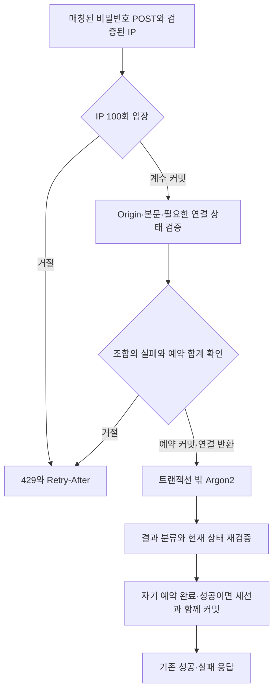

# 비밀번호 로그인 시도 제한 보완 - Plan

## Goal Capsule

- **Objective:** 다른 IP에서 발생한 로그인 실패 때문에 정상 사용자가 자신의 계정에 로그인하지 못하는 문제를 해결한다.
- **Means:** 이메일+IP의 실패 예산과 IP 전체 요청 예산을 분리하고, 검사 중 요청을 임시 예약한다(KTD1, KTD2).
- **Authority:** Issue #8의 U02·R1-R3/R43-R45와 사용자 승인 보완 정책을 적용한다. MVP 원본 계획의 다른 요구사항은 변경하지 않는다.
- **Execution:** 같은 Issue #8의 하위 작업 8-7이다. 최종 계획 승인 후 Codex가 test-first로 구현하며, Claude 독립 리뷰·수정·재검토와 별도 커밋 승인을 거친다.
- **Stop conditions:** 동시성 보장, 결과 분류 또는 기존 인증 계약을 지킬 수 없으면 원인을 보고하고 구현을 중단한다. 배포·push·PR은 별도 승인 대상이다.

---

## Product Contract

### Summary

비밀번호 로그인과 계정 연결의 비밀번호 확인에 동일한 제한을 적용한다. 같은 이메일의 다른 IP는 실패 횟수를 공유하지 않으며, 같은 IP의 전체 요청에는 별도 상한을 둔다. 이 문서는 MVP 전체를 다시 정의하지 않고 U02의 로그인 제한만 보완한다.

### Problem Frame

현재 두 비밀번호 경로는 IP와 이메일 각각의 요청 횟수를 선소모한다. 공격자가 피해자의 이메일로 요청하면 다른 IP의 올바른 로그인도 제한되며, 성공 요청도 실패처럼 예산을 소모한다. 실패 이후에만 횟수를 더하는 단순 변경은 여러 요청이 동시에 마지막 검증 기회를 사용하는 문제를 남긴다.

### Key Decisions

- **조합별 실패와 IP 전체 요청 분리.** 전역 이메일 잠금으로 타인의 로그인을 막는 경로를 제거한다. Governs R1, R2, R3. (session-settled: user-approved — chosen over global email-only lockout: reduce cross-IP denial while accepting distributed guessing and shared-IP effects.)
- **진행 중 검증의 임시 예약.** 실패가 확정되기 전의 일시 차단과 서버 중단 시 현재 창 만료까지의 점유를 허용한다. Governs R4, R5. (session-settled: user-approved — chosen over post-verification counting alone: prevent concurrent requests from sharing the last available attempt.)
- **기존 인증과 화면 보존.** CAPTCHA·새 서비스·가입 디자인 변경은 포함하지 않는다. Governs R6, R7. (session-settled: user-approved — chosen over adding another authentication service: keep this correction within the current MVP.)

### Requirements

아래 R-ID와 U-ID는 이 보완 계획 안의 식별자다. 상위 계획의 U02·R1-R3/R43-R45를 대체하거나 다시 번호 매기지 않는다.

**Count and admission**

| ID  | 요구사항                                                                                                                                                          |
| --- | ----------------------------------------------------------------------------------------------------------------------------------------------------------------- |
| R1  | 정규화한 이메일+검증된 IP 조합별 인증 실패를 15분 고정 창에서 10회까지 허용한다. 이메일 단독 전체 잠금은 적용하지 않는다.                                         |
| R2  | 같은 IP의 두 비밀번호 POST 경로를 합산해 15분 고정 창에서 요청 100회까지 허용한다. 성공·실패·조합 차단·본문 오류·Origin 거절·무효 연결 상태도 IP 요청에 포함한다. |
| R3  | 성공은 해당 조합의 확정 실패만 초기화한다. 다른 조합과 IP 전체 요청 횟수는 바꾸지 않는다.                                                                         |
| R4  | 입장 시 `확정 실패 + 진행 중 예약 < 10`을 원자적으로 확인한다. 허용 시 예약하고, 차단 시 비밀번호를 검사하지 않는다.                                              |
| R5  | 차단 요청과 완료 처리로 창 만료를 연장하지 않는다. 프로세스 종료로 남은 예약도 원래 창 만료 이후 입장을 막지 않는다.                                              |

**Compatibility and privacy**

| ID  | 요구사항                                                                                                                                       |
| --- | ---------------------------------------------------------------------------------------------------------------------------------------------- |
| R6  | 가입·인증 재발송·재설정의 기존 제한과 인증·세션·명시적 계정 연결 계약을 보존한다. 내부 결과 분류를 늘려도 정상 HTTP 본문·쿠키 계약은 유지한다. |
| R7  | 기존 UI와 429/Retry-After 표현을 사용한다. 새 CAPTCHA·외부 서비스·라이브러리는 추가하지 않는다.                                                |
| R8  | 제한 상태에는 이메일·IP 원문 대신 환경 비밀 기반 HMAC을 저장한다. 비밀번호·쿠키·인증 토큰과 조합 원문을 로그·보고서에 추가하지 않는다.         |

### Acceptance Examples

- AE1. 이메일 A+IP1의 10회 실패 후 같은 조합의 다음 검증은 429이고, A+IP2의 올바른 로그인은 성공한다. Covers R1, R2.
- AE2. 실패 9회에서 검증 1개를 멈춘 동안 같은 조합의 추가 요청은 검사에 들어가지 않는다. 멈춘 요청이 성공하면 그 조합의 실패는 0이며 다른 진행 중 예약은 남는다. Covers R3, R4.
- AE3. IP 요청이 99회일 때 서로 다른 이메일의 동시 요청 중 하나만 100번째 입장을 허용한다. Covers R2.
- AE4. 원래 창이 만료된 뒤 새 창을 만든 다음 이전 창의 성공·실패를 완료해도 새 횟수와 만료는 바뀌지 않는다. Covers R5.
- AE5. 로그인과 연결용 비밀번호 확인을 번갈아 요청하거나 연결 쿠키를 새로 발급받아도 동일 조합의 예산은 새로 생기지 않는다. Covers R1, R6.

### Scope Boundaries

8-6의 가입 인증번호·미인증 가입 전환과 Figma 작업은 별도다. Issue #9, SQL 전체 포맷팅 Issue #22, 풀 크기 확대, 일반 rate limiter의 전면 재작성, 서버 전체 Argon2 작업 큐, 새 모니터링 서비스는 포함하지 않는다. 이 제한만으로 여러 IP 공격이나 서버 전체 계산량의 절대 상한을 보장하지 않는다.

---

## Planning Contract

### Key Technical Decisions

- KTD1. **로그인 전용 저장과 모듈.** `login-rate-limit.ts`와 새 `auth_password_login_limits` 테이블을 사용한다. 기존 `auth_rate_limits`를 다른 인증 경로가 계속 사용하므로 상태와 정리를 분리한다. 기존 login 행은 새 정책에서 읽지 않는다. 기존 행의 요청 수를 새 실패 수로 변환하지 않는다.
- KTD2. **짧은 입장 예약.** IP 계수는 독립적으로 커밋하고 조합 예약은 별도의 짧은 트랜잭션으로 확정한다. 연결을 반환한 후 Argon2를 실행한다. R4의 동작을 수행하는 최소 상태만 추가한다. (session-settled: user-approved — chosen over post-verification counting alone: pending verification must temporarily occupy the remaining attempt budget.)
- KTD3. **완료 시점 순서.** 같은 유효 창의 결과를 DB 확정 순서로 적용한다. 성공은 그 시점의 확정 실패를 0으로 만들고 자기 예약만 해제한다. 다른 예약은 보존한다. A/B 입장→A 성공→C 실패→B 성공이면 마지막 성공으로 C 실패가 초기화된다. 이는 R3의 성공 초기화를 따르며, 입장 세대를 이유로 성공 초기화를 생략하는 별도 정책을 만들지 않는다.
- KTD4. **만료 창 분리.** 각 창과 각 예약에 서버가 생성한 UUID를 사용한다. 완료는 원래 창·자기 예약의 소유권을 확인한 한 번만 반영한다. 이전 창 완료는 새 창을 변경하지 않는다. SQL 타임스탬프를 JS Date로 왕복해 창 식별자로 사용하지 않는다.
- KTD5. **성공과 세션의 원자성.** 사용자·identity·필요한 연결 상태를 기존 순서로 잠그고 재검증한 뒤 조합 완료를 같은 짧은 트랜잭션에 넣는다. 사용자/identity/연결 상태 → 제한 행 순서를 유지하고 반대 순서로 계정 행을 얻는 경로를 만들지 않는다. 커밋 후에만 쿠키를 보낸다.
- KTD6. **검증 결과와 운영 오류 구분.** 아래 결과 분류표를 따른다. 내부 DB·해시 오류를 비밀번호 실패로 바꾸지 않고, 예약을 해제할 수 없으면 원래 창 만료로 회복한다. 브라우저가 연결을 끊어도 계속 실행 중인 검증의 예약을 먼저 해제하지 않는다.
- KTD7. **창의 시간과 정리.** IP·조합 창은 각각 최초 허용 입장부터 15분이다. 행 잠금을 얻은 뒤 DB의 실제 현재 시각을 한 번 읽어 판정한다. 만료된 현재 키는 입장 중 직접 새 창으로 바꾸므로 별도 정리 성공에 복구가 의존하지 않는다. IP 허용 트랜잭션에서 만료 인덱스·SKIP LOCKED를 이용해 한 번에 최대 128행만 정리한다. 전체 만료 집합 DELETE나 새 worker는 만들지 않는다.

### Data and lifecycle

새 테이블은 주체 종류(IP 또는 이메일+IP)와 HMAC의 복합 키, 창 UUID·시작·만료, 횟수, 진행 중 예약 UUID 배열을 가진다. IP 행의 횟수는 전체 요청이고 예약은 비어 있다. 조합 행의 횟수는 확정 실패이며 배열 길이는 최대 10이다. DB에서 주체 종류, hash 형식, 유효한 기간, 음수 금지, IP 최대 100, 조합 횟수+예약 최대 10, IP의 예약 금지를 강제한다. NULL·다차원 예약 배열을 거부한다. 서버만 예약 ID를 만들고 같은 ID를 중복 추가하지 않는 조건부 변경을 사용한다.

다음 표는 상태 전이의 방향을 설명하며 최종 SQL 명세가 아니다.

| 사건                       | 횟수와 예약                                | 창                         |
| -------------------------- | ------------------------------------------ | -------------------------- |
| IP 입장                    | 100 미만이면 1 증가, 조합 처리와 독립 커밋 | 유효 창 유지               |
| 조합 입장                  | 실패+예약이 10 미만이면 자기 예약 추가     | 유효 창 유지               |
| 인증 실패 확정             | 자기 예약을 제거하고 실패 1 증가           | 원래 창만 변경             |
| 정상 인증 확정             | 자기 예약을 제거하고 실패 0                | 다른 예약·만료 유지        |
| 취소 가능한 오류·무효 상태 | 자기 예약만 제거                           | 만료 유지                  |
| 창 만료 후 입장            | 횟수·예약 초기화, 새 창 UUID               | 잠금 후 현재 시각부터 15분 |
| 중복·이전 창 완료          | 횟수 변경 없음                             | 새 창 변경 없음            |

원래 창이 만료된 뒤 검증이 완료되면 제한 기록은 no-op다. 자격 증명·사용자·연결 상태가 현재도 유효하면 이미 허용했던 요청의 정상 인증은 보존한다. 반면 원래 창이 아직 유효한데 자기 예약을 찾지 못하는 비정상 완료는 정상 성공으로 처리하지 않는다. 성공 초기화의 DB 오류도 세션과 함께 롤백한다. 성공 커밋 뒤 재전송된 완료가 다시 횟수를 지우거나 실패를 더하지 않도록 한다.

### Result classification

| 결과                                                       | 조합 처리                             | 외부 응답                                 |
| ---------------------------------------------------------- | ------------------------------------- | ----------------------------------------- |
| 없는 이메일·잘못된 비밀번호·미인증 password identity       | 실패 1 확정                           | 기존 일반 401, 미등록도 dummy Argon2 유지 |
| `authenticated`                                            | 정상 인증 확정                        | 기존 로그인 세션·200                      |
| 유효한 `account_link_required`                             | 정상 비밀번호 증명으로 확정           | 기존 연결 세션·200; 자동 계정 연결 아님   |
| 연결 쿠키·동의·연결 상태가 입장 전에 무효                  | 조합 예약 없음                        | 기존 오류 계약; IP는 소비                 |
| 올바른 검증 후 해시·identity·연결 유효성이 경합으로 달라짐 | 자기 예약 해제, 실패 증가·초기화 없음 | 기존 401 또는 연결 필요 응답              |
| DB·Argon2·세션 생성 오류                                   | 가능한 경우 자기 예약 해제            | 기존 서버 오류, 정상 세션 발급 없음       |

### Request boundary and Retry-After

검증된 `request.clientAddress`를 설정한 상위 훅 뒤, 인증 plugin의 Origin 거절·본문 파싱 앞에서 매칭된 `/auth/login`·`/auth/link/password` POST만 IP에 집계한다. 매칭 경로 메타데이터로 식별해 query 유무와 무관하게 한 번만 센다. GET·OPTIONS·다른 인증 경로는 새 예산에 넣지 않는다. IP 초과의 429는 뒤의 400/403/401보다 먼저 반환한다.

IP가 막히면 조합은 읽지 않는다. 조합 차단은 IP 집계를 되돌리지 않는다. 429의 Retry-After는 차단한 고정 창의 남은 시간(초, 최소 1)을 반환한다. 예약 차단은 다른 요청의 완료로 더 일찍 풀릴 수 있으므로 이 값은 안전한 상한이며 정확한 완료 예측이 아니다.

### Flow sketch

### Migration and operational limits

새 Drizzle migration을 추가하고 기존 migration은 수정하지 않는다. 스키마 검증·테스트 DB reset 목록도 새 테이블을 포함한다. 실제 배포는 이번 작업에서 하지 않는다. 향후 배포 시 스키마를 먼저 적용하고 API를 교체한다. 구·신 API가 섞여 있는 동안은 구버전의 전역 이메일 제한이 남으므로 개선 완료로 판단하지 않는다. 신규 제한은 새 저장소에서 시작하므로 전환 시 로그인 예산이 한 번 새로 부여된다. 다른 인증 제한은 유지된다. 구버전으로 되돌리면 새 테이블을 삭제하지 않지만 이전 잠금 동작이 돌아온다.

기존 일반 제한을 재사용하는 안은 결과 롤백·의미가 다른 과거 수치·공통 만료 삭제와 결합된다. 실패만 사후 증가하는 안과 해시 동안 DB 잠금을 보유하는 안은 R4 또는 연결 반환 원칙을 충족하지 못하므로 선택하지 않는다. 살아남은 동등한 설계 후보를 새로 개발해야 하는 상황이 아니어서 별도 구현 경쟁 실험은 하지 않는다.

---

## Implementation Units

세 단위는 하나의 8-7 전달 범위를 구성한다. 저장소·호출부·회귀 검증을 함께 완료하기 전 중간 상태를 배포하지 않는다.

### U1. 로그인 전용 예산과 예약 상태

- **Requirements:** R1-R5, R8; KTD1-KTD4, KTD7.
- **Depends on:** 기존 U02 인증·DB migration 기반.
- **Files:** 새 `apps/api/src/modules/auth/login-rate-limit.ts`, 새 `apps/api/src/modules/auth/login-rate-limit.test.ts`, `apps/api/src/modules/auth/schema.ts`, `apps/api/src/modules/auth/schema.test.ts`, `apps/api/drizzle/`의 새 migration·meta, `apps/api/test/support/auth-database.ts`, `apps/api/test/integration/database.test.ts`, 새 `apps/api/test/integration/auth-login-rate-limit.test.ts`.
- **Approach:** 전용 테이블·HMAC 도메인과 모호하지 않은 조합 직렬화를 추가한다. IP 계수, 조합 예약, 결과 완료와 제한된 만료 청소를 짧은 DB 작업으로 분리한다. 과거 로그인 횟수는 읽지 않는다.
- **Execution note:** 경계·동시 입장의 의도한 실패를 먼저 확인한 뒤 최소 구현한다.
- **Test scenarios:** AE1-AE4, 빈 행 동시 생성, 중복 예약·완료, DB 제약 거절, 프로세스 중단 뒤 원래 창 만료로 회복, 원문 부재·비밀별 digest 분리, 잠금 대기 중 만료, 이전 창 완료·동시 정리, 예약 차단에도 IP 증가를 실제 PostgreSQL 별도 연결로 검증한다.
- **Verification:** 실패 9+예약 1과 IP99의 경쟁에서 추가 검증이 한도를 넘지 않으며 청소 없이도 만료 키를 재사용한다.

### U2. 두 비밀번호 경로의 결과·세션 통합

- **Requirements:** R1-R8; KTD2-KTD6.
- **Depends on:** U1.
- **Files:** `apps/api/src/modules/auth/routes.ts`, `apps/api/src/modules/auth/routes.test.ts`, `apps/api/src/modules/auth/service.ts`, `apps/api/src/modules/auth/service.test.ts`, `apps/api/test/integration/auth-password.test.ts`, `apps/api/test/integration/auth-account-link.test.ts`, `apps/api/test/integration/auth-login-rate-limit.test.ts`.
- **Approach:** 본문 전 IP 집계와 두 handler의 조합 입장을 연결한다. 내부 결과를 구분하되 기존 직접 호출 fixture·HTTP 응답을 유지한다. 정상 완료와 세션 변경을 같은 트랜잭션에서 처리하고 users 우선 잠금과 현재 해시 재검증을 보존한다.
- **Execution note:** HTTP 회귀와 성공·실패 분류를 먼저 실패시킨 뒤 연결한다. 제품 코드에 테스트 전용 우회 경로를 만들지 않는다.
- **Test scenarios:** AE1·AE2·AE5, 정상 세션·연결 필요 200, 미등록·미인증 401, 연결 만료·해시 변경 경합, malformed JSON·스키마·Origin·쿠키 거절의 IP 소비, query·메서드·다른 경로 제외, 동일 요청 이중 집계 부재, 해시 중 풀 연결 반환, 완료 DB 오류 때 쿠키 미발급, 성공/실패 완료 순서 교차를 검증한다.
- **Verification:** 두 경로 사이 예산 우회가 없고 성공이 다른 조합·IP 예산·진행 중 예약을 지우지 않는다.

### U3. 통합 회귀와 전달 근거

- **Requirements:** R1-R8.
- **Depends on:** U1, U2.
- **Files:** `apps/api/test/integration/auth-login-rate-limit.test.ts`, `apps/api/test/integration/auth-email-rate-limit.test.ts`, `apps/api/test/integration/health.test.ts`, `apps/api/test/integration/database.test.ts`, `tests/e2e/auth-ui.spec.ts`, `docs/issue-reports/issue-8.md`, `status.md`.
- **Approach:** 결정적 장벽과 복수 pool로 API 인스턴스 간 경합을 재현한다. 다른 인증 scope와 기존 프록시 주소 신뢰·세션 흐름을 회귀 검증한다. 기존 E2E 파일에서 영향받는 경로를 확인하고 필요한 회귀만 추가한다. 전달 보고에는 실제 결과와 미실행 항목을 구분한다.
- **Test scenarios:** A/B 성공·C 실패 완료 순서, 만료 후 이전 성공·실패, 요청 중단과 서버 예외, IP와 조합의 별도 만료, 기존 가입·재전송·재설정 한도, 다른 IP의 로그인 가능, 기존 429 안내와 로그아웃·재로그인을 확인한다.
- **Verification:** 아래 검증과 독립 리뷰가 실제로 완료되고, 보류된 가입 문제를 해결했다고 표현하지 않는다.

---

## Verification Contract

| 검증           | 명령·범위                                                                                                                                                                                             | 확인할 결과                                                       |
| -------------- | ----------------------------------------------------------------------------------------------------------------------------------------------------------------------------------------------------- | ----------------------------------------------------------------- |
| 집중 단위      | `pnpm exec vitest run apps/api/src/modules/auth/login-rate-limit.test.ts apps/api/src/modules/auth/routes.test.ts apps/api/src/modules/auth/service.test.ts apps/api/src/modules/auth/schema.test.ts` | 새 동작 Red/Green, 해시 중 DB 미점유·결과 분류                    |
| 실DB 통합      | `pnpm test:integration`                                                                                                                                                                               | 테스트 DB 안전 guard, 새 migration·다중 연결 경합·기존 scope 회귀 |
| 전체 단위      | `pnpm test`                                                                                                                                                                                           | 기존 계약·API·웹 회귀 없음                                        |
| 타입·린트·포맷 | `pnpm typecheck`, `pnpm lint`, `pnpm format:check`                                                                                                                                                    | 새 schema·함수·테스트·문서 검사 통과                              |
| 빌드           | `pnpm build`                                                                                                                                                                                          | API와 웹 빌드 통과                                                |
| E2E            | `pnpm test:e2e`                                                                                                                                                                                       | 기존 인증 핵심 흐름·429 계약·세션 회귀 통과                       |
| 독립 리뷰      | native `/code-review high`와 수정 후 대상 재검토                                                                                                                                                      | 미커밋 코드·신규 파일·문서와 모든 지적 처분 확인                  |

실DB 명령은 `TEST_DATABASE_URL`과 기존 `amuq_test` 안전 검사를 통과해야 한다. DB 접속값은 출력하지 않는다. 실행 시 필요하면 Windows에서는 기존 `.cmd` 진입점을 사용한다. UI 변경이 없으므로 새 Figma 비교·시각 audit는 적용하지 않으며, UI 변경이 필요해지면 범위를 보고한다. 예전 테스트 통과 수를 이번 구현의 통과 결과로 재사용하지 않는다.

---

## Definition of Done

R1-R8과 AE1-AE5를 실제 테스트로 증명하고 관련 검증을 통과한다. 확정 실패·예약·IP 요청·창 만료가 실DB 경쟁에서도 정의한 의미를 유지해야 한다. 새로운 원문 식별자·민감 로그·승인 없는 UI/서비스 변경이 없어야 한다. 실험하다 버린 코드와 불필요한 테스트 전용 경로는 제거한다.

구현·검증 이후 Claude 독립 리뷰와 모든 처분의 재검토를 받고, 사용자에게 결과를 보고한 뒤 정확한 변경의 로컬 커밋 승인을 별도로 받는다. 이 계획의 승인이나 8-7 완료가 Issue #8 전체 완료·PR 승인은 아니다. 8-6 가입 보안 수정과 이후 전체 Issue CE 리뷰가 남는다.

---

## Sources

- [Issue #8](https://github.com/sysysysyb/AMUQ/issues/8), 상위 `docs/plans/2026-09-09-0037-feat-amuq-mvp-requirements-plan.md`의 U02와 Verification Contract.
- `docs/solutions/architecture-patterns/authenticate-client-address-across-hosted-proxies.md`: 검증된 IP의 신뢰 경계.
- `docs/solutions/architecture-patterns/keep-authentication-transactions-short-and-lock-users-first.md`: Argon2 밖 트랜잭션, users 우선 잠금·잠금 뒤 재검증.
- `docs/solutions/architecture-patterns/equalize-anonymous-authentication-response-timing.md`: 미등록 계정 처리와 일반화된 실패 응답. 이메일용 응답 지연을 로그인에 복제하지 않는다.
- [PostgreSQL 17 격리](https://www.postgresql.org/docs/17/transaction-iso.html#XACT-READ-COMMITTED), [행 잠금](https://www.postgresql.org/docs/17/explicit-locking.html#LOCKING-ROWS), [현재 시각](https://www.postgresql.org/docs/17/functions-datetime.html#FUNCTIONS-DATETIME-CURRENT): 입장 원자성·시각 재평가의 근거.
- [node-postgres 트랜잭션](https://node-postgres.com/features/transactions): 같은 클라이언트로 커밋하고 해시 전에 연결 반환.
- [Fastify 5.12.5 Hooks](https://raw.githubusercontent.com/fastify/fastify/v5.12.5/docs/Reference/Hooks.md): 본문 파싱 전 IP 집계의 위치.
- [OWASP Authentication](https://cheatsheetseries.owasp.org/cheatsheets/Authentication_Cheat_Sheet.html#login-throttling): 제한과 계정 잠금의 서비스 거부 위험. 이번 조합·예약 알고리즘 자체를 OWASP 권고로 표시하지 않는다.
