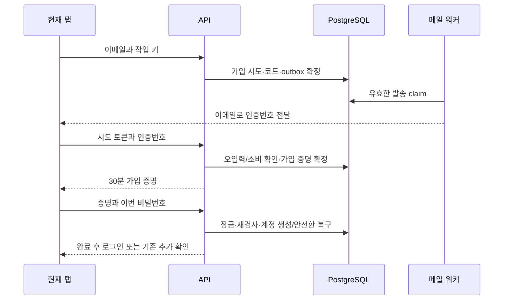
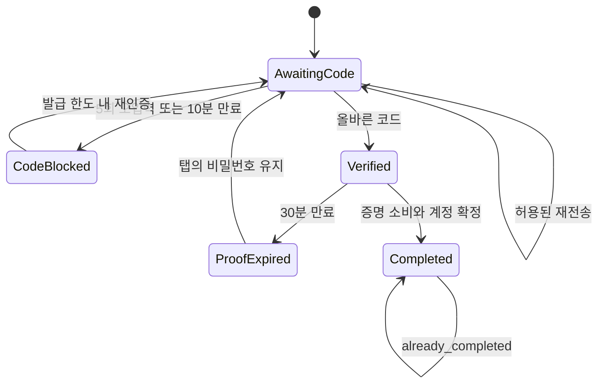

# 이메일 소유권 확인 후 가입 - Plan

## Goal Capsule

- **Objective:** 이메일 소유자가 타인의 선점 비밀번호를 활성화하지 않고 자기 비밀번호로 가입하거나 Google로 안전하게 진입할 수 있게 한다.
- **Means:** 가입 전 소유권 확인과 최종 계정 생성을 분리한다(KTD1–KTD4).
- **Authority:** Issue #8의 U02와 상위 R1–R3/R43–R45를 보완한다. 이 문서의 R/U/AE 번호는 이 보완 범위의 식별자다.
- **Boundary:** 가입 보안과 필요한 화면 동작만 변경한다. 시각적 차이는 사용자가 나중에 수동 수정하기로 했으며 새 Figma 작업은 하지 않는다.
- **Execution:** 제품 변경은 계획 승인 후 Codex가 TDD로 수행한다. 독립 Claude 리뷰·재검토와 정확한 변경의 커밋 승인은 기존 AGENTS.md를 따른다.

---

## Product Contract

### Summary

이메일 인증번호 확인을 끝낸 뒤 사용자가 정한 비밀번호를 저장한다. 기존 미인증 비밀번호와 구 인증 링크는 소유자의 새 인증으로 되살리지 않는다. 기존 정상 계정의 추가 인증수단 연결은 별도 본인 확인을 유지한다.

### Problem Frame

현재 `registerPasswordUser`는 소유권 확인 전에 사용자와 비밀번호를 만들고, `verifyEmailAddress`는 메일 링크로 그 비밀번호를 인증한다. 따라서 공격자가 먼저 입력한 비밀번호가 소유자의 클릭으로 활성화된다. 같은 미인증 계정은 정당한 Google 가입도 막는다.

### Key Decisions

- **가입 전에 이메일을 확인한다.** Governs R1, R5. (session-settled: user-approved — chosen over activating a password stored before ownership verification: prevent pre-account takeover.)
- **입력은 현재 탭에서만 유지한다.** Governs R2, R4. (session-settled: user-directed — chosen over refresh restoration and browser storage: re-verify in the same screen without persisting passwords.)
- **기존 재전송 제한을 유지한다.** Governs R3. (session-settled: user-approved — chosen over resetting the budget after code expiry: retain the existing one-hour restriction.)
- **추가 디자인 보완은 수동 작업으로 넘긴다.** Governs R4. (session-settled: user-directed — chosen over another automated visual refinement pass: finish Issue #8 without extending design work.)

### Requirements

**소유권과 시간**

| ID  | 요구사항                                                                                                                                                                                           |
| --- | -------------------------------------------------------------------------------------------------------------------------------------------------------------------------------------------------- |
| R1  | 인증 전에는 사용자·비밀번호 identity를 만들지 않는다. 이메일 인증번호는 앞자리 0을 포함할 수 있는 6자리 숫자이며 발급 후 10분, 오입력 5회까지 유효하다.                                            |
| R2  | 인증 성공 시 해당 이메일의 가입에만 쓸 수 있는 별도 증명을 발급한다. 유효시간은 성공 시각부터 30분이며 반복 응답으로 연장하지 않는다.                                                              |
| R3  | 재전송은 마지막 발급부터 60초 후, 첫 재전송부터 1시간에 최대 3회다. 기존 IP·이메일 발송 제한도 유지하며 새 요청·새 탭·새 challenge로 예산을 초기화하지 않는다.                                     |
| R4  | 증명 만료 시 같은 화면에서 비밀번호·확인 입력을 유지하고 재인증한다. 새로고침 복원·브라우저 저장소 저장은 제외한다. 기존 컴포넌트로 필요한 동작과 접근성을 구현하고 시각적 차이는 별도로 기록한다. |

**계정 전환과 보호**

| ID  | 요구사항                                                                                                                                                                                                    |
| --- | ----------------------------------------------------------------------------------------------------------------------------------------------------------------------------------------------------------- |
| R5  | 최종 제출은 증명에서 이메일을 결정하며 사용자가 이번에 입력한 비밀번호만 저장한다. 증명·계정 생성은 원자적으로 처리하고 중복 제출이 계정을 추가하거나 비밀번호를 바꾸지 못하게 한다.                        |
| R6  | 기존 미인증 password-only 계정은 소유권 확인 후 선점 비밀번호를 폐기하여 복구한다. 기존 인증 계정·Google identity·사용자 데이터는 일괄 삭제하거나 덮어쓰지 않는다.                                          |
| R7  | Google은 검증된 OIDC sub를 우선한다. 엄격히 확인한 미인증 password-only 잔여 계정만 복구하며, 정상 계정은 이메일 일치만으로 연결하지 않는다.                                                                |
| R8  | 구 가입·이메일 링크 검증 경로로 미인증 비밀번호를 활성화할 수 없어야 한다. 비밀번호 재설정 30분, 기존 세션 정책과 8-7 로그인 제한은 보존한다.                                                               |
| R9  | OTP·증명·비밀번호 원문을 DB·로그·보고서에 남기지 않으며 비밀번호는 기존 Argon2id 해시만 저장한다. 인증 전에는 계정 존재·로그인 방식을 공개하지 않는다. 발송 재시도는 기존 payload·키·claim 조건을 보존한다. |

### Acceptance Examples

- AE1. Covers R1, R5, R6. 공격자가 피해 이메일과 자기 비밀번호를 먼저 제출해도 계정이 생성되지 않는다. 소유자가 인증 후 고른 비밀번호만 로그인에 사용된다.
- AE2. Covers R2, R4. 인증 성공 30분 뒤 제출하면 비밀번호 입력은 남고 재인증이 필요하다. 새로고침하면 입력·가입 증명은 복원되지 않는다.
- AE3. Covers R3. 재전송 3회를 소진한 뒤 코드까지 만료되면 새 challenge도 한도를 우회하지 못하며 서버가 계산한 다음 가능 시각을 안내한다.
- AE4. Covers R6–R8. 옛 링크 클릭으로 선점 비밀번호가 활성화되지 않는다. 실제 이메일 소유자의 OTP 복구와 검증된 Google 진입은 정상 계정을 덮어쓰지 않는다.
- AE5. Covers R5, R9. 완료 응답을 잃고 재시도해도 비밀번호가 다시 저장되지 않는다. 이미 처리된 경우임을 명시하고 로그인으로 복구한다.

### Scope Boundaries

- 기존 정상 계정 연결·비밀번호 재설정·세션·프록시 신뢰 경계는 회귀 검증 대상이며 새 정책을 만들지 않는다.
- CAPTCHA, 신규 인증 서비스, 저장소 기반 입력 복원, 일반 인증 프레임워크 추출은 만들지 않는다. 이 변경에 필요하지 않다.
- 프로젝트 폴더의 DB 백업 파일이나 자동 스냅샷 체계는 추가하지 않는다. 필요한 것은 Drizzle 스키마 변경 이력뿐이다.

### Product Contract Preservation

상위 U02의 R1/R3/R43/R44를 구체화하고 기존 24시간 가입 링크를 R1–R2의 단계로 교체하는 범위다. 상위 R2의 삭제·메일 보존, R45의 일반 수명 주기와 다른 MVP 단위는 변경하지 않는다. 이 보완 계획은 사용자 승인된 기능 계약이며 U2에서 GitHub Issue·상위 계획·DESIGN의 구 조항을 동기화한다. Figma 초안의 시각적 일치 승인을 뜻하지 않는다.

---

## Planning Contract

### Key Technical Decisions

- KTD1. **사용자 없는 가입 시도와 발급 세대를 분리한다.** 신규 `auth_signup_attempts`는 이메일·요청 토큰 해시·가입 증명 상태를, `auth_signup_codes`는 시도 FK·발급 세대·코드 digest·키 식별자·만료·오입력·폐기 상태를 가진다. 발급 ID·코드·수신자·만료 등 메일 재구성 입력을 고정하고 오입력·소비 상태만 갱신한다. Governs R1–R3, R9.
- KTD2. **기존 비밀키 기반 재구성 방식을 재사용한다.** 서버 비밀키와 signup 용도·시도·발급 ID를 구분해 OTP를 파생하고, 고정 길이 HMAC digest로 검증한다. 별도 가입 증명은 충분히 긴 opaque 값으로 파생하며 DB에는 해시만 둔다. OTP와 증명의 도메인을 분리하고 현재/이전 키 식별자를 적용한다. 원문 저장이나 새 암호화 서비스는 필요 없다. Governs R1, R2, R9.
- KTD3. **outbox에는 두 가지 발송 원천만 허용한다.** `source_kind`로 구 token과 가입 code를 구분하고 대기 중인 메일은 `token_id`와 `signup_code_id` 중 정확히 하나만 참조하도록 FK·CHECK·유일성을 둔다. 종료된 가입 메일은 인증 자료 삭제 뒤 code FK가 비어도 발송 ID·상태·webhook 이력을 보존하며, 참조 없는 행을 pending으로 되돌릴 수 없다. reset/link 메일의 기존 경로는 유지하고 OTP 수신자는 발급 코드에 고정한다. 새 코드에는 새 outbox를 만들며 기존 행의 본문을 바꾸지 않는다. (session-settled: user-approved — 만료 인증 자료와 최소 발송 이력을 분리하도록 재검토 후 승인.) Governs R8, R9.
- KTD4. **기존 사용자와 경쟁하는 변경은 같은 잠금 순서를 쓴다.** 최종 가입은 기존 Google identity advisory lock → 이메일별 transaction advisory lock → 기존 users → 가입 시도/발급 → 토큰·identity 순서다. 발급/재전송은 이메일 lock → 시도/발급 순서이며 users를 변경하지 않는다. 모든 경로가 이 역순으로 잠금을 추가하지 않게 한다. UNIQUE는 마지막 방어선이며 Argon2·외부 발송은 트랜잭션 밖에 둔다. 잠금과 해싱 뒤 최신 시각으로 만료·상태를 재검사한다. Governs R3, R5–R7.
- KTD5. **증명과 비밀번호는 탭 메모리에 둔다.** React 상태로 값을 유지하고 요청 세대 번호로 이메일 변경·새 요청 뒤 도착한 응답을 버린다. 다른 이메일로 변경하면 이전 인증 증명을 폐기한다. 공유 쿠키·localStorage·sessionStorage로 가입 증명을 보존하지 않는다. Governs R2, R4. (session-settled: user-directed — chosen over refresh-restorable storage: retain current-tab work without storing passwords.)
- KTD6. **진행 중 요청 재시도는 이미 확정한 결과를 재사용한다.** 요청/재전송의 작업 키를 탭에 유지하고 해시로 중복 발급을 막는다. 검증 응답 유실 시 같은 유효 코드로 원래 증명·만료를 돌려주며 새 30분을 시작하지 않는다. 최종 증명이 이미 소비됐다면 새로운 입력을 저장하지 않고 `already_completed`와 로그인 안내를 준다. 이는 변경된 비밀번호가 적용됐다는 성공 응답과 구별한다. Governs R2, R3, R5.

### API Boundaries

모든 변경 요청은 기존 Origin 검사·본문 schema·인증값 비노출 경계를 따른다. 아래 계약은 API와 웹을 같은 변경 단위에서 연결한다.

| 경로                                                                   | 입력과 결과                                                                                                                                  |
| ---------------------------------------------------------------------- | -------------------------------------------------------------------------------------------------------------------------------------------- |
| `POST /auth/signup/challenges`                                         | 이메일·작업 키 → 계정 상태를 드러내지 않는 202와 opaque 시도 토큰·코드 만료·재전송 가능 시각. 비밀번호를 받지 않는다.                        |
| `POST /auth/signup/challenges/resend`                                  | 시도 토큰·작업 키 → 새 발급 세대 또는 429/서버 재시도 시각.                                                                                  |
| `POST /auth/signup/challenges/verify`                                  | 시도 토큰·6자리 코드 → 가입 증명·원래 증명 만료. 소유권 확인 뒤에만 기존 계정 안내를 구별한다.                                               |
| `POST /auth/signup/complete`                                           | 가입 증명·비밀번호 → 생성 완료, 기존 계정 안내, 추가 Google 확인 또는 `already_completed`. 클라이언트 user ID·이메일로 대상을 고르지 않는다. |
| 기존 `/auth/signup`, `/auth/verify-email`, `/auth/resend-verification` | U2 전환 시 구 활성화 동작을 종료한다. 구 화면은 토큰을 새 증명으로 교환하지 않고 새 가입으로 안내한다.                                       |

코드 불일치에는 잔여 횟수, 코드/증명 만료에는 구별 가능한 상태를 제공한다. 발송 요청의 익명 응답은 기존 공통 처리·최소 응답 시간 관례를 유지하며 경합 지연까지 같다고 보장하지 않는다.

### Quotas and Replay

- OTP 오입력은 발급 세대별로 센다. 새 코드는 새 5회를 갖지만 R3의 이메일·IP 발급 예산을 공유하므로 무제한 초기화되지 않는다. 다른 시도의 코드나 구 발급 세대는 사용할 수 없다.
- 발급은 이메일 lock 아래에서 직렬화한다. 같은 이메일의 기존 발급 기록이나 활성 재전송 창이 있으면 새 시작 요청도 재전송 예산을 사용한다. 두 창이 모두 끝나기 전에는 새 시도에 무료 최초 발송을 부여하지 않는다.
- 마지막 발급 시각과 두 subject의 한도 만료 중 가장 늦은 시각을 사용해 재시도 가능 시각을 계산한다. 한도 초과 요청은 메일을 enqueue하지 않고 차단으로 창을 연장하지 않는다.
- 수락된 작업 키의 재시도는 코드·발송·예산을 추가 소비하지 않는다. 기존 정책처럼 admission 단계에서 확정된 요청 예산은 후속 발송 트랜잭션 실패로 되돌리지 않는다. 잘못된 코드 횟수도 오류 응답 전에 commit해야 하므로 트랜잭션 내부에서 예외를 던져 증가분을 rollback하지 않는다.
- 검증 성공·가입 증명 소비·재전송은 잠근 최신 상태로 판단한다. 만료된 증명은 새 OTP 검증으로만 교체하고 익명 재전송만으로 다른 시도의 유효한 가입 증명을 무효화하지 않는다.
- 새 시도의 초기 응답까지 잃는 경우도 작업 키로 복구한다. 동일 키의 다른 이메일·작업은 충돌로 거절한다.

### Legacy and Google Transition

- 구 password-only 잔여 상태는 `users.email_verified_at IS NULL`, password `verified_at IS NULL`, 다른 인증 identity 없음으로 엄격히 분류한다. 데이터 일괄 삭제 대신 검증된 소유자의 완료 트랜잭션에서 비밀번호를 교체하고 기존 user ID를 보존한다. 옛 토큰·세션·연결 증명은 폐기한다.
- 검증된 Google 소유자의 같은 잔여 계정 복구는 이전 password identity만 제거하고 새 Google sub를 등록한다. 기존 인증 password나 Google identity가 있는 계정에는 이 분기를 적용하지 않는다.
- 정상 인증 password 계정에는 새 비밀번호를 덮어쓰지 않고 로그인·재설정으로 안내한다. Google-only 계정에 기존 코드가 지원하던 password 추가는 미활성 password와 제한된 연결 세션까지만 만들고, 기존 Google 추가 확인 후에만 활성화한다. 동일 이메일만으로 로그인 세션을 발급하지 않는다.
- 최종 완료의 해싱 전에는 기존 가입 제한의 별도 HMAC 구분값으로 IP·증명별 1시간 5회 예산을 적용한다. 번호 발급 예산과 섞지 않으며 이미 소비된 증명의 재시도에는 해싱·예산을 추가하지 않는다. 화면의 남은 시간은 서버 Date 응답을 기준으로 보정한다.
- 실제 사용자가 확인한 메일 지연을 줄이기 위해 기존 worker가 2초마다 아직 첫 발송을 시도하지 않은 메일을 확인해 기존 큐를 깨운다. 대기한 깨우기 요청은 중복 누적하지 않는다. 종료 시 타이머를 중단하고 진행 중 조회를 별도로 무기한 기다리지 않고 기존 제한 시간의 pg-boss 종료로 넘긴다. 연속 확인 오류는 첫 건만 기록하고 정상 복구 뒤 새 오류를 다시 기록한다. 가입 자료 정리는 최대 1분에 한 번 수행한다. 1분 주기 재시도·기존 claim·동일 payload와 업무 키는 유지한다. (session-settled: user-requested — 실제 가입 테스트 후 빠른 메일 수신 요청.)
- 구 링크는 메일을 회수할 수 없으므로 서버 교환 endpoint에서 최종 거절한다. 남은 구 인증 token을 무효화하고 미시도 pending 메일만 안전하게 퇴역시킨다. 이미 claim된 발송 결과를 덮어쓰지 않는다.
- 적용 순서는 additive migration·구/신형 발송을 읽는 worker → 새 API/웹 및 구 활성화 차단 → 구 데이터 무효화다. 혼합 버전이 취약한 구 경로를 계속 제공하면 안 되므로 전환 시 API·worker의 구 프로세스를 먼저 중지하고 새 세트를 가동한다. 롤백은 취약한 가입 활성화를 복구하는 방식으로 하지 않는다.
- 시도·코드 자료는 유효한 증명, 대기/발송 중 메일, 재전송 예산에 필요한 발급 이력이 모두 끝난 뒤 기존 worker 주기의 제한된 정리로 삭제한다. 유효 코드·증명·활성 claim을 삭제하지 않으며 별도 정리 서비스는 추가하지 않는다.
- 발송 기록 보존을 이유로 인증용 이메일·코드·증명 행을 무기한 남기지 않는다. 종료된 가입 메일의 code FK는 인증 자료 삭제 때 `SET NULL`로 해제하고 발송 ID·전달 상태·webhook 이력은 유지한다. 발송·webhook 이력이 없는 종료 행도 제한된 정리로 제거한다. 이는 재검토에서 드러난 계약 충돌에 대한 사용자 승인 보완이며, 새 개인정보 보존 기간을 임의로 추가하지 않는다.

### High-Level Technical Design

### Sources and Risks

- 현재 구현: `apps/api/src/modules/auth/service.ts::registerPasswordUser/verifyEmailAddress/completeGoogleLogin`, `apps/api/src/jobs/send-email.ts::nextPendingEmail/renderEmail`. 가상의 `email/outbox.ts` 파일을 새로 만들지 않는다.
- 잠금·시간·짧은 트랜잭션은 `docs/solutions/architecture-patterns/keep-authentication-transactions-short-and-lock-users-first.md`, 발송 불변 조건은 `make-authentication-email-outbox-retries-stable-and-race-safe.md`, 익명 응답은 `equalize-anonymous-authentication-response-timing.md`를 따른다(후자 둘도 같은 디렉터리).
- [OWASP OTP 저장](https://cheatsheetseries.owasp.org/cheatsheets/Multifactor_Authentication_Cheat_Sheet.html#hashing-otps)은 짧은 코드의 일반 해시만으로 오프라인 대입을 막을 수 없음을 설명한다. KTD2는 이 위험에 서버 비밀키를 적용한 구현 선택이다.
- [PostgreSQL 잠금](https://www.postgresql.org/docs/current/explicit-locking.html), [시각 함수](https://www.postgresql.org/docs/current/functions-datetime.html#FUNCTIONS-DATETIME-CURRENT), [Node 22 crypto](https://nodejs.org/download/release/v22.13.0/docs/api/crypto.html), [Resend idempotency](https://resend.com/docs/dashboard/emails/idempotency-keys)를 확인했다. PostgreSQL current 문서는18이며 실제 서버 버전은 이번 계획에서 조회하지 않았다. 선택한 잠금·제약은 현행 pg 사용 방식에 한정한다.
- 기존 단일 DB 연결 풀의 성능·공유 IP의 오차단·분산 공격은 이 작업에서 임의로 변경하지 않는다. 메일 지연·이미 진행 중인 이전 코드 발송으로 메일이 두 통 도착할 수 있으나 이전 코드는 사용할 수 없어야 한다.
- UI 기준은 기존 `docs/DESIGN.md`의 컴포넌트·접근성 규칙과 [8-6 기능 상태](https://www.figma.com/design/iArpXyXjJ3rNCDP2QfU6s8/AMUQ?node-id=1240-8814)다. 사용자가 지적한 양식 차이는 승인 완료로 기록하지 않는다. 이번 구현에서 Figma를 수정하거나 기존 화면까지 다시 디자인하지 않는다.

---

## Implementation Units

### U1. 무계정 인증 기반과 메일 발송

- **Goal:** 기존 가입을 아직 전환하지 않고 새 OTP·가입 증명·발송 기반을 독립 검증한다.
- **Requirements:** R1–R3, R9; KTD1–KTD4/KTD6.
- **Dependencies:** 상위 U01 및 현재 Issue #8 기반.
- **Files:** `apps/api/src/modules/auth/schema.ts`, 신규 `signup-challenge.ts`와 `signup-challenge.test.ts`(같은 디렉터리), `rate-limit.ts`, `apps/api/src/modules/email/schema.ts`, `apps/api/src/jobs/send-email.ts`·`send-email.test.ts`, `apps/api/drizzle/`, `apps/api/src/db/schema.ts`, `apps/api/src/db/migrations.test.ts`, `apps/api/test/integration/database.test.ts`, `apps/api/test/integration/auth-email-rate-limit.test.ts`.
- **Approach:** additive schema와 세대별 파생 자료를 추가하고 기존 worker가 신형 OTP와 기존 reset을 함께 읽게 한다. 기존 제한 함수 전체를 바꾸지 않고 signup 발급에 필요한 원자적 입장·60초 간격만 분리한다. 구 API의 활성화 동작은 U2와 함께 교체한다.
- **Execution note:** 실제 PostgreSQL의 실패하는 동시 발급·오입력·만료 검사부터 구현한다.
- **Test scenarios:**
  1. 최초 요청·재전송·올바른 검증 전후에 users/password 행이 없고 원문 OTP·증명이 DB/로그에 없다.
  2. 09:59/10:00과 29:59/30:00 경계, 해싱·잠금 대기 중 만료를 구별한다.
  3. 동시 5번째 오입력, 동시 검증·재전송, 59/60초, 세 번째/네 번째 재전송과 한도 해제 경계에서 정확한 상태·예산을 유지한다. Covers AE3.
  4. 새 시도·새 IP·다른 탭·초기 요청 재시도·같은 작업 키로 예산을 초기화하거나 메일을 중복 생성하지 않는다.
  5. outbox 실패 시 코드 생성 rollback, provider 성공 후 응답 유실·키 교체·오래된 claim·메일 만료에서도 payload와 기존 reset 동작을 보존한다.
  6. 검증 응답 유실 뒤 같은 증명/만료 복구, 다른 시도 코드·구 세대·용도 바꿔치기 거절과 안전한 만료 자료 정리를 확인한다.
- **Verification:** 새 기반의 상태·DB 제약·회귀 검사 통과. 이 단계만으로 선점 가입 해결이나 배포 가능을 선언하지 않는다.

### U2. 가입 전환·기존 계정 복구·현재 탭 화면

- **Goal:** 새 흐름을 실제 가입 경로로 전환하고 취약한 구 경로를 함께 닫는다.
- **Requirements:** R4–R9; KTD4–KTD6; 상위 U02/R1/R3/R43/R44.
- **Dependencies:** U1. API·웹·구 경로 차단은 한 응집된 전환으로 적용한다.
- **Files:** `apps/api/src/modules/auth/service.ts`, `apps/api/src/modules/auth/routes.ts`의 기존 본문 schema, `apps/api/src/worker.ts`·`worker.test.ts`, `packages/contracts/src/auth.ts`, `apps/web/features/auth/screens/signup-screen.tsx`, `verify-email-screen.tsx`, 기존 `account-link-screen.tsx`·인증 lib, `apps/api/test/support/auth-database.ts`, `auth-password.test.ts`·`auth-google.test.ts`·`auth-account-link.test.ts`·`auth-password-reset.test.ts`·`auth-login-rate-limit.test.ts`와 `database.test.ts`(모두 `apps/api/test/integration/`), `tests/e2e/auth-ui.spec.ts`, `docs/DESIGN.md`, 상위 계획·Issue #8 계약·추적 Issue 보고서·`status.md`. 사용자 결정에 따라 별도 상세 보고서는 더 만들거나 갱신하지 않는다.
- **Approach:** API와 웹에 새 계약을 연결하고 구 링크를 비활성화한다. 인증 전 password가 네트워크로 전송되지 않게 한다. uncontrolled 폼의 unmount에 의존하지 않고 KTD5로 입력을 보존한다. 테스트의 `createVerifiedPasswordLogin`도 실제 새 API 경로로 전환한다. 상위 계약은 이번 가입 부분만 동기화한다.
- **Execution note:** 선점 비밀번호 활성화와 Google 차단의 실패 회귀를 먼저 고정한다.
- **Test scenarios:**
  1. 선점 가입→실제 소유자 OTP→새 비밀번호 완료 후 선점 비밀번호 실패/소유자 비밀번호 성공. 구 링크는 전후 모두 활성화 불가. Covers AE1/AE4.
  2. proof 없는 최종 제출·변조·다른 목적·만료·중복·동시 완료, users 유일성 충돌과 DB 실패에서 다른 계정/비밀번호를 덮어쓰지 않는다. Covers AE5.
  3. 엄격한 legacy password-only만 새 password/검증된 Google로 복구하고 활성 password·Google-only·혼합 identity는 기존 추가 증명을 보존한다. Google/OTP 동시 완료의 양쪽 승자 순서를 검사한다.
  4. 현재 탭에서 30분 경과→비밀번호 유지→재인증→가입 완료, 새로고침 비복원, 이메일 변경 뒤 늦은 응답 무시와 통신 재시도를 확인한다. Covers AE2.
  5. 코드·제한 안내, 로그인·추가 확인 전환, 모바일/데스크톱 키보드·오류 포커스·자동완성·실제 브라우저 접근성을 확인한다.
  6. 전체 reset/session/account-link/8-7 회귀와 발송 worker 통합, 구 경로 퇴역·활성 claim 보존을 확인한다.
- **Verification:** 두 경로의 선점 가입 회귀와 전체 인증 흐름이 통과하고 기존 연결·제한 계약이 보존된다. 발견된 시각 차이와 실메일 미검증 여부를 명시한다.

---

## Verification Contract

아래는 구현 뒤 실행할 명령이며 이번 계획 작성에서 제품 테스트를 실행했다는 뜻이 아니다. Windows에서는 `pnpm.cmd`를 사용한다.

| 검증             | 명령/방법                                              | 완료 근거                                                            |
| ---------------- | ------------------------------------------------------ | -------------------------------------------------------------------- |
| 단위·일반 검사   | `pnpm test`                                            | 신규 코드/증명·worker 검사와 기존 일반 검사 통과                     |
| 실제 DB 통합     | `pnpm test:integration`                                | 별도 테스트 DB, 다중 연결·원자성·허가 경계·rollback 통과             |
| 스키마·변경 이력 | `pnpm db:check`                                        | 기존 DB와 새 DB 모두 새 제약·전환 확인                               |
| 정적 검사        | `pnpm typecheck`, `pnpm lint`, `pnpm format:check`     | 대상 소스와 추적 문서 통과                                           |
| 빌드             | `pnpm build`                                           | API/웹/worker 빌드 통과                                              |
| 브라우저         | `pnpm test:e2e`, `ce-test-browser`, `impeccable audit` | 핵심 가입·Google 연결·reset 회귀, 오류 복구·키보드·반응형 확인       |
| 디자인 대조      | 기존 승인 컴포넌트·두 기준 viewport와 기능 상태 대조   | 기능·접근성 결함 수정, 사용자 수동 수정 예정인 시각 차이는 별도 기록 |

실제 provider 메일과 Google 검증은 구현 뒤 사용 가능한 테스트 설정으로 수행하고, 수행하지 못한 항목은 mock·구조 검사와 구별한다. 테스트 DB에는 개발·운영 데이터를 사용하지 않는다.

---

## Definition of Done

- AE1–AE5와 관련 상위 U02 회귀가 실패→성공 근거를 갖고 통과한다.
- 구 활성화 링크·미인증 선점 password가 더 이상 계정 소유권을 얻지 못한다.
- 전체 인증 검증과 독립 Claude 리뷰·재검토를 마치고 보고서가 실제 결과를 반영한다.
- 실험·폐기 코드·불필요한 임시 발송 자료를 남기지 않는다. 리뷰 근거는 AGENTS.md의 Issue 단위 보존·정리 규칙을 따른다.
- 이 계획만으로 커밋·push·PR·병합을 승인하거나 Issue 완료를 선언하지 않는다.
